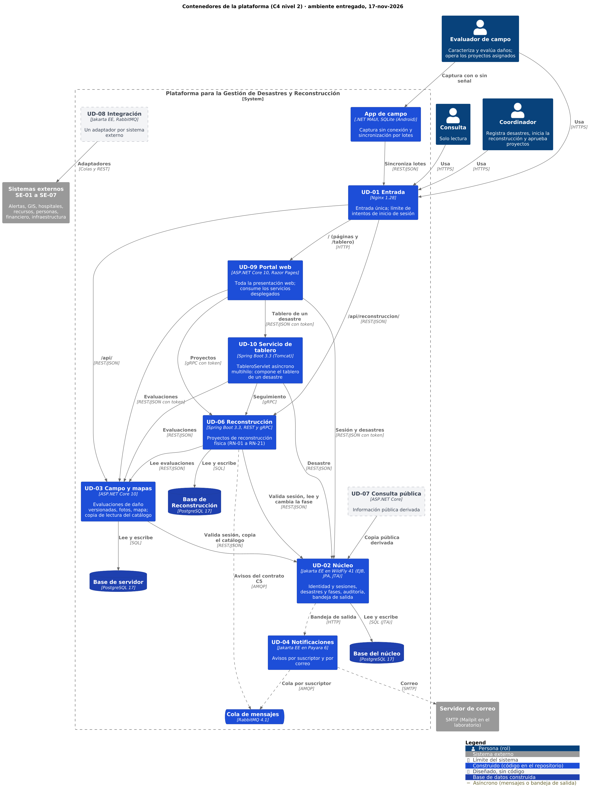
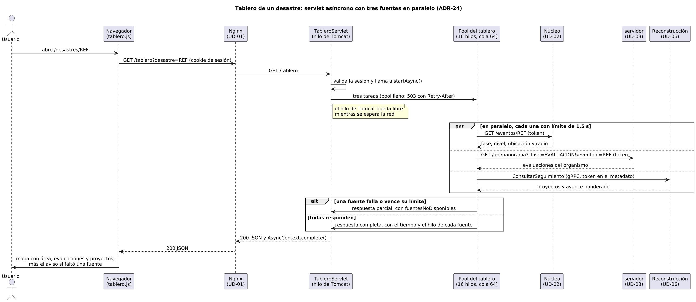

# ATAM v2.0 · Plataforma para la Gestión de Desastres y Reconstrucción

**Evaluación de la arquitectura con el método ATAM, según el informe de evaluación del SEI**

**Versión:** 2.0 · **Fecha:** 18 de noviembre de 2026

**Equipo:** Andrés Barrios, Nicolás Parra, Thomás López, André Landinez

**Pontificia Universidad Javeriana** · Arquitectura de Software

## Resumen ejecutivo

**Qué y cómo.** Se evaluó la arquitectura del SAD v2.2 (17-nov-2026), construida y diseñada, con los nueve pasos del ATAM (Kazman, Klein y Clements, 2000), en una evaluación interna del equipo, sobre once grupos de escenarios.

Dos de los once análisis quedaron medidos de punta a punta: el tablero de un desastre (AN-01) y la reconstrucción física (AN-06). Seis quedaron parciales, con una parte medida y otra solo diseñada: la falla de una fuente interna, la falla de un sistema externo, el trabajo sin conexión, la seguridad, la extensión con sistemas nuevos y la alerta crítica. Los tres restantes, el aumento repentino de usuarios, la ingesta masiva desde campo y la disponibilidad, solo tienen sustento de diseño. En total resultaron 17 puntos de sensibilidad, 19 trade-offs, 31 riesgos y 16 no-riesgos, agrupados en siete temas de riesgo.

**Lo que la evidencia sostiene.** La verificación de punta a punta del 17-nov pasó con 271 comprobaciones (E1), entre ellas 87 de Reconstrucción, 47 del portal, 32 de caracterización y tipos de activo y 10 de seguridad. La app de campo, probada en un celular real, pasó 33 comprobaciones de caracterización, tipo de activo, conflicto de versión y sesión vencida (E3). El tablero cumple su meta de consulta en una máquina, con un p95 de 50 ms para un cliente y de 366 ms para 20, y cuando Reconstrucción deja de responder entrega respuestas parciales en lugar de fallar: 60 de 60, con un p95 de 1.528 ms.

**Lo que la evaluación encontró.** La medición mostró un trade-off que el diseño no anticipaba. Consultar las tres fuentes en paralelo gana con un cliente (p95 de 50 frente a 64 ms), pero con 20 clientes en una sola máquina resulta un poco más lento que en secuencia (366 frente a 355 ms), porque triplica la carga simultánea sobre servicios que ya están ocupados. Los riesgos de más peso son estructurales: el núcleo valida cada sesión y, sin un modo degradado construido, su caída detiene todo lo protegido (R-13); notificaciones todavía no admite varias instancias (R-15); y el SQLite del teléfono no va cifrado (R-07). La evaluación agregó dos riesgos nuevos, el límite de inicios de sesión por IP (R-30) y la fuente interna colgada en el tablero (R-31), y dio por mitigado el riesgo de que la app confunda la sesión vencida con la falta de red (R-24).

**Lo que falta.** La disponibilidad del 99,95 % y la escala de 10.000 usuarios y 500 equipos con fotos todavía no tienen evidencia: exigen el despliegue en tres centros y pruebas de carga que el ambiente de una sola máquina no permite.

## El método ATAM

El ATAM evalúa una arquitectura frente a sus metas de calidad; no da una nota. Según Bass, Clements y Kazman, produce: la arquitectura presentada, los objetivos de negocio, el árbol de utilidad, riesgos y no-riesgos, puntos de sensibilidad y de trade-off, temas de riesgo y el vínculo entre decisiones y atributos.

### Pasos

La fase 0 reúne las entradas, descritas en «Adaptación a una evaluación interna». La fase 1 cubre los pasos 1 a 6; la fase 2, los pasos 7 a 9; la fase 3 es el seguimiento, en el «Plan de verificación». Cada paso queda en una sección de este documento:

1. Presentar el método, en «El método ATAM».
2. Presentar los impulsores de negocio, en «Impulsores de negocio y restricciones».
3. Presentar la arquitectura, en «Arquitectura presentada».
4. Identificar los enfoques arquitectónicos, en «Enfoques arquitectónicos identificados».
5. Generar el árbol de utilidad, en «Árbol de utilidad».
6. Analizar los enfoques, en «Análisis de escenarios».
7. Hacer la lluvia de ideas y priorizar escenarios, en «Escenarios agregados y priorización».
8. Analizar de nuevo con los escenarios agregados, también en «Análisis de escenarios».
9. Presentar los resultados, en «Riesgos, no-riesgos, puntos de sensibilidad y trade-offs», «Temas de riesgo» y «Plan de verificación».

### Vocabulario

- **Riesgo:** decisión, o falta de ella, que puede impedir cumplir un atributo.
- **No-riesgo:** decisión que, analizada, es segura bajo los supuestos dichos.
- **Punto de sensibilidad (PS):** propiedad de la que depende de forma marcada la respuesta de un atributo.
- **Trade-off (TO):** propiedad que es punto de sensibilidad de dos o más atributos y los mueve en sentidos opuestos.
- **Tema de riesgo:** grupo de riesgos con una causa común, ligado a los impulsores de negocio que amenaza.

### Adaptación a una evaluación interna

El SEI supone un equipo evaluador externo. Aquí, evaluadores y arquitectos son el mismo equipo, lo que resta independencia; para compensarlo, cada resultado se ata a evidencia repetible: la verificación de punta a punta y la medición del tablero (E1 y E2). El profesor es el interesado principal, en representación de la organización gubernamental, a través del enunciado, sus aclaraciones y sus anotaciones; los demás interesados (SAD, «Interesados») se representan con los escenarios del SRS. Entradas: SRS v1.0, SAD v2.2 (ADR-01 a ADR-29), el código y los registros de prueba.

**Reglas de evidencia.** Un resultado es *Medido* solo si hay un registro de la prueba. Las mediciones son de una máquina y no se extrapolan al despliegue objetivo (ADR-29). El rendimiento se informa con p50 y p95, solicitudes y concurrencia: Bass, Clements y Kazman miden la respuesta con latencia y tasa de incumplimiento («p95 menor que 2 s» admite 5 % de incumplimiento), y el libro de SRE de Google (Beyer et al., 2016, cap. 4) trata la latencia como una distribución, porque el promedio esconde las solicitudes lentas. Una meta se cumple si el p95 queda dentro del tiempo, ninguna solicitud supera el doble y menos del 0,1 % falla (SAD, «Metas cuantitativas»).

## Impulsores de negocio y restricciones

Una organización gubernamental necesita coordinar a varios organismos durante un desastre y en la reconstrucción, con información repartida en ocho tipos de sistemas que no va a reemplazar. De esa necesidad salen nueve objetivos de negocio, y cada uno exige un atributo de calidad que el SRS precisa en sus escenarios.

El primero es que la plataforma funcione justo cuando ocurre el desastre, que es cuando más se la necesita: lo crítico debe estar disponible el 99,95 % del mes y recuperarse en 15 minutos sin perder datos (disponibilidad, QA-DIS-01 y 02). En ese mismo momento llega el pico de uso, de 1.000 a 10.000 usuarios y 500 equipos de campo, que la plataforma debe absorber (escalabilidad, QA-ESC-01 y 02). Y los organismos necesitan actuar a tiempo, con consultas en 2 s, registros en 3 s y alertas en 5 s (rendimiento, QA-REN-01 a 03).

Como depende de sistemas que no controla, la plataforma no puede exigir que todo esté arriba: una falla debe quedar contenida y no volverse general (resiliencia, QA-RES-01 y 02). Por la misma razón debe integrar tecnologías distintas y sumar sistemas nuevos sin reemplazar los existentes (interoperabilidad y extensibilidad, QA-INT-01 y 02, QA-EXT-01).

Los demás objetivos protegen la confianza en la información. Cada organismo ve solo lo suyo, según su rol, y no se guardan datos de personas afectadas (seguridad, QA-SEG-01 y 02; ADR-28). Los proyectos y presupuestos de reconstrucción deben rendir cuentas de quién hizo qué, cuándo, sobre qué y con qué resultado (trazabilidad, QA-TRZ-01 y 02). Los reportes de campo no pueden perderse ni sobrescribirse (confiabilidad, QA-CNF-01 y 02, QA-DIS-03). Y la plataforma debe servir para desastres y organismos nuevos con cambios de configuración y no de código (modificabilidad, QA-MOD-01 y 02).

**Mínimos del proyecto** (SAD, «Propósito y alcance»): a) app móvil que recolecta y caracteriza; b) reconstrucción física; c) mapa con desastres, evaluaciones y proyectos; d) evaluación de daños; más autenticación y autorización.

**Restricciones.** No se reemplazan los sistemas existentes, que pueden fallar (CON-01 a CON-04); el móvil trabaja parcialmente sin conexión (CON-08); hay que proteger datos personales (CON-09). Del curso: presentación en .NET con MVC, MVP o MVVM (aclaración del 17-nov; ADR-23), multihilo con servlets (ADR-24) y .NET para operar sin conexión (ADR-25). Personas, recursos y donaciones son sistemas externos (ADR-28). El ambiente entregado es una sola máquina, lo que limita la evidencia de disponibilidad y de carga.

## Arquitectura presentada

El detalle está en el SAD v2.2, de la estrategia de solución a las decisiones arquitectónicas. Son servicios de grano grueso, separados por consistencia transaccional y por perfil de carga, cada uno dueño de sus datos. Cuando una unidad necesita la respuesta de otra para continuar, la llama de forma síncrona, y el protocolo lo fija el par de unidades, no cada llamada. Reconstrucción ofrece gRPC, con un contrato tipado y compartido, como canal interno hacia el portal y el servicio de tablero; también expone sus operaciones por REST para clientes externos y pruebas (ADR-26). Todas las demás llamadas síncronas son REST, entre ellas las de la app, el portal y el servicio de tablero hacia el núcleo y hacia servidor. Los sistemas que no usan REST pueden iniciar sesión por SOAP o por EJB remoto. Cuando no necesita la respuesta, la unidad avisa por colas, siempre desde una bandeja de salida.

*Figura 1. Contenedores (C4 nivel 2); Figura 2 del SAD. Azul: construido. Gris punteado: diseñado.*

Construidos: UD-01 Entrada (Nginx), UD-02 Núcleo (Jakarta EE), UD-03 servidor (ASP.NET Core), UD-04 Notificaciones (Jakarta EE, con consumo de avisos de Reconstrucción, ADR-27), UD-06 Reconstrucción (Spring Boot), UD-09 Portal (Razor Pages), UD-10 Servicio de tablero (Spring Boot y Tomcat) y la app de campo (.NET MAUI). Diseñados: UD-07 Consulta pública, UD-08 Integración y los tres centros de datos.

**Cambios frente a lo que evaluó la v1.0.** Presentación en .NET (ADR-23) y servlet en UD-10 (ADR-24); Reconstrucción en Spring Boot con REST y 14 RPC de gRPC (ADR-26); UD-05 retirada (ADR-28); cuatro fases del desastre (Registro, Caracterización, Reconstrucción y Cierre), protegidas en el núcleo; metas con p50 y p95 (ADR-29); y el ambiente entregado, de 12 contenedores, separado del despliegue objetivo en tres centros (SAD, «Vista de despliegue»).

## Enfoques arquitectónicos identificados

Las tácticas siguen los nombres de Bass, Clements y Kazman. Se agrupan por el atributo al que sirven; entre paréntesis van las decisiones del SAD que las adoptan y su estado.

**Rendimiento.** El servlet asíncrono del tablero introduce concurrencia, acota la cola y limita el tiempo de cada fuente (ADR-24; medido). Las copias de lectura de los datos de otras unidades evitan una consulta remota en cada solicitud (ADR-03 y 24; construido).

**Disponibilidad y resiliencia.** Cuando una fuente falla, la respuesta se degrada de forma controlada: el tablero devuelve lo que tiene y, si su cola se llena, responde 503 (ADR-11 y 24; medido). Cada cambio y su aviso se guardan en la misma transacción y el aviso sale por una bandeja de salida con reintento (ADR-02 y 15; medido). Hacia los sistemas externos se usan tiempo de espera, corte de circuito, una cola por destino y confirmación explícita (ADR-07, 15 y 21): las colas están construidas y los adaptadores, diseñados. La redundancia, la réplica, la conmutación y el monitoreo en tres centros están solo diseñados (ADR-09, 12 y 16).

**Escalabilidad.** Las unidades crecen por separado detrás de una entrada única, y la incorporación de evaluaciones puede diferirse en los picos (ADR-01, 14 y 18). Está construido, pero sin prueba de carga.

**Seguridad.** El núcleo autentica y autoriza; se restringe el inicio de sesión, se revocan sesiones y se separan los organismos (ADR-10, 14, 19 y 23). Está construido, salvo el ámbito por evento, que está diseñado.

**Trazabilidad y confiabilidad.** Cada cambio se audita en la misma transacción que lo produce (ADR-20; construido en cada unidad). Cada operación de campo lleva el identificador del cliente y la versión base, lo que impide sobrescribir en silencio (ADR-04; medido).

**Interoperabilidad y modificabilidad.** La interfaz se adapta a cada consumidor con REST, gRPC, SOAP, EJB remoto y adaptadores (ADR-07, 17 y 26; los accesos están construidos y los adaptadores, diseñados). Las dependencias se restringen con capas y con los contratos C1 a C5, y el enlace se difiere con catálogos configurables (ADR-08 y 26; construido en parte).

**Presentación.** El portal sigue MVVM del lado del servidor con Razor Pages (ADR-23; construido).

## Árbol de utilidad

### Árbol

Cada hoja es un escenario del SRS con (importancia, dificultad): A alta, M media, B baja (SAD, «Árbol de calidad»).

| Atributo | Refinamiento | Escenario | (I, D) | Análisis |
| --- | --- | --- | --- | --- |
| Disponibilidad | Servicio continuo | QA-DIS-01: 99,95 % mensual en lo crítico | (A, A) | AN-11 |
| Disponibilidad | Recuperación | QA-DIS-02: se pierde un centro; lo crítico vuelve en 15 min sin pérdida | (A, A) | AN-11 |
| Disponibilidad | Datos de campo | QA-DIS-03: nada capturado sin conexión se pierde | (M, M) | AN-04 |
| Escalabilidad | Usuarios | QA-ESC-01: de 1.000 a 10.000 en 10 min; crece solo lo saturado | (A, A) | AN-07 |
| Escalabilidad | Ingesta | QA-ESC-02: 500 equipos sin subir más de 10 % la coordinación | (A, A) | AN-10 |
| Rendimiento | Consulta | QA-REN-01: estado del evento en menos de 2 s | (A, M) | AN-01, AN-07 |
| Rendimiento | Registro | QA-REN-02: registro confirmado en menos de 3 s | (A, M) | AN-07 |
| Rendimiento | Alerta | QA-REN-03: alerta en menos de 5 s, hasta 10 simultáneas | (A, M) | AN-09 |
| Resiliencia | Falla externa | QA-RES-01: cae el sistema hospitalario sin afectar lo crítico | (A, M) | AN-03 |
| Resiliencia | Falla interna | QA-RES-02: falla detectada en 10 s y aislada | (A, M) | AN-02 |
| Interoperabilidad | Intercambio | QA-INT-01: válidos procesados e inválidos rechazados | (A, M) | AN-03 |
| Interoperabilidad | Cambio de contrato | QA-INT-02: ninguna capacidad ajena cambia | (M, M) | AN-08 |
| Extensibilidad | Sistema nuevo | QA-EXT-01: un adaptador nuevo, sin tocar lo existente | (M, M) | AN-08 |
| Seguridad | Confidencialidad | QA-SEG-01: 100 % de accesos no autorizados rechazados | (A, M) | AN-05 |
| Seguridad | Separación | QA-SEG-02: ningún acceso fuera del organismo | (A, M) | AN-05 |
| Trazabilidad | Operaciones críticas | QA-TRZ-01: quién, qué, cuándo, sobre qué y resultado | (A, B) | AN-06 |
| Trazabilidad | Evolución | QA-TRZ-02: estado del evento a las 10:00 y a las 14:00 | (M, M) | Escenarios sin código |
| Modificabilidad | Tipo y organismo | QA-MOD-01, 02: por configuración en 1 hora | (M, B) | AN-08 |
| Confiabilidad | Reconciliación | QA-CNF-01: ninguna sobrescritura silenciosa | (A, A) | AN-04 |
| Confiabilidad | Consolidación | QA-CNF-02: con procedencia y reversible | (M, M) | Escenarios sin código |

### Escenarios agregados y priorización (paso 7)

En esta versión, la lluvia de ideas partió de los cambios de la arquitectura: por cada cambio del SAD se preguntó qué escenario lo pone a prueba.

| ID | Escenario agregado | Refina | (I, D) | Análisis |
| --- | --- | --- | --- | --- |
| EA-01 | Un coordinador abre el tablero, con 1 y con 20 usuarios a la vez | QA-REN-01 | (A, M) | AN-01 |
| EA-02 | Reconstrucción deja de responder con 20 usuarios en el tablero | QA-RES-02 | (A, M) | AN-02 |
| EA-03 | Un evaluador pasa más de 8 h sin señal y su sesión vence | QA-DIS-03, QA-SEG-01 | (A, M) | AN-04 |
| EA-04 | Autoaprobación de un proyecto, cambio con versión vieja y sobrecosto (Escenario E) | QA-TRZ-01, QA-SEG-02 | (A, M) | AN-06 |
| EA-05 | El portal pasa a dos instancias en el pico | QA-ESC-01 | (M, M) | AN-07 |

**Priorización.** Primero, los (A, A) y (A, M) ligados a los escenarios A a E y a los mínimos con código. Los (A, A) de disponibilidad y escala van al final del análisis, porque su análisis es solo de diseño. QA-TRZ-02 y QA-CNF-02 se resumen en «Escenarios sin código».

## Análisis de escenarios

Cada análisis sigue la plantilla del SEI: escenario; decisiones con columnas de sensibilidad, trade-off, riesgo y no-riesgo (descritos en «Riesgos, no-riesgos, puntos de sensibilidad y trade-offs»); razonamiento; diagrama; y evidencia con su estado. «Registro del 17-nov» es la verificación de punta a punta de ese día (E1).

### Tablero de un desastre (AN-01)

| Campo | Contenido |
| --- | --- |
| Escenario | QA-REN-01 y EA-01 · Rendimiento (A, M) |
| Estímulo y ambiente | Un coordinador abre el tablero; 1 y 20 clientes; ambiente entregado en una máquina |
| Respuesta | El portal pide el tablero a UD-10, que consulta en paralelo el núcleo, servidor y Reconstrucción (gRPC) |
| Medida | p95 menor que 2 s; ninguna sobre 4 s; menos de 0,1 % con error |

| Decisión | Sensibilidad | Trade-off | Riesgo | No-riesgo |
| --- | --- | --- | --- | --- |
| ADR-24: servlet asíncrono; 16 hilos, cola de 64; 1,5 s por fuente | PS-13 | TO-14 | R-22, R-31 | NR-11 |
| ADR-23: el portal .NET llama a UD-10 con el token del usuario | PS-16 | TO-15 | — | NR-14 |
| ADR-26: copia de 3 s del catálogo en Reconstrucción, solo lecturas | PS-14 | TO-17 | — | — |
| ADR-10: cada fuente valida el token en el núcleo | PS-11 | TO-04 | R-13 | — |

**Razonamiento.** En secuencia, las latencias de las tres fuentes se suman; en paralelo, el tablero tarda lo de la más lenta. Sin carga, el paralelo debe ganar. Con carga, pide las tres fuentes a la vez a servicios ya saturados, y la ventaja desaparece. Cada vista cuesta tres validaciones de sesión.

*Figura 2. Tablero de un desastre (Figura 10 del SAD).*

**Evidencia: Medido** (E2). La medición entra al portal como lo haría un navegador, con su sesión y su token antifalsificación, y recorre la entrada, el portal, el servicio de tablero y las tres fuentes.

| Modo | Solicitudes | Clientes | p50 | p95 | Máximo | Solicitudes/s | Errores |
| --- | --- | --- | --- | --- | --- | --- | --- |
| Paralelo | 100 | 1 | 26,7 ms | 49,7 ms | 66,5 ms | 33,1 | 0 |
| Secuencial | 100 | 1 | 40,5 ms | 63,7 ms | 133,1 ms | 21,7 | 0 |
| Paralelo | 300 | 20 | 223,0 ms | 365,5 ms | 573,3 ms | 82,0 | 0 |
| Secuencial | 300 | 20 | 182,4 ms | 355,0 ms | 467,7 ms | 98,4 | 0 |

Antes y después, p95 paralelo / secuencial (E2):

| Corrida | Situación | 1 cliente | 20 clientes |
| --- | --- | --- | --- |
| 15-nov, primera | Portal en Spring; sin copia del catálogo | 55,6 / 67,1 ms | 323,4 / 287,5 ms |
| 15-nov, segunda | Portal en Spring; con copia del catálogo | 44,3 / 60,5 ms | 241,4 / 232,7 ms |
| 17-nov | Portal .NET; salto a UD-10 | 49,7 / 63,7 ms | 365,5 / 355,0 ms |

**Lectura.** Con 1 cliente, el paralelo es un 22 % más rápido en p95 (50 frente a 64 ms). Con 20, es un 3 % más lento (366 frente a 355 ms) y atiende menos solicitudes por segundo: es el trade-off TO-14, aceptado en ADR-24. El salto a UD-10 cuesta unos 6 ms de p95 con 1 cliente (de 44 a 50 ms); con 20, el p95 sube de 241 a 366 ms porque compiten dos contenedores más (TO-15). Son corridas distintas, no un experimento aislado.

**Resultado.** Cumple QA-REN-01 en el ambiente entregado: el peor p95 es 366 ms frente a 2 s, sin errores. No dice nada de 10.000 usuarios ni de red real (AN-07).

### Falla de una fuente interna (AN-02)

| Campo | Contenido |
| --- | --- |
| Escenario | QA-RES-02 y EA-02 · Resiliencia (A, M) |
| Estímulo y ambiente | Reconstrucción deja de responder (se congela su contenedor) con 20 clientes en el tablero; en otra prueba se detiene RabbitMQ |
| Respuesta | El tablero responde con las otras fuentes e indica qué fuentes no respondieron; el registro sigue y el aviso espera en la bandeja |
| Medida | Nada crítico afectado; respuesta en menos de 2 s; detección en 10 s; reemplazo en 2 min |

| Decisión | Sensibilidad | Trade-off | Riesgo | No-riesgo |
| --- | --- | --- | --- | --- |
| ADR-24: 1,5 s por fuente; respuesta parcial; 503 con el pool lleno | PS-13 | TO-14 | R-31 | NR-11 |
| ADR-11: lo degradable en otra unidad | — | TO-02 | — | NR-11 |
| ADR-02 y ADR-15: bandeja de salida y colas | PS-05 | TO-08 | R-15 | NR-10 |
| ADR-16: sondas y métricas | PS-03 | — | R-03 | — |

**Razonamiento.** Reconstrucción es degradable y nada crítico la llama. El tablero espera a cada fuente 1,5 s como máximo, así que con una fuente caída responde en ese límite; por encima de 2 s, el tablero degradado incumpliría QA-REN-01 (PS-13). Mientras la fuente está colgada, cada consulta ocupa un hilo hasta su límite y no hay corte de circuito para fuentes internas: con una caída sostenida, la cola puede llenarse y dar 503 (R-31; inferencia, no medida).

**Evidencia.**

- *Medido.* Reconstrucción congelada, 60 solicitudes con 20 clientes: 60 de 60 exitosas y parciales; p50 de 1.514,9 ms, p95 de 1.527,8 ms, máximo de 1.530,1 ms (E2, corrida del 17-nov con Reconstrucción congelada). Las corridas del 15-nov dan p95 de 1.519,4 y 1.523,1 ms.
- *Medido.* Con RabbitMQ detenido, el desastre se registra, el aviso espera en la bandeja y se entrega al volver; núcleo y servidor reinician sin perder datos (E1).
- *Corrección por la medición.* En la primera corrida del 15-nov, con el plazo de 5 s de las páginas, 25 de 60 respuestas fueron 503; ahora el plazo de cada cliente es el límite de su fuente. Esa corrida no se guardó; queda documentada junto a la configuración del servicio de tablero.
- *Diseñado, sin evidencia.* Detección en 10 s y reemplazo en 2 min.

**Resultado.** Parcial: aislamiento y degradación medidos; detección y recuperación, diseñadas.

### Falla de un sistema externo (AN-03)

| Campo | Contenido |
| --- | --- |
| Escenario | QA-RES-01 y QA-INT-01 · Resiliencia e interoperabilidad (A, M) |
| Estímulo y ambiente | El sistema hospitalario (SE-03) no responde 10 min o 4 h, con avisos en curso |
| Respuesta | Lo crítico sigue; los avisos para ese sistema esperan en su cola y salen al volver |
| Medida | Nada crítico afectado; pendientes al día en 5 min; inválidos rechazados |

| Decisión | Sensibilidad | Trade-off | Riesgo | No-riesgo |
| --- | --- | --- | --- | --- |
| ADR-07: adaptador por sistema, con corte de circuito | PS-07, PS-10 | — | R-06, R-09 | — |
| ADR-15: cola durable por suscriptor y correo | PS-05 | TO-08 | R-05 | NR-03 |
| ADR-21: Por confirmar y En conciliación | — | — | R-20 | — |
| ADR-02: llamada inmediata solo si se necesita la respuesta | PS-11 | TO-02 | R-13 | — |

**Razonamiento.** Ninguna unidad crítica llama a un externo, y cada suscriptor tiene su cola: uno caído no frena a los demás. El adaptador, diseñado, corta tras 3 fallas y prueba cada 30 s. Tras horas de caída, ponerse al día puede pasar de 5 min (R-06). Una operación sin respuesta queda En conciliación, sin liberar ni revertir. Diagrama: Figura 7 del SAD.

**Evidencia.** *Medido* (registro del 17-nov): «núcleo → outbox → Taller3 → RabbitMQ → correo confirmado»; la bandeja con RabbitMQ detenido; y un aviso de Reconstrucción mal formado que queda en la cola de errores sin bloquear la cola (E1). *Diseñado, sin evidencia:* adaptadores de SE-01 a SE-07, corte de circuito y En conciliación.

**Resultado.** Parcial: mecanismos de cola medidos; el escenario depende de adaptadores sin código.

### Trabajo sin conexión y reconciliación (AN-04)

| Campo | Contenido |
| --- | --- |
| Escenario | QA-DIS-03 (M, M), QA-CNF-01 (A, A) y EA-03 · Disponibilidad y confiabilidad |
| Estímulo y ambiente | El evaluador captura en modo avión, cierra la app y recupera la red; otra persona corrigió la misma evaluación; la sesión pudo vencer |
| Respuesta | Lo capturado persiste en SQLite. Cada operación queda incorporada, repetida, en conflicto o rechazada; el conflicto conserva ambas versiones. Un 401 pide sesión sin borrar pendientes |
| Medida | Ninguna captura perdida, duplicada ni sobrescrita en silencio |

| Decisión | Sensibilidad | Trade-off | Riesgo | No-riesgo |
| --- | --- | --- | --- | --- |
| ADR-04: identificador del dispositivo y versión base | PS-06 | TO-06 | R-04 | NR-06, NR-09 |
| ADR-25: MAUI con SQLite local; no se borra hasta confirmar | PS-08, PS-15 | TO-05 | R-07, R-24 | — |
| ADR-13: la foto viaja con su evaluación | PS-12 | TO-09 | R-19 | NR-04 |
| ADR-18: incorporación inmediata o diferida | — | TO-11 | — | — |

**Razonamiento.** La sobrescritura silenciosa es imposible por construcción: el servidor solo aplica sobre la versión vigente y, si no, responde conflicto sin cambiar nada. Un reintento no duplica y el dispositivo conserva la captura hasta la confirmación. El punto débil es la sesión: dura 8 horas y un evaluador puede pasar más de un turno sin señal. Si la app tratara el 401 como falta de red, los pendientes se retrasarían sin aviso (R-24). La app lo trata aparte: avisa que la sesión venció, conserva lo pendiente y no reintenta hasta un nuevo inicio de sesión. Además, el SQLite no va cifrado (R-07). Diagrama: Figura 8 del SAD.

**Evidencia.**

- *Medido en el servidor* (E1). Una propuesta sobre una versión vieja queda en conflicto, no sobrescribe y se reenvía tras resolver. Un reintento idéntico no duplica, la foto llega con su captura y la identidad sale del token. En 32 comprobaciones, servidor reenvía la caracterización (C2) sin convertir un 409 en éxito y acepta tipos de activo válidos, desconocidos o ausentes (C1) sin romper la idempotencia del lote.
- *Medido en la app, integración anterior* (E4). Una prueba en el emulador aprobó la persistencia en SQLite, la desconexión real, el conflicto y su resolución. Es anterior a los cambios de esta semana.
- *Medido en un celular real* (17-nov; Samsung SM-A155M con Android 16; E3). La prueba ejecuta el código real de la app y aprobó 33 comprobaciones:
  - **C2 sin conexión:** la caracterización persiste al reabrir SQLite y sigue pendiente mientras el servidor está caído. Al volver la red, el desastre queda en fase Caracterización con su ubicación, su radio y su nivel.
  - **C1:** el catálogo de tipos de activo baja a SQLite, y la evaluación llega con su código y con el texto libre.
  - **409:** una caracterización sobre una versión vieja queda en conflicto VERSION_DESACTUALIZADA y el servidor no cambia. Se resuelve solo por decisión explícita, como una operación nueva.
  - **401:** la app marca la sesión vencida, distinta de la falta de red. No borra lo pendiente ni reintenta con el token vencido, y después de iniciar sesión otra vez sincroniza todo.
  - Las capturas de la interfaz siguen el mismo recorrido, incluidos el cierre forzado de la app sin red y una sesión vencida en el núcleo.
- *Diseñado, sin evidencia.*
  - La prueba con 100 capturas seguidas y en modo avión. En el celular se cortó el enlace con el servidor, no la radio.
  - El cifrado del SQLite: no está hecho (R-07).
- *Hallazgo de la prueba, corregido.* En la primera prueba, con la sesión vencida, «Cerrar sesión» fallaba con un mensaje de falta de conexión, y la app apuntaba por defecto a una dirección distinta de la del ambiente. La versión siguiente de la app corrige ambas cosas, y se volvió a probar en el celular: cerrar sesión con la sesión vencida limpia la sesión local sin error, lo pendiente sigue en SQLite y se sincroniza al entrar de nuevo, y una instalación limpia trae la dirección correcta (E3).

**Resultado.** Parcial: la reconciliación está medida en el servidor y en la app sobre un celular real, incluidos C1, C2, el 409 y el 401. Faltan la prueba de 100 capturas y el cifrado del SQLite.

### Acceso no autorizado y separación entre organismos (AN-05)

| Campo | Contenido |
| --- | --- |
| Escenario | QA-SEG-01 y QA-SEG-02 · Seguridad (A, M) |
| Estímulo y ambiente | Dos organismos y tres roles. Solicitudes sin token válido, con rol sin permiso, con identidad falsa, sobre datos ajenos, sin token antifalsificación o con muchos intentos de inicio de sesión |
| Respuesta | Rechazo con 401, 403, 404 o 429, sin cambiar nada |
| Medida | 100 % rechazados; ningún acceso fuera del organismo |

| Decisión | Sensibilidad | Trade-off | Riesgo | No-riesgo |
| --- | --- | --- | --- | --- |
| ADR-10: sesión validada en el núcleo en cada solicitud | PS-08, PS-11 | TO-04 | R-13 | NR-08, NR-16 |
| ADR-19: ámbito de organismo (evento, diseñado) | — | TO-13 | R-21 | NR-16 |
| ADR-14: entrada única con límite de inicios de sesión | PS-17 | TO-18 | R-30 | — |
| ADR-23: token en el servidor del portal; CSRF | — | TO-16 | R-23 | NR-14 |
| Servicios internos y cifrado | — | — | R-25, R-27 | — |

**Razonamiento.** La identidad sale de validar el token en el núcleo, nunca del cliente. Cada servicio valida en el backend; el portal solo oculta botones. La revocación surte efecto en la siguiente solicitud. El costo es una llamada al núcleo por operación, y sin núcleo nada protegido funciona, porque el modo degradado de servidor no tiene código (R-13). Hallazgo nuevo: Nginx permite 30 intentos por minuto por IP, con ráfaga de 20, y cuenta todo intento de inicio de sesión, correcto o no; un puesto de mando con muchos usuarios detrás de una IP puede recibir 429 al cambio de turno (R-30; inferencia, no medida).

**Evidencia: Medido** (E1). Las pruebas de seguridad (10 comprobaciones) exigen la clave de integración exacta y responden 401 sin token en desastres, panorama y Reconstrucción, y 429 tras muchos intentos fallidos. Las del portal (47) comprueban la cookie HttpOnly sin token en el navegador, el rechazo sin token antifalsificación y los botones por rol. Las de unificación comprueban el aislamiento entre organismos en detalle, foto, consultas y suscripciones, que la identidad sale del token y no del JSON, y que un token revocado no da acceso. Las de evolución y Reconstrucción comprueban que cerrar por SOAP revoca REST, que un rol falso en una cabecera no da permisos y que gRPC rechaza un token ausente o inventado. *Diseñado, sin evidencia:* ámbito de evento, vencimiento real de 8 h, TLS, cifrado en reposo y autenticación de notificaciones.

**Resultado.** Parcial: medido en todo lo construido; faltan los controles diseñados.

### Reconstrucción física, escenario E (AN-06)

| Campo | Contenido |
| --- | --- |
| Escenario | Escenario E, QA-TRZ-01 y EA-04 · Trazabilidad, seguridad y confiabilidad (A, M) |
| Estímulo y ambiente | Desastre en Reconstrucción. Quien formuló un proyecto intenta aprobarlo; un responsable no asignado registra avance; alguien usa una versión vieja; un costo supera el presupuesto |
| Respuesta | Se rechazan y auditan RN-20 y RN-21; la versión vieja recibe 409; el sobrecosto se registra y avisa (RN-14) y bloquea finalizar (RN-15) |
| Medida | 100 % de cambios e intentos rechazados auditados; ninguna sobrescritura |

| Decisión | Sensibilidad | Trade-off | Riesgo | No-riesgo |
| --- | --- | --- | --- | --- |
| ADR-26: hexagonal; reglas en un dominio sin framework; REST y gRPC | — | TO-10 | R-26 | NR-12, NR-15 |
| ADR-20: auditoría en la transacción, con intentos rechazados (RN-17) | — | TO-12 | — | NR-07 |
| ADR-04 y SAD «Concurrencia y consistencia»: versión esperada; registro de evaluaciones ya tomadas (RN-09) | — | — | — | NR-06, NR-13 |
| ADR-02 y ADR-27: bandeja de salida (C5) y consumo con deduplicación | PS-05 | TO-08, TO-19 | R-15 | NR-10 |
| Fases protegidas en el núcleo (RN-01 a RN-05) | — | — | R-28 | NR-17 |

**Razonamiento.** Las reglas viven en la entidad Proyecto y en los casos de uso, sin Spring, gRPC ni JDBC, así que REST y gRPC aplican lo mismo. Cada caso de uso autoriza por rol y organismo y audita en la transacción del cambio, también el intento rechazado. La versión esperada viaja de punta a punta y la base impide dos proyectos activos sobre una evaluación. Solo Reconstrucción pasa el desastre a Reconstrucción o a Cierre. Diagrama: Figura 9 del SAD.

**Evidencia.**

- *Medido* (E1). Las pruebas de Reconstrucción, con 87 comprobaciones, cubren RN-01, 02, 04, 07, 09, 12, 14, 15 (sin 100 %, sin evidencia y con sobrecosto), 17, 18, 20 y 21; 409 con una versión esperada vieja; avisos C5 y su correo de aprobación, sobrecosto y cierre; un aviso repetido no genera otro correo; gRPC con y sin token y con roles; el coordinador no salta fases llamando al núcleo. El portal repite por la interfaz la RN-20, el formulario viejo que no pisa el cambio de otro y la auditoría del intento rechazado.
- *Medido.* Los siete tipos de evento C5 tienen ejemplos reales (E6), y las 31 pruebas del dominio y de los casos de uso pasaron sin fallas el 15-nov (E7).
- *Límite.* La concurrencia en Reconstrucción se prueba con una versión vieja, en secuencia; dos creaciones simultáneas sobre una evaluación las impide la base, sin prueba simultánea. En el núcleo sí hay reintentos simultáneos: 5 cambios de nivel dan uno y 10 registros dan uno.

**Resultado.** Medido en lo construido. Quedan diseñados el compromiso ante SE-06 (ADR-21) y la validación de evaluaciones (R-26).

### Aumento repentino de usuarios (AN-07)

| Campo | Contenido |
| --- | --- |
| Escenario | QA-ESC-01 (A, A), QA-REN-02 (A, M) y EA-05 · Escalabilidad y rendimiento |
| Estímulo y ambiente | De 1.000 a 10.000 usuarios en 10 min |
| Respuesta y medida | Crece solo lo saturado en 5 min; nada crítico se rechaza; consulta en 2 s y registro en 3 s, en p95 |

| Decisión | Sensibilidad | Trade-off | Riesgo | No-riesgo |
| --- | --- | --- | --- | --- |
| ADR-01: unidades que crecen por separado | PS-03 | TO-02 | R-03, R-10 | — |
| ADR-03: consulta pública desde su caché (UD-07, diseñada) | PS-04 | TO-03 | — | NR-02 |
| ADR-10: una validación de sesión por solicitud | PS-11 | TO-04 | R-13 | — |
| ADR-23: portal sin estado de vista, con tokens en memoria | — | TO-16 | R-23 | — |
| ADR-24: pool acotado y 503 | PS-13 | TO-14 | R-22 | — |

**Razonamiento.** El modelo del SAD («Escalabilidad y rendimiento») estima 267 consultas ciudadanas por segundo desde la caché de UD-07, 200 operaciones de funcionarios y unas 210 validaciones de sesión por segundo. Con 100 operaciones por segundo por instancia, supuesto sin medir, seis instancias de núcleo y de servidor quedan al 46 % y al 35 %. Hallazgo: el modelo cuenta una validación por solicitud, pero una vista del tablero genera tres (R-13). Para EA-05: con tokens en memoria, dos instancias del portal sin afinidad pierden sesiones (R-23).

**Evidencia.** *Medido, una máquina:* tablero con 20 clientes, p95 de 366 ms (AN-01). Con el código del 11-nov: 600 consultas con 6 simultáneas, mediana de 17 ms y p95 de 24 a 30 ms; registro de un desastre en 22 ms (E5). *Diseñado, sin evidencia:* 10.000 usuarios, crecimiento automático, UD-07 y varias instancias del portal.

**Resultado.** Diseñado, sin evidencia: las cifras locales no incluyen red real, réplica ni carga representativa.

### Sistema nuevo, cambio de contrato y configuración (AN-08)

| Campo | Contenido |
| --- | --- |
| Escenario | QA-EXT-01, QA-INT-02 (M, M); QA-MOD-01, 02 (M, B) |
| Estímulo y ambiente | En operación, llega un sistema externo, cambia un contrato o se pide un tipo o un organismo nuevo |
| Respuesta | Un suscriptor se registra sin código; un sistema con intercambio entra con un adaptador; un cambio de contrato toca su traductor o el contrato gRPC; tipos y organismos por configuración |
| Medida | Nada cambia en las unidades existentes; adaptador en 5 días-persona; configuración en 1 hora |

| Decisión | Sensibilidad | Trade-off | Riesgo | No-riesgo |
| --- | --- | --- | --- | --- |
| ADR-07: adaptador por sistema con modelo común | PS-10 | — | R-09 | — |
| ADR-15: suscripción por la API, sin código | — | — | — | NR-05 |
| ADR-17 y ADR-26: REST, gRPC, SOAP y EJB remoto; contrato gRPC en tres copias | — | TO-10 | R-10 | NR-15 |
| ADR-08: catálogos por configuración | — | — | R-14 | — |

**Razonamiento.** Un sistema que solo recibe avisos se suscribe y obtiene su cola. Uno que intercambia datos necesita un adaptador con conector, traductor y validador; las unidades solo conocen el modelo común. El contrato gRPC vive en tres copias, y una prueba verifica que sean idénticas.

**Evidencia.** *Medido* (registro del 17-nov): suscripción por la API; SOAP con las mismas cuentas; el portal .NET usa el gRPC de un servicio Java; las copias del contrato gRPC son idénticas; los tipos de activo salen de un catálogo configurable (C1). *Medido, integración anterior:* EJB remoto (E8, 10-nov). *Diseñado, sin evidencia:* adaptadores; tipos de desastre y organismos por configuración.

**Resultado.** Parcial.

### Alerta crítica (AN-09)

| Campo | Contenido |
| --- | --- |
| Escenario | QA-REN-03 · Rendimiento (A, M) |
| Estímulo y ambiente | Se registra un desastre o cambia su nivel; hasta 10 alertas simultáneas |
| Respuesta | El aviso queda en la cola de cada suscriptor y el servidor de correo lo acepta |
| Medida | p95 menor que 5 s con 10 simultáneas; ninguna sobre 10 s |

| Decisión | Sensibilidad | Trade-off | Riesgo | No-riesgo |
| --- | --- | --- | --- | --- |
| ADR-02: bandeja de salida con ciclo de 1 s | PS-05 | TO-08 | R-17 | NR-10 |
| ADR-15: cola por suscriptor y correo | — | — | R-05 | NR-03 |
| ADR-27: hasta 20 mensajes por cola y ciclo; deduplicación | PS-05 | TO-19 | R-16 | — |
| ADR-22: entregas en base (diseñado; hoy archivos) | — | — | R-15 | — |

**Razonamiento.** El presupuesto del SAD («Escenario A: inicio de una emergencia») suma 3,7 s (guardar con réplica, bandeja, entrega, consumo y correo) y deja 1,3 s de margen. Con un mensaje por segundo por cola, la décima alerta simultánea esperaba unos 10 s; ahora el procesador toma hasta 20 por ciclo, así que 10 caben en uno. Está en el código, sin medir. Diagrama: Figura 6 del SAD.

**Evidencia.** *Medido con el código del 11-nov* (ciclo de 5 s): 2,7 s al registrar y 3,2 s al cambiar el nivel, con avisos aislados (E5). *Medido el 17-nov, sin tiempos:* la cadena hasta el correo y la entrega tras detener RabbitMQ. *Diseñado, sin evidencia:* 10 simultáneas.

**Resultado.** Parcial: falta medir 10 simultáneas con el código actual.

### Ingesta masiva desde campo (AN-10)

| Campo | Contenido |
| --- | --- |
| Escenario | QA-ESC-02 · Escalabilidad (A, A) |
| Estímulo y ambiente | 500 equipos, un reporte por minuto con foto de 1 MB; ráfagas al reconectar |
| Respuesta y medida | Todo se recibe; cada evaluación se confirma en 10 min; la coordinación no sube más de 10 % |

| Decisión | Sensibilidad | Trade-off | Riesgo | No-riesgo |
| --- | --- | --- | --- | --- |
| ADR-01: evaluación en una unidad aparte del núcleo | PS-11 | TO-02 | R-13 | — |
| ADR-13: foto con su evaluación, después de los lotes | PS-12 | TO-09 | R-12, R-19 | NR-04 |
| ADR-18: incorporación inmediata o diferida | — | TO-11 | — | — |
| ADR-12: réplica en otro centro | PS-02 | TO-01 | R-02 | — |

**Razonamiento.** Son 8 registros y 8 MB por segundo sobre servidor. Una foto de 1 MB a 1 Mbps tarda unos 8 s; una de 5 MB, unos 40 s, y un corte obliga a reenviarla. Evaluación y desastres no comparten proceso ni base; solo la entrada y la validación de sesión.

**Evidencia.** *Medido, solo funcional:* lotes con foto, conflictos y reintento (E1); su observación local (acuse de 17 ms, consulta de 62 ms) es de un lote y no es representativa. *Diseñado, sin evidencia:* 500 equipos, fotos reales y red móvil.

**Resultado.** Diseñado, sin evidencia.

### Disponibilidad y recuperación (AN-11)

| Campo | Contenido |
| --- | --- |
| Escenario | QA-DIS-01 y QA-DIS-02 · Disponibilidad (A, A) |
| Estímulo y ambiente | Operación mensual; se pierde un centro de datos |
| Respuesta y medida | 99,95 % mensual (21,6 min de caída); lo crítico vuelve en 15 min sin perder lo confirmado |

| Decisión | Sensibilidad | Trade-off | Riesgo | No-riesgo |
| --- | --- | --- | --- | --- |
| ADR-12: tres centros; primario y dos réplicas síncronas | PS-01, PS-02 | TO-01, TO-07 | R-01, R-02, R-11 | — |
| ADR-09 y ADR-16: conmutación en 5 min; monitoreo | PS-03 | — | R-18 | — |
| ADR-11: lo crítico separado de lo degradable | — | TO-02 | R-10, R-15, R-23 | NR-11 |

**Razonamiento.** Con centros al 99,5 % e independientes, al menos dos de tres están arriba el 99,9925 % del tiempo: unos 3 min de caída al mes. Es ilustrativo (SAD, «Despliegue objetivo: tres centros de datos (diseñado)»): software, red, operación y conmutación (5 min presupuestados) deben caber en los 18 min restantes. Además, notificaciones y el portal aún no corren con varias instancias, y la promoción del primario no existe.

**Evidencia.** *Medido, indirecto:* separación de lo degradable (AN-02) y durabilidad tras reiniciar (registro del 17-nov). *Diseñado, sin evidencia:* tres centros, réplica, conmutación y 99,95 %.

**Resultado.** Diseñado, sin evidencia.

### Escenarios sin código

| Escenario | Decisión | PS, TO y riesgo | Estado |
| --- | --- | --- | --- |
| QA-TRZ-02 (M, M): estado del evento a las 10:00 y a las 14:00 | ADR-06: dos fechas por versión | PS-09; R-08. Hoy hay historial con versión y hora | Diseñado, sin evidencia |
| QA-CNF-02 (M, M): consolidación con procedencia y reversible | ADR-05: alias gobernado | TO-06; R-04 | Diseñado, sin evidencia |

## Riesgos, no-riesgos, puntos de sensibilidad y trade-offs

Se conservan los identificadores de la v1.0; los nuevos empiezan en PS-13, TO-14, R-22 y NR-11.

### Puntos de sensibilidad

| ID | La respuesta de | Es sensible a | ADR |
| --- | --- | --- | --- |
| PS-01 | Disponibilidad | Independencia de fallas entre centros | 12 |
| PS-02 | Tiempo de registro | Latencia de confirmar en otro centro (0,8 s supuesto) | 12 |
| PS-03 | Uso en el pico | Capacidad por instancia (100 operaciones/s supuesto) y arranque | 01, 16 |
| PS-04 | Carga de la consulta pública | Vigencia de su caché (30 s) | 03 |
| PS-05 | Tiempo de alerta | Ciclo de la bandeja (1 s) y mensajes por ciclo (hasta 20) | 02, 27 |
| PS-06 | Conflictos por resolver | Tiempo sin conexión y solapamiento de zonas | 04 |
| PS-07 | Contención de una falla externa | Umbral del corte de circuito | 07 |
| PS-08 | Exposición de un teléfono comprometido | Vigencia de la sesión (8 h); SQLite sin cifrar | 10, 25 |
| PS-09 | Consulta histórica | Versiones acumuladas | 06 |
| PS-10 | Esfuerzo de integrar | Cobertura del modelo común | 07 |
| PS-11 | Toda operación protegida | Tiempo del núcleo al validar; validaciones por vista (tres en el tablero) | 10 |
| PS-12 | Capacidad de ingesta | Tamaño de la foto | 13 |
| PS-13 | Latencia y degradación del tablero | Pool (16), cola (64) y límite por fuente: con 5 s, 25 de 60 fueron 503; con 1,5 s, la parcial tarda 1.528 ms de p95 | 24 |
| PS-14 | Carga del tablero sobre el núcleo | Vigencia de la copia del catálogo en Reconstrucción (3 s) | 24, 26 |
| PS-15 | Continuidad de la captura | Vigencia de la sesión (8 h) y trato del 401 en la app | 10, 25 |
| PS-16 | Latencia del tablero | Saltos de red: portal → UD-10, unos 6 ms de p95 | 23, 24 |
| PS-17 | Disponibilidad del inicio de sesión | Clave (IP) y tasa (30 por minuto, ráfaga de 20) del límite | 14 |

### Trade-offs

| ID | Decisión | Mejora | Empeora |
| --- | --- | --- | --- |
| TO-01 | Confirmar en otro centro | Durabilidad | Registro (0,8 de 3 s) |
| TO-02 | Identidad, desastres y auditoría en el núcleo | Integridad; simplicidad | Escala por partes; contención de fallas |
| TO-03 | Copia pública en caché | Escalabilidad | Frescura (30 s) |
| TO-04 | Validar la sesión en cada solicitud | Revocación inmediata | Una llamada por operación; dependencia del núcleo |
| TO-05 | Captura sin conexión con sesión de 8 h | Continuidad del campo | Seguridad del teléfono (PS-08 y PS-15) |
| TO-06 | No fusionar en automático | Confiabilidad | Carga de quienes resuelven |
| TO-07 | Aceptar operaciones con un solo centro | Disponibilidad | Durabilidad en ese lapso |
| TO-08 | Avisos por bandeja de salida | Ningún aviso se pierde | Hasta un ciclo de espera |
| TO-09 | Foto con su evaluación | Integridad | Escala de la ingesta |
| TO-10 | Java en el *back-office*, .NET en la presentación | Interoperabilidad | Operación: dos plataformas y tres copias del contrato gRPC |
| TO-11 | Lotes inmediatos por defecto | Certeza del evaluador | Capacidad en picos |
| TO-12 | Auditoría local por unidad | No hay cambio sin registro | Consulta consolidada atrasada |
| TO-13 | Compartir por participación en el evento | Coordinación | Más organismos ven la información |
| TO-14 | Tablero en paralelo | Latencia sin carga; aislamiento de fallas | Con 20 clientes no gana (medido) |
| TO-15 | Servlet en UD-10, detrás del portal .NET | Cumple el curso; token fuera del navegador | Un salto más (unos 6 ms de p95) |
| TO-16 | Tokens en la memoria del portal | El token no llega al navegador | Afinidad con varias instancias |
| TO-17 | Copia de 3 s del catálogo en Reconstrucción | Carga del tablero | Lecturas hasta 3 s atrasadas |
| TO-18 | Límite de inicios de sesión por IP | Resistencia a adivinar contraseñas | Usuarios legítimos que comparten IP |
| TO-19 | Al menos una vez, con deduplicación | Ningún aviso se pierde | Un correo puede repetirse tras una caída |

### Riesgos

| ID | Riesgo y consecuencia | Acción | Estado |
| --- | --- | --- | --- |
| R-01 | Los centros comparten energía o red y caen juntos | Inventario de dependencias | Abierto |
| R-02 | Latencia entre centros mayor a la supuesta | Medirla | Abierto |
| R-03 | Capacidad por instancia menor a la supuesta | Prueba de carga | Abierto |
| R-04 | Los conflictos superan a quienes los resuelven | Priorizar por severidad | Abierto |
| R-05 | La cola de un sistema y el correo fallan juntos | Redes distintas | Abierto |
| R-06 | Tras horas de caída externa, ponerse al día tarda más de 5 min | Lo reciente primero | Abierto |
| R-07 | Teléfono perdido con sesión vigente y SQLite sin cifrar | SQLCipher | Aceptado como limitación |
| R-08 | La historia de un evento largo lleva la consulta sobre 2 s | Resúmenes por periodo | Abierto |
| R-09 | Un sistema nuevo no cabe en el modelo común | Versionar el modelo | Abierto |
| R-10 | Operar nueve unidades de dos plataformas excede al equipo | Automatizar despliegue | Abierto; creció |
| R-11 | Se pierden dos centros y lo confirmado solo en ellos | Copia aislada | Aceptado |
| R-12 | Fotos de 5 MB multiplican por cinco la ingesta | Comprimir | Abierto |
| R-13 | El núcleo valida cada sesión y el modo degradado no tiene código: si cae, nada protegido funciona | Redundancia; modo degradado | Abierto |
| R-14 | Catálogos fijos: un tipo de desastre nuevo exige código | Administrar catálogos | Mitigado en parte (C1) |
| R-15 | Notificaciones guarda su estado en archivos: una sola instancia | ADR-22 | Abierto |
| R-16 | Consumo lento de colas: 10 alertas sobre 5 s | 20 por ciclo (ADR-27) | Mitigado en código; sin medir |
| R-17 | Avisos fuera de orden o duplicados por varias instancias | Reclamo de filas que salta las ya tomadas | Mitigado en parte |
| R-18 | Promoción del primario sin implementar | Implementar y simular | Abierto |
| R-19 | La evaluación con foto aparece tarde con red lenta | Medir con red real | Abierto |
| R-20 | Un externo sin consulta ni cancelación deja presupuesto apartado | Exigirlo en el contrato | Abierto; diseño |
| R-21 | Un organismo asociado por error a un evento ve información ajena | Auditar asociaciones | Abierto; diseño |
| R-22 | El tablero en paralelo triplica la carga simultánea y no gana con carga | Medir con servicios escalados | Nuevo; aceptado |
| R-23 | Tokens del portal en memoria: dos instancias pierden sesiones | Afinidad o almacén compartido | Nuevo; abierto |
| R-24 | La app confunde sesión vencida con falta de red | Tratar el 401 aparte | Nuevo; mitigado, medido en un celular real (AN-04) |
| R-25 | Notificaciones no autentica a quien la llama | Clave de servicio | Nuevo; abierto |
| R-26 | Sin validación de evaluaciones, RN-02 descansa en un supuesto | Validación por otro coordinador | Nuevo; abierto |
| R-27 | Sin TLS ni cifrado en reposo | Despliegue objetivo | Nuevo; aceptado en laboratorio |
| R-28 | Un cierre directo del coordinador no emite aviso | Emitirlo desde la bandeja | Nuevo; abierto |
| R-29 | Sin internet, el mapa no tiene fondo (OpenStreetMap) | Mosaicos propios | Nuevo; aceptado |
| R-30 | Límite por IP: un puesto de mando recibe 429 al cambio de turno | Limitar por IP y usuario | Nuevo, de esta evaluación |
| R-31 | Fuente interna colgada sin corte de circuito: hilos retenidos y 503 | Corte de circuito interno | Nuevo, de esta evaluación |

### No-riesgos

| ID | No-riesgo | Estado |
| --- | --- | --- |
| NR-02 | La carga ciudadana no toca los datos críticos (copia pública) | Diseñado |
| NR-03 | Una falla externa no detiene lo crítico (nadie crítico la llama) | Colas medidas |
| NR-04 | No hay evaluación sincronizada sin su foto | Medido |
| NR-05 | Un suscriptor nuevo no requiere código | Medido |
| NR-06 | No se sobrescribe un cambio concurrente (versión base) | Medido |
| NR-07 | No hay cambio sin registro (una transacción) | Medido |
| NR-08 | Una sesión revocada no sigue operando | Medido |
| NR-09 | Reintentar no duplica | Medido |
| NR-10 | No se pierde un aviso si RabbitMQ cae | Medido |
| NR-11 | Una fuente caída no tumba el tablero | Medido |
| NR-12 | Nadie aprueba lo que formuló ni opera sin ser el responsable | Medido |
| NR-13 | Una evaluación no origina dos proyectos activos | Medido en secuencia |
| NR-14 | El token no llega al navegador y los formularios resisten CSRF | Medido |
| NR-15 | Las copias del contrato gRPC no se desalinean | Medido |
| NR-16 | Una identidad falsa en cabeceras o JSON no da permisos | Medido |
| NR-17 | El coordinador no salta fases llamando al núcleo | Medido |

## Temas de riesgo

Los 31 riesgos se agrupan en siete temas. Cada tema reúne riesgos con una causa común y amenaza a uno o más objetivos de negocio.

**Disponibilidad y escala sin la infraestructura que las sostiene** (R-01, 02, 03, 11, 12, 18 y 19). La meta del 99,95 % y la escala de 10.000 usuarios dependen de tres centros de datos, de réplicas con promoción del primario y de pruebas de carga que todavía no existen. Mientras no existan, no se sabe si los centros caerían juntos, cuánta latencia habría entre ellos ni cuánta carga aguanta cada instancia. Amenaza los objetivos de funcionar cuando ocurre el desastre y de atender el pico.

**El núcleo como punto común de cada solicitud** (R-13, 22 y 31). Todas las unidades validan la sesión contra el núcleo, y el tablero multiplica esa carga al consultar tres fuentes a la vez. Si el núcleo cae o se satura, nada protegido funciona, porque el modo degradado de servidor no tiene código. Amenaza los objetivos de funcionar cuando ocurre el desastre y de actuar a tiempo.

**Unidades que todavía no corren con varias instancias** (R-10, 15, 16, 17 y 23). Notificaciones guarda su estado en archivos y el portal guarda los tokens en memoria, así que ninguna de las dos puede duplicarse sin perder estado; además, operar nueve unidades en dos plataformas ya pesa sobre el equipo. Amenaza los mismos dos objetivos.

**El teléfono y la sesión en campo** (R-04, 07 y 24). Un teléfono perdido guarda capturas en un SQLite sin cifrar, y en un desastre grande los conflictos de versión pueden superar a quienes los resuelven. La confusión entre sesión vencida y falta de red, en cambio, ya quedó mitigada. Amenaza la confianza en los reportes de campo y la protección de la información.

**Integraciones y avisos que dependen de terceros o solo del diseño** (R-05, 06, 09, 20, 28 y 29). Los adaptadores hacia los sistemas externos están diseñados pero no construidos, y la entrega de avisos depende de colas, correo y mapas de terceros. Amenaza los objetivos de integrar sin reemplazar y de actuar a tiempo.

**Controles de seguridad de laboratorio** (R-21, 25, 27 y 30). El ambiente entregado no tiene TLS ni cifrado en reposo, notificaciones no autentica a quien la llama y el límite de inicios de sesión por IP puede bloquear a un puesto de mando completo. Amenaza la protección de la información de cada organismo.

**Reglas que dependen de capacidades sin código** (R-08, 14 y 26). Algunas reglas suponen funciones que aún no existen, como validar evaluaciones o administrar catálogos, y la historia de un evento largo puede volver lenta la consulta. Amenaza los objetivos de rendir cuentas y de servir para desastres nuevos.

Los dos primeros temas pesan más: tocan los escenarios de mayor importancia y dificultad, y no se reducen sin el despliegue objetivo y pruebas de carga.

## Plan de verificación y conclusiones

### Qué cambió por la evaluación y la medición

La evaluación y la medición cambiaron seis cosas del diseño. Dos riesgos de la versión 1.0 se corrigieron en el código: el consumo de un mensaje por segundo por cola, que retrasaba las alertas, ahora toma hasta 20 por ciclo y descarta los avisos repetidos (ADR-27; antes R-16), y la publicación duplicada con varias instancias se evita reclamando las filas de la bandeja sin tomar las que ya tiene otra instancia (antes R-17).

La primera medición del tablero mostró que un plazo general de 5 s producía 25 respuestas 503 de 60; desde entonces, el plazo de cada cliente es el límite de su fuente. También mostró que Reconstrucción descargaba el catálogo en cada consulta, y ahora usa una copia de 3 s para las lecturas. El hallazgo de que el paralelo no gana con 20 clientes quedó registrado como trade-off en ADR-24. Por último, la anotación del profesor sobre los escenarios llevó a expresar las metas con p50 y p95 (ADR-29).

### Plan de verificación

| Escenario | Prueba | Se acepta si | Estado |
| --- | --- | --- | --- |
| QA-REN-01 | Medición del tablero con 1 y 20 clientes y una fuente congelada | p95 menor que 2 s; ninguna sobre 4 s; menos de 0,1 % de errores | Hecho el 17-nov en una máquina |
| QA-RES-02 | Fuente congelada 5 min; detener una instancia | Parcial en menos de 2 s; detección en 10 s | Falta |
| QA-DIS-03, QA-CNF-01 | App en teléfono: 100 capturas, modo avión, cierre forzado, sesión vencida, C1 y C2 | Llegan las 100 sin duplicar; el 401 no borra pendientes | Parcial el 17-nov en un celular real: cierre forzado, corte del servidor, sesión vencida, C1, C2 y 409. Faltan las 100 capturas y el modo avión |
| QA-SEG-01, 02 | Scripts de seguridad, portal y unificación; 50 inicios válidos desde una IP | Ningún acceso indebido; ningún legítimo con 429 | Hecho, salvo la IP compartida |
| Escenario E; C1 y C2 | Pruebas de punta a punta de Reconstrucción y de caracterización | Todas correctas | Hecho el 17-nov |
| QA-REN-03 | 1 y 10 alertas simultáneas, con y sin RabbitMQ | p95 menor que 5 s con 10 | Pendiente |
| QA-ESC-01, 02; QA-REN-02 | De 1.000 a 10.000 usuarios; 500 equipos con fotos de 0,3 a 5 MB | Capacidad nueva en 5 min; metas de p95; nada rechazado | Pendiente: sin ambiente |
| QA-RES-01 | Simulador hospitalario caído 10 min y 4 h | Pendientes al día en 5 min | Pendiente: sin adaptadores |
| QA-DIS-01, 02 | Sonda externa; simulacro de pérdida de un centro | 99,95 %; críticas en 15 min sin pérdida | Pendiente: sin despliegue |

### Conclusiones

La evaluación muestra una arquitectura que responde con razonamiento a todos los escenarios del árbol de utilidad y que, donde hay código, lo sostiene con evidencia. Las decisiones que más pesan en la operación diaria están medidas: el tablero cumple su meta de consulta y se degrada sin caerse cuando una fuente falla; la reconstrucción aplica sus reglas en un dominio aislado y audita cada cambio y cada intento rechazado; la reconciliación de campo no sobrescribe en silencio, también en un celular real; los organismos quedan separados en cada lectura y escritura; y los avisos esperan en la bandeja cuando RabbitMQ se detiene y se entregan al volver.

Además de confirmar el diseño, la medición lo corrigió. Destapó dos defectos del tablero, el plazo general que producía respuestas 503 y la descarga del catálogo en cada consulta, y mostró que la concurrencia no siempre gana: en una sola máquina y con 20 clientes, consultar en paralelo resultó un poco más lento que hacerlo en secuencia, porque las tres fuentes ya estaban ocupadas y todas validan la sesión contra el núcleo. Ese resultado convierte ADR-24 en un trade-off explícito: el paralelo se justifica por la latencia sin carga y por el aislamiento de fallas, y bajo carga en una máquina no aporta rendimiento.

El punto más débil es estructural. El núcleo es el punto común de cada solicitud, y mientras el modo degradado no tenga código su caída detiene todo lo protegido. Notificaciones y el portal todavía no corren con varias instancias. Son riesgos conocidos y con una acción definida, pero hoy limitan la disponibilidad real más que cualquier otra decisión.

La evaluación también deja claro lo que no puede afirmar. Los escenarios de mayor importancia y dificultad, la disponibilidad del 99,95 % y la escala de 10.000 usuarios, solo tienen sustento de diseño, porque exigen tres centros de datos y pruebas de carga que el ambiente de una sola máquina no permite. Faltan además dos pruebas más acotadas: 100 capturas seguidas en el teléfono y 10 alertas simultáneas. El siguiente paso es medir lo que hoy está solo razonado, y el plan de verificación ya define esas pruebas y su criterio de aceptación.

## Referencias

- Bass, L., Clements, P. y Kazman, R. (2021). *Software Architecture in Practice* (4.ª ed.). Addison-Wesley.
- Beyer, B., Jones, C., Petoff, J. y Murphy, N. R. (eds.) (2016). *Site Reliability Engineering*. O'Reilly. Cap. 4.
- Kazman, R., Klein, M. y Clements, P. (2000). *ATAM: Method for Architecture Evaluation* (CMU/SEI-2000-TR-004). Software Engineering Institute, Carnegie Mellon University.
- SAD v2.2, SRS v1.0 y ATAM v1.0 del proyecto.

## Anexo. Registro de evidencias

Cada resultado marcado como *Medido* remite a uno de estos registros, guardados en el repositorio del proyecto.

| ID | Qué muestra | Registro |
| --- | --- | --- |
| E1 | Verificación de punta a punta del 17-nov: 271 comprobaciones de API, integración, campo, Reconstrucción, evolución, unificación, caracterización, portal y seguridad | evidencias/rol1-build/2026-11-17_verificar_final.log |
| E2 | Mediciones del tablero del 15 y del 17-nov, con 1 y 20 clientes y con Reconstrucción congelada | evidencias/rol1-tablero/ |
| E3 | Prueba de la app en un celular real (17-nov): 33 comprobaciones y capturas de la interfaz | evidencias/rol2-campo/ |
| E4 | Prueba de la app en el emulador, de la integración anterior | evidencias/evolucion-android-instrumentacion.log |
| E5 | Comprobación de la API con el código del 11-nov | evidencias/comprobacion-api-2026-11-11.md |
| E6 | Ejemplos de los siete tipos de evento C5 | evidencias/rol1-reconstruccion/ejemplos_eventos_C5.json |
| E7 | Pruebas del dominio y de los casos de uso de Reconstrucción (15-nov) | Informe de Maven, no versionado |
| E8 | EJB remoto (10-nov) | evidencias/evolucion-rpc-pruebas.log |
