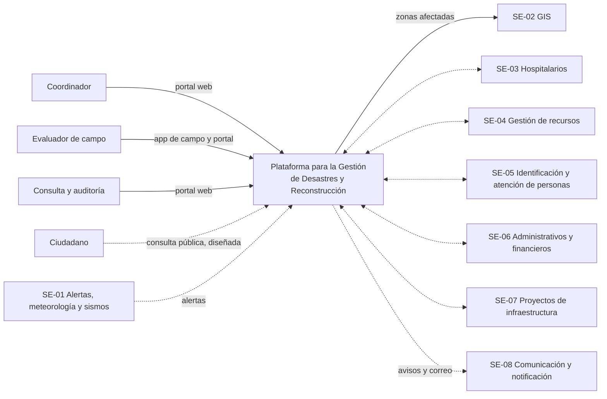
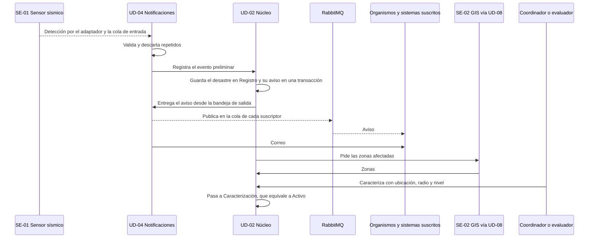
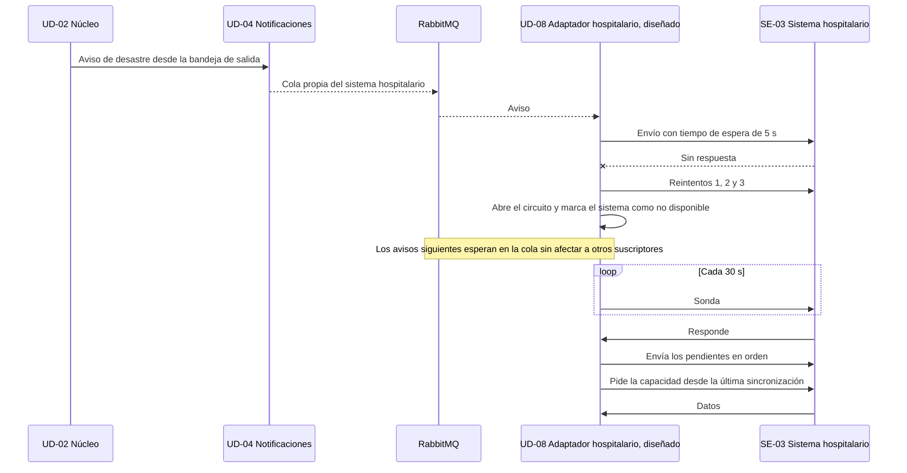
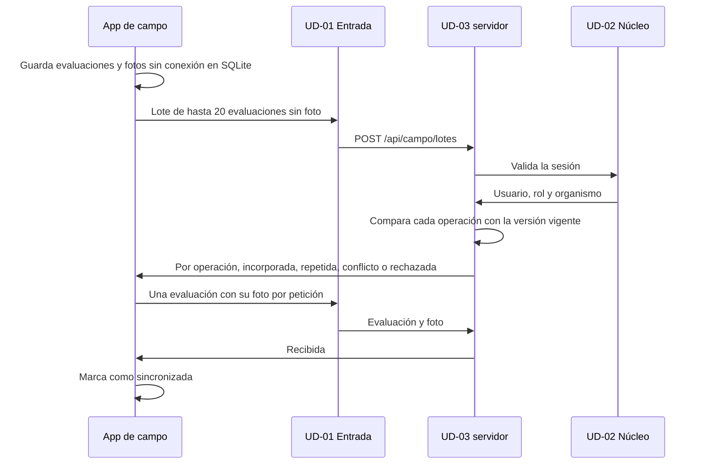
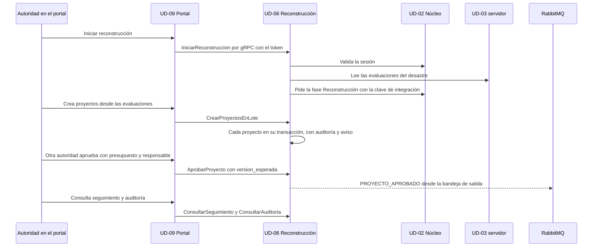

# SAD v2.2 · Plataforma para la Gestión de Desastres y Reconstrucción

**Documento de arquitectura de software, organizado según arc42**

**Versión:** 2.2 · **Fecha:** 17 de noviembre de 2026

**Equipo:** Andrés Barrios, Nicolás Parra, Thomás López, André Landinez

**Pontificia Universidad Javeriana** · Arquitectura de Software

## Cómo se cubren las vistas 4+1 y los entregables del enunciado

| Vista o entregable | Sección |
| --- | --- |
| Vista lógica | «Contenedores (C4 nivel 2)» y «Reglas de dominio por capacidad» |
| Vista de desarrollo | «Componentes (C4 nivel 3)» y «Organización del código» |
| Vista de procesos | «Vista de ejecución» |
| Vista física | «Vista de despliegue» |
| Escenarios (+1) | «Vista de ejecución» y «Requisitos de calidad» |
| Diagramas de contenedores, componentes y despliegue | Figuras 2 a 5, 11 y 12 |
| Modelo de integración con sistemas externos | «Sistemas externos» y «Modelo de integración» |
| Diseño de APIs y eventos | «APIs y eventos» |
| Decisiones arquitectónicas | «Decisiones arquitectónicas» |
| Estrategia de seguridad | «Seguridad» |
| Estrategia de resiliencia y recuperación | «Resiliencia y recuperación» y «Despliegue objetivo: tres centros de datos (diseñado)» |
| Estrategia de escalabilidad | «Escalabilidad y rendimiento» |

**Convención de estado.** *Construido*: tiene código y pasa la verificación del ambiente entregado («Ambiente entregado: Docker Compose en una máquina»). *Diseñado* o *sin código*: está decidido, pero no implementado. *En curso*: cambio de código que el equipo está haciendo y que aún no se entrega.

## Introducción y metas

### Propósito y alcance

Este documento describe la arquitectura de la Plataforma para la Gestión de Desastres y Reconstrucción y justifica sus decisiones con los atributos de calidad del SRS. Es una sola arquitectura: la que implementa el código entregado, extendida a las partes que aún no tienen código.

| Mínimo del proyecto | Qué se entrega | Dónde |
| --- | --- | --- |
| a. App móvil que recolecta y caracteriza | App de campo .NET MAUI con SQLite: captura sin conexión y sincronización. Caracteriza el desastre (C2) y elige el tipo de activo (C1) sin conexión, probado en un celular real (E3) | «Escenario D: evaluación distribuida y sincronización sin conexión», «Operación sin conexión» |
| b. Reconstrucción física | UD-06 Reconstrucción, en Spring Boot con REST y gRPC | «Reglas de dominio por capacidad», «Escenario E: reconstrucción» |
| c. Mapa con desastres, evaluaciones y proyectos | Tablero del desastre en el portal (UD-09), armado por el servlet multihilo del servicio de tablero (UD-10) | «Tablero de un desastre (servlet multihilo)» |
| d. Evaluación de daños | Evaluaciones versionadas con fotografía en servidor (UD-03) | «Reglas de dominio por capacidad», «Escenario D: evaluación distribuida y sincronización sin conexión» |
| Autenticación y autorización | Sesión del núcleo validada en cada solicitud; permisos por rol y organismo | «Seguridad» |

Personas afectadas, gestión de recursos y donaciones quedan fuera de alcance por indicación del profesor (ADR-28): son sistemas externos (SE-04 y SE-05) y UD-05 se retira. Quedan diseñados, sin código: la coordinación de organismos, la consulta pública (UD-07), la integración (UD-08), el modo degradado de servidor y el despliegue en tres centros de datos.

### Metas de calidad

Cinco escenarios del SRS tienen importancia y dificultad altas, y son los que más condicionan la arquitectura. El resto está en «Requisitos de calidad».

| Escenario | Qué exige | Consecuencia para el diseño | Estado |
| --- | --- | --- | --- |
| QA-DIS-01 | 99,95 % mensual en las funciones críticas | Redundancia de lo crítico; lo degradable aparte | Meta de diseño |
| QA-DIS-02 | Recuperar lo crítico en 15 min sin perder operaciones confirmadas | Datos en dos centros; conmutación automática | Meta de diseño |
| QA-ESC-01 | De 1.000 a 10.000 usuarios, creciendo solo lo saturado | Unidades separadas por perfil de carga | Unidades construidas; sin prueba de carga |
| QA-ESC-02 | 500 equipos de campo sin afectar la coordinación | Evaluaciones en una unidad distinta del núcleo | Construido; sin prueba de carga |
| QA-CNF-01 | Reconciliar sin sobrescribir tras trabajar sin conexión | Operaciones con identidad propia y conflictos explícitos | Construido y probado |

### Metas cuantitativas

| Meta | Valor | Cómo se verifica |
| --- | --- | --- |
| Disponibilidad de las funciones críticas | 99,95 % mensual (21,6 min de caída como máximo) | Meta de diseño del despliegue objetivo |
| Usuarios concurrentes | De 1.000 a 10.000 en 10 minutos | Meta de diseño; modelo de capacidad en «Escalabilidad y rendimiento» |
| Consulta frecuente | Menos de 2 s | p50 y p95 medidos en el ambiente entregado (ADR-29) |
| Registro de un desastre | Menos de 3 s | Ídem |
| Alerta crítica | Menos de 5 s, con hasta 10 alertas simultáneas | Ídem; las 10 simultáneas dependen de ADR-27 |
| Recuperación de lo crítico | 15 minutos, 0 operaciones confirmadas perdidas | Meta de diseño |

Una meta de tiempo se cumple cuando el p95 queda dentro del tiempo, ninguna operación supera el doble y menos del 0,1 % termina con error. Cada medición indica el número de solicitudes y la concurrencia.

### Interesados

El profesor y los evaluadores esperan decisiones justificadas y evidencia; los coordinadores y autoridades, fases, tablero y proyectos auditados; los evaluadores de campo, una captura que no pierde datos; los operadores, saber desplegar, verificar y recuperar; y los responsables de sistemas externos y el equipo de desarrollo, contratos estables entre unidades.

## Restricciones

### Restricciones del SRS

| Restricción | Efecto en el diseño |
| --- | --- |
| CON-01 a CON-03: no se reemplazan los sistemas existentes y cada uno conserva su mecanismo | Un adaptador por sistema externo (ADR-07) |
| CON-04: los sistemas externos pueden no estar disponibles | Tiempo de espera, reintentos, corte de circuito y cola de pendientes |
| CON-05 y CON-06: hay operaciones inmediatas y otras diferibles | Cada interacción declara su mecanismo («Modelo de integración») |
| CON-07: tecnologías de los talleres del curso | Jakarta EE, Spring Boot, .NET, PostgreSQL, RabbitMQ y Nginx, por unidad (ADR-17) |
| CON-08: móvil parcialmente sin conexión | SQLite en el dispositivo y reconciliación (ADR-04, ADR-25) |
| CON-09: protección de datos personales | La plataforma no guarda datos de personas afectadas (ADR-28); las cuentas de usuario se protegen según «Seguridad» |
| CON-10: toda la presentación en .NET | Portal en ASP.NET Core Razor Pages (ADR-23) y app de campo en .NET MAUI (ADR-25); los servicios Java no sirven vistas |

### Restricciones del curso

| Restricción | Cómo se cumple |
| --- | --- |
| Toda la presentación en .NET, con MVC, MVP o MVVM (aclaración del 17-nov-2026) | Portal en ASP.NET Core Razor Pages, MVVM del lado del servidor (ADR-23), y app de campo en .NET MAUI |
| Multihilo con servlets | Servlet asíncrono con pool acotado, en el servicio de tablero que consume el portal (ADR-24) |
| Componentes .NET para operar sin conexión | App de campo .NET MAUI con SQLite (ADR-25) |
| Autenticación y autorización | Sesión del núcleo validada en cada unidad; permisos en el backend («Seguridad») |
| Alcance indicado en clase | Personas, recursos y donaciones como sistemas externos (ADR-28) |

### Restricciones organizativas y convenciones

- Se entrega un ambiente de una máquina con Docker Compose («Ambiente entregado: Docker Compose en una máquina»). Los tres centros de datos quedan diseñados («Despliegue objetivo: tres centros de datos (diseñado)»).
- Plantilla arc42 y diagramas C4: azul sólido es construido; gris con borde punteado, diseñado.
- Se conservan los identificadores del SRS y de la versión 1.0 (RF, QA, CON, SE, UD, ADR). RN-01 a RN-21 son las reglas de negocio de Reconstrucción.
- Cada unidad de despliegue lleva el nombre de su contenedor: núcleo (UD-02), servidor (UD-03), Reconstrucción (UD-06), portal (UD-09) y servicio de tablero (UD-10).

## Contexto y alcance

### Contexto

*Figura 1. Contexto de la plataforma. Línea continua: uso o llamada inmediata. Línea punteada: mensajes en cola o canal diseñado.*

| Actor | Rol en la plataforma | Rol en Reconstrucción | Qué hace |
| --- | --- | --- | --- |
| Coordinador | COORDINADOR | AUTORIDAD | Registra el desastre y cambia su fase y nivel; crea, aprueba y cancela proyectos; administra los usuarios de su organismo |
| Evaluador de campo | EVALUADOR | RESPONSABLE | Captura evaluaciones; caracteriza el desastre; opera el proyecto que tiene asignado |
| Consulta | CONSULTA | AUDITOR | Solo lectura, incluida la auditoría |
| Ciudadano | Sin sesión | — | Consulta pública (diseñada) |
| Sistema que no usa REST | Cuenta de la plataforma | — | Inicia sesión por SOAP o por EJB remoto (construido) |

### Sistemas externos

Cada sistema externo sigue siendo dueño de sus datos; la plataforma guarda una copia con su fuente y su hora. La columna de protección indica tiempo de espera, reintentos y umbral del corte de circuito.

| Sistema | Mecanismo | Qué cruza la frontera | Protección | Si no responde | Estado |
| --- | --- | --- | --- | --- | --- |
| SE-01a, b, c Alertas, meteorología, sismos | Entrada: cola, o webhook que deja el mensaje en la cola | Fenómeno, magnitud, ubicación y hora; JSON o CAP. Se reconoce por fuente e identificador | El emisor reintenta | Siempre se recibe; lo inválido queda en cuarentena visible | Cola de entrada construida; adaptadores diseñados |
| SE-02 GIS | REST inmediato | Geometrías GeoJSON con la versión de su catálogo | 2 s; 2; 5 fallas en 30 s | Última geometría conocida, marcada «por actualizar» | Diseñado |
| SE-03 Hospitalarios | Cola diferida y consulta cada 60 s | Sale el aviso de desastre; entra la capacidad disponible. Sin datos de pacientes (ADR-28) | 5 s; 3; 3 seguidas | Datos marcados desactualizados; pendientes en cola | Cola del aviso construida; adaptador diseñado |
| SE-04 Gestión de recursos | Cola diferida y consulta cada 5 min | Disponibilidad con su hora; es dueño de recursos y donaciones | 5 s; 3; 3 seguidas | Última disponibilidad con su hora | Diseñado |
| SE-05 Identificación y atención de personas | REST inmediato y cola | Es dueño de los datos de personas; solo cruzarían identificadores | 3 s; 2; 5 en 30 s | Sin efecto en lo crítico | Diseñado |
| SE-06 Administrativos y financieros | Cola diferida | Compromiso presupuestal (proyecto, monto, versión) y su respuesta | 10 s; 5; 3 seguidas | Operación en conciliación (ADR-21) | Diseñado |
| SE-07 Proyectos de infraestructura | Cola diferida | Proyectos, avances, estado y contratista | 10 s; 5; 3 seguidas | Pendientes en cola | Diseñado |
| SE-08 Comunicación y notificación | Salida: cola por sistema suscrito y correo SMTP | Aviso JSON con su identificador | Reintento a los 5 s | Pendiente hasta que el canal confirma; lo no procesable va a errores | Construido |

Un circuito abierto se prueba con una sonda cada 30 s y se cierra con la primera respuesta correcta.

### Modelo de integración

Toda comunicación con un sistema externo pasa por su adaptador en la unidad de integración (UD-08, diseñada). Un adaptador tiene cuatro piezas: el **conector**, con el protocolo y la credencial del externo; el **traductor**, entre el formato externo y el modelo común; el **validador**, que rechaza lo inválido con un error explícito; y la **protección**. Ninguna unidad interna conoce formatos ajenos.

| Mecanismo | Cuándo se usa | Garantía |
| --- | --- | --- |
| API REST inmediata | Quien llama necesita la respuesta | Respuesta o error dentro del tiempo de espera |
| Cola diferida | El destino puede no estar; importa que llegue | Al menos una vez; se guarda hasta su aceptación |
| Avisos por cola | Varios interesados en un cambio confirmado | Al menos una vez a cada suscriptor |
| Webhook de entrada | El externo avisa sin que se le pregunte | La recepción queda en cola antes de responder |

Todo mensaje lleva un identificador único y quien lo recibe descarta los repetidos. Cada intercambio tiene un estado visible: Recibido, Validado, Incorporado; en las salidas, Aceptado o En conciliación (ADR-21); o Rechazado, con su causa. Un sistema nuevo es un adaptador nuevo que se despliega solo (QA-EXT-01); uno que solo recibe avisos se suscribe con POST /sistemas, sin código nuevo, y eso ya está construido. Un cambio de contrato toca solo el traductor (QA-INT-02).

## Estrategia de solución

### Estilo arquitectónico

La plataforma usa servicios de grano grueso, separados por consistencia transaccional y por perfil de carga, cada uno dueño de sus datos. Se llaman por REST o gRPC cuando necesitan la respuesta y se avisan por colas cuando no. Así, lo consistente se guarda en una transacción local y lo que recibe la carga crece por separado.

| Atributo (1 a 5) | A. Monolito modular | B. Núcleo y tres satélites | C. Servicios por consistencia y carga | D. Un servicio por componente |
| --- | --- | --- | --- | --- |
| Disponibilidad de lo crítico | 3 | 3 | 4 | 4 |
| Escalabilidad por partes | 2 | 3 | 4 | 5 |
| Rendimiento | 5 | 4 | 4 | 3 |
| Resiliencia | 2 | 3 | 3 | 5 |
| Interoperabilidad | 3 | 4 | 4 | 4 |
| Modificabilidad | 3 | 3 | 4 | 5 |
| Integridad de los cambios | 5 | 4 | 5 | 3 |
| Simplicidad de operación | 5 | 4 | 3 | 1 |
| **Total** | **28** | **28** | **31** | **30** |

Los puntajes son valoraciones del equipo, no mediciones. A y B pierden en escalabilidad porque el Escenario B pide crecer solo lo necesario. El resultado es sensible: sin la fila de integridad o la de simplicidad ganaría D. Esas filas pesan porque la trazabilidad es obligatoria y es más segura cuando el cambio y su registro son una transacción, y porque la plataforma la opera una entidad pública, no un equipo dedicado a decenas de servicios. Ningún escenario exige lo que D hace mejor: escalar un componente aislado del núcleo.

### Patrones

| Patrón | Dónde | Estado |
| --- | --- | --- |
| Transacción local: cambio, historial, auditoría y aviso juntos | Núcleo, servidor, Reconstrucción | Construido |
| Bandeja de salida | Núcleo y Reconstrucción | Construido |
| Publicar y suscribir con una cola por suscriptor | Notificaciones | Construido |
| Entrada única | Nginx | Construido |
| MVVM del lado del servidor (vista Razor y PageModel) | Portal | Construido |
| Composición de API: consultas en paralelo con pool acotado y respuesta parcial | Servlet asíncrono del servicio de tablero | Construido |
| Puertos y adaptadores (hexagonal) | Reconstrucción; capas en todas las unidades | Construido |
| Fachada de API | servidor ofrece a la app una sola API y delega sesión y desastres en el núcleo | Construido |
| Copia de lectura derivada | Catálogo de desastres en servidor; consulta pública | Construido; consulta pública diseñada |
| Adaptador por sistema externo | UD-08 | Diseñado |

### Tecnología y relación con Sahana Eden

Java atiende el *back-office* en línea: el núcleo en Jakarta EE, por sus transacciones JTA, y Reconstrucción y el servicio de tablero en Spring Boot 3.3. .NET atiende toda la presentación (el portal en Razor Pages y la app MAUI) y servidor, que comparte con la app los contratos de sincronización (ADR-17, ADR-23).

De Sahana Eden, analizada en el SRS, se toman la plataforma web como punto común, la configurabilidad por catálogos, la información geográfica transversal y el control de acceso por organización. No se toman su unidad única de despliegue ni su base compartida, porque impiden escalar y proteger lo crítico por separado.

## Vista de bloques

### Contenedores (C4 nivel 2)

*Figura 2. Contenedores de la plataforma (C4 nivel 2). Azul: construido. Gris punteado: diseñado.*

| ID | Unidad | Tecnología | Responsabilidad | Datos propios | Criticidad | Estado |
| --- | --- | --- | --- | --- | --- | --- |
| UD-01 | Entrada (web) | Nginx 1.28 | SRV-01: acceso único; enruta y limita tamaño e intentos de inicio de sesión | Ninguno | Crítica | Construida |
| UD-02 | Núcleo (nucleo) | Java 21, Jakarta EE, WildFly 41 | SRV-02 identidad y sesiones; SRV-03 desastres (registro, nivel, fases, caracterización); SRV-12 auditoría; bandeja de salida | Base propia | Crítica | Construida; delimitación, consolidación, coordinación y auditoría consolidada diseñadas |
| UD-03 | Campo y mapas (servidor) | ASP.NET Core 10 | SRV-05 evaluaciones; SRV-06 fotos; mapa; copia del catálogo de desastres; API de la app | Base propia | Crítica | Construida; validación y duplicados diseñados |
| UD-04 | Notificaciones (desastres) | Java 17, Jakarta EE, Payara 6 | SRV-04: cola por suscriptor, correo, registro de entregas; entrada de alertas | Registro de entregas y bandeja de entrada (archivos) | Crítica | Construida, con consumo de los avisos de Reconstrucción (ADR-27) |
| UD-05 | Personas afectadas | — | SRV-07 | — | — | Retirada (ADR-28) |
| UD-06 | Reconstrucción | Java 17, Spring Boot 3.3, REST y gRPC | SRV-09: proyectos de reconstrucción física; RN-01 a RN-21 | Base propia | Degradable | Construida |
| UD-07 | Consulta pública | ASP.NET Core | SRV-10: copia pública de solo lectura | Copia derivada | Degradable | Diseñada |
| UD-08 | Integración | Jakarta EE, RabbitMQ | SRV-11: un adaptador por sistema externo | Pendientes | Según adaptador | Diseñada |
| UD-09 | Portal web (portal) | ASP.NET Core 10, Razor Pages | Única interfaz web; consume los demás servicios | Tokens de sesión en memoria | Crítica | Construida |
| UD-10 | Servicio de tablero (tablero) | Java 21, Spring Boot 3.3, Tomcat | Tablero de un desastre: servlet asíncrono multihilo | Ninguno | Degradable | Construida |
| — | App de campo (campo) | .NET MAUI, SQLite | Captura sin conexión y sincronización | Capturas por organismo y usuario | Crítica | Construida; probada en un celular real |
| INF-01 | Cola de mensajes | RabbitMQ 4.1 | — | Mensajes en tránsito | Crítica | Construida, un nodo |
| INF-02 | Monitoreo | Sondas y métricas | — | Métricas | Crítica | Solo sondas de salud |

SRV-07 (personas) y SRV-08 (recursos) salen de alcance (ADR-28). El código de Solicitudes de recursos del Taller 2 sigue en el núcleo y en servidor hasta que el equipo acuerde retirarlo; el portal ya no lo ofrece y este documento no lo trata como funcionalidad. La web estática de servidor y la interfaz React de Reconstrucción ya no se sirven.

**Agrupación.** Identidad, desastres y auditoría van juntos en el núcleo porque comparten transacciones. La evaluación de daños va aparte porque recibe la escritura de 500 equipos (QA-ESC-02), y la foto va con su evaluación (ADR-13). Las notificaciones van aparte para que el registro siga aunque fallen RabbitMQ o el correo. Reconstrucción va aparte porque opera meses después y es degradable. El portal va aparte porque no guarda estado de vista y habla con cada dueño de datos. Ninguna unidad lee la base de otra.

### Componentes (C4 nivel 3)

#### Núcleo (UD-02)

*Figura 3. Componentes del núcleo (C4 nivel 3).*

El filtro de autenticación valida el token en cada solicitud y compara la clave de integración en tiempo constante. El servicio de identidad maneja usuarios, contraseñas y tokens, y lo usan por igual REST, SOAP y EJB remoto. El registro integrado inscribe el desastre y cambia nivel, fase y caracterización con su historial, en una transacción JTA. El publicador de la bandeja de salida entrega los avisos a notificaciones y purga las sesiones vencidas («Concurrencia y consistencia»).

#### Portal web (UD-09)

*Figura 4. Componentes del portal web (C4 nivel 3): ASP.NET Core Razor Pages.*

| Parte del MVVM | En el portal |
| --- | --- |
| Vista | Página Razor: HTML generado en el servidor; el mapa usa Leaflet, servido por el portal |
| Modelo de vista | El PageModel de cada página: propiedades que la vista enlaza, validadas con anotaciones, y los comandos de lectura y de envío |
| Modelo | Datos de los servicios dueños, que traen los clientes del núcleo y de servidor (REST), de Reconstrucción (gRPC, generado del contrato compartido) y del servicio de tablero (REST) |

Pantallas: inicio de sesión; desastres con filtro por fase, registro, caracterización, cambio de fase e historial; tablero con mapa; evaluaciones con historial y foto; Reconstrucción completa; usuarios del organismo. La autenticación por cookie envía al inicio de sesión a quien no tiene sesión; la cookie solo lleva la identidad y un id, y el token del núcleo queda en la memoria del portal. Cada formulario lleva un token antifalsificación. Los botones dependen del rol, pero cada servicio valida los permisos.

#### Servicio de tablero (UD-10)

*Figura 4b. Componentes del servicio de tablero (C4 nivel 3): servlet asíncrono multihilo.*

No tiene interfaz: solo lo llama el portal, con el token del usuario en la cabecera de autorización. El servlet reparte las tres consultas en un pool acotado («Tablero de un desastre (servlet multihilo)») y cada fuente valida el token contra el núcleo; si alguna responde 401, el servlet responde 401 y el portal cierra la sesión. No se publica en el equipo.

#### Reconstrucción (UD-06)

*Figura 5. Componentes de Reconstrucción (C4 nivel 3): arquitectura hexagonal.*

- **Entrada:** REST y gRPC (14 RPC). Ambos validan el token contra el núcleo y aceptan la versión esperada: la cabecera If-Match en REST y un campo de versión en gRPC.
- **Casos de uso CU-01 a CU-09:** autorizan por rol y organismo, auditan cambios e intentos rechazados (RN-17) y abren la transacción.
- **Dominio:** el proyecto, los estados del proyecto y del desastre y la evaluación de daño, sin Spring, gRPC ni JDBC; 31 pruebas en memoria (E7).
- **Salida:** repositorio con control optimista; bandeja de salida hacia RabbitMQ; un adaptador hacia el núcleo (catálogo y cambio de fase) y otro hacia servidor (evaluaciones, con el token del usuario).

En servidor (UD-03) los componentes son la fachada de API, la recepción de lotes inmediata o diferida (ADR-18), las evaluaciones versionadas, los mapas y la copia del catálogo de desastres.

### Reglas de dominio por capacidad

#### Gestión de desastres (núcleo)

El registro guarda identificador del cliente, tipo (lista fija), fecha, ubicación, nivel de 1 a 4, descripción, organismo (de la sesión), fase y versión; la caracterización agrega punto y radio. Quedan diseñados el área delimitada con versiones, la fuente de la información y el responsable de la emergencia.

**Fases.** Son las cuatro del profesor (Registro, Caracterización, Reconstrucción y Cierre), en una columna con CHECK.

| Transición | Quién la pide | Condición |
| --- | --- | --- |
| Registro → Caracterización | El coordinador, o automática con la primera caracterización | — |
| Caracterización → Reconstrucción | Solo el módulo de Reconstrucción (token del usuario y clave de integración) | RN-01, RN-02: al menos una evaluación validada con daño moderado o superior |
| Reconstrucción → Cierre | Solo el módulo de Reconstrucción | RN-04: ningún proyecto sin finalizar ni cancelar |
| Registro o Caracterización → Cierre | El coordinador, no Reconstrucción (RN-03) | Motivo, por ejemplo una falsa alarma |
| Desde Cierre | Nadie | Terminal (RN-05) |

Todo cambio de fase exige motivo y guarda versión, valor anterior y nuevo, y autor. Si un coordinador pide por la API una transición que depende de RN-01, RN-02 o RN-04, el núcleo la rechaza. *Equivalencia con los estados de ejemplo del enunciado:* Detectado y Registrado → Registro; Activo, En evaluación y En atención → Caracterización; En recuperación y En reconstrucción → Reconstrucción; Cerrado → Cierre.

**Caracterización (contrato C2).** PATCH /eventos/{id}/caracterizacion recibe latitud, longitud, radio en km (hasta 500), nivel de 1 a 4 opcional, descripción, versión base y claveIdempotencia. Repetir la clave devuelve lo mismo; una versión vieja responde 409 VERSION_DESACTUALIZADA con la versión actual. Queda en el historial y, si cambia el nivel, emite un aviso. La hacen coordinador y evaluador. El nivel 1 a 4 del desastre no es el nivel de afectación 1 a 5 de una evaluación.

#### Evaluación de daños (servidor y app)

| Aspecto | Construido | Diseñado o en curso |
| --- | --- | --- |
| Datos | Identificador del dispositivo, desastre, evaluador y organismo de la sesión, ubicación, tipo de activo con catálogo (C1) y activo en texto, nivel de afectación 1 a 5, descripción, foto y versión | — |
| Estados | Preliminar (sin desastre) y Registrada | Validada por un coordinador distinto del evaluador, Devuelta y Duplicada |
| Evidencias | Una foto JPEG o PNG de hasta 5 MB; correcciones con historial que no tocan la captura original | Documentos PDF; hasta cinco evidencias |
| Uso | Mapa de calor y panorama | Estimación de costo y prioridad por zona |

Mientras no exista la validación, Reconstrucción considera validada una evaluación vinculada a un desastre registrado («Riesgos y deuda técnica»).

#### Reconstrucción física (UD-06)

| Transición del proyecto | Quién | Condición |
| --- | --- | --- |
| Propuesto → Aprobado | Una autoridad distinta de quien lo formuló (RN-20) | Presupuesto mayor que cero, financiación y responsable (RN-11, RN-12) |
| Aprobado → En ejecución | El responsable asignado (RN-21) | Contratista y cronograma (RN-11) |
| En ejecución ↔ Suspendido | Autoridad o responsable asignado | Motivo (RN-16) |
| En ejecución → Finalizado | Autoridad o responsable asignado | Avance 100 %, una evidencia como mínimo y sin sobrecosto (RN-15) |
| No terminal → Cancelado | Solo la autoridad (RN-21) | Motivo; sus evaluaciones quedan libres |

Finalizado y Cancelado son terminales (RN-16). Un proyecto nace con el desastre en Reconstrucción (RN-06), de evaluaciones del mismo desastre y organismo, sin repetirlas (RN-07); con destrucción total es de reconstrucción y no de reparación (RN-08). Una evaluación origina a lo sumo un proyecto no cancelado, y lo garantiza una restricción de unicidad en la base (RN-09). En lote, cada ítem va en su transacción (RN-18). Cada organismo ve solo sus proyectos (RN-10). Solo la autoridad modifica el presupuesto, con motivo (RN-12); el avance solo baja como corrección con motivo (RN-13); el sobrecosto se marca y se avisa sin bloquear el registro del costo (RN-14). El tipo de activo se copia de las evaluaciones y el avance del desastre se pondera por presupuesto. No se guardan datos de personas. El presupuesto es más simple que en la versión 1.0, sin versiones propuestas y autorizadas por separado; el compromiso ante SE-06 queda diseñado (ADR-21).

#### Diseñados sin código

La coordinación de organismos (participación por desastre y tareas con estados Pendiente, Asignada, En curso, Terminada y Cancelada); los catálogos configurables (ADR-08), hoy listas fijas; la consulta pública, solo con lo publicable; la delimitación con dos fechas (ADR-06) y la consolidación con alias (ADR-05).

### Organización del código

| Capa | Contiene | Depende de |
| --- | --- | --- |
| Dominio | Entidades y reglas | Nada |
| Casos de uso | Una operación por intención de negocio | Dominio |
| Adaptadores | Controladores REST y gRPC, mensajería, repositorios | Casos de uso |
| Infraestructura | Base de datos, colas, red, configuración | Adaptadores |

Hay una carpeta y un contenedor por unidad, más una carpeta con los clientes de prueba de SOAP y EJB remoto. Ninguna unidad importa código de otra: se comunican por contratos REST, gRPC (un contrato compartido, copiado en el portal y en el tablero) y de eventos («APIs y eventos»). Las pruebas de punta a punta viven junto a las unidades y un solo comando las corre todas (E1).

## Vista de ejecución

Esta sección recorre los escenarios A a E del enunciado, el tablero multihilo y la sincronización sin conexión. Flecha continua: llamada inmediata. Flecha punteada: mensaje en cola o respuesta diferida.

### Escenario A: inicio de una emergencia

*Figura 6. Escenario A: inicio de una emergencia.*

**Construido:** registro con su aviso en una transacción, bandeja de salida, cola por suscriptor, correo, caracterización y cambio de fase. **Diseñado:** los adaptadores de SE-01 y SE-02 y el registro automático del evento preliminar; la cola de entrada ya existe. La alerta no espera al GIS y se cuenta hasta que el aviso queda en la cola de cada suscriptor y el servidor de correo lo acepta.

| Tramo de la alerta | Presupuesto |
| --- | --- |
| Guardar el evento y su aviso, con réplica en otro centro | 0,8 s |
| Espera en la bandeja de salida (ciclo de 1 s) | 1,0 s |
| Entrega a notificaciones y publicación | 0,4 s |
| Consumo, cola de cada suscriptor y correo | 1,5 s |
| Margen | 1,3 s |
| **Total (QA-REN-03)** | **5,0 s** |

Con avisos aislados, la versión 1.0 midió 2,7 s y 3,2 s, con un ciclo de 5 s que hoy es de 1 s. Desde el 18-nov el consumidor procesa hasta 20 mensajes por cola en cada ciclo de 1 s, en vez de uno (ADR-27). Con 10 alertas simultáneas no está medido.

| Situación | Qué hace la plataforma |
| --- | --- |
| Mensaje inválido o repetido | Lo inválido va a la cola de errores; lo repetido se descarta por fuente e identificador |
| El núcleo no responde al registrar | El mensaje vuelve a su cola de reintento cada 5 s |
| El GIS no responde | El evento se crea; la geometría queda pendiente |
| Notificaciones o RabbitMQ no responden | El aviso espera en la bandeja de salida (verificado deteniendo RabbitMQ) |

### Escenario B: aumento repentino de usuarios

Los ciudadanos usarían la consulta pública (diseñada), que lee su propia copia desde caché, con límite de tasa, y nunca llama al núcleo. Los funcionarios usan el portal y la app. Cada unidad crece por separado cuando su métrica lo pide («Escalabilidad y rendimiento»). El tablero acota sus hilos: con el pool lleno responde 503 en lugar de cargar más a los servicios de atrás.

| Situación | Qué hace la plataforma |
| --- | --- |
| Las consultas ciudadanas superan el límite | La entrada responde 429; los funcionarios usan otras rutas |
| Una unidad pasa de 60 % de uso sostenido | Se agregan instancias solo de esa unidad |
| La carga supera la capacidad | Se degrada en el orden de «Resiliencia y recuperación»; lo crítico no |
| El núcleo no responde | Las operaciones protegidas se rechazan; la consulta pública sigue |

Evidencia: el tablero con 20 clientes responde con p95 de 366 ms en una máquina («Tablero de un desastre (servlet multihilo)»). No hay prueba con 10.000 usuarios.

### Escenario C: falla de un sistema externo

*Figura 7. Escenario C: falla del sistema hospitalario.*

Mientras el hospital no responde, las demás unidades y suscriptores siguen trabajando, porque ninguno lo llama. **Construido:** cada sistema suscrito tiene su cola durable, y si deja de consumir, sus avisos esperan sin afectar a los demás. **Diseñado:** el adaptador con corte de circuito y la consulta de capacidad. Tras una caída de horas, los pendientes salen por lotes y lo más reciente primero; los datos viejos se muestran con su hora; una operación sin respuesta en el plazo queda En conciliación (ADR-21).

### Escenario D: evaluación distribuida y sincronización sin conexión

*Figura 8. Escenario D: sincronización de evaluaciones de campo.*

Las fotos van después de los lotes, una por petición, para que una foto pesada no retrase a las demás. Evaluador y organismo salen de la sesión, no de lo que envía la app. El tiempo de confirmación no está medido en campo; se estima en unos 8 s para subir una foto de 1 MB a 1 Mbps, más 1,8 s para confirmar, frente a la meta de 10 minutos (QA-ESC-02). Hoy la app sincroniza cada 8 s mientras la pantalla de captura está abierta; lo que está en curso se describe en «Operación sin conexión».

| Situación | Qué hace la plataforma |
| --- | --- |
| Se corta una evaluación con foto, o se reenvía un lote | No queda nada a medias; lo repetido responde «repetida» y no se duplica |
| Otra persona corrigió antes la evaluación | Conflicto: se conservan la propuesta y el dato del servidor, y decide el evaluador |
| La sesión venció | 401; la app avisa que la sesión venció, conserva los pendientes y no reintenta hasta un nuevo inicio de sesión |
| El núcleo no responde | servidor rechaza; la app sigue capturando y reintenta |
| El desastre aún no está en la copia de servidor | La evaluación queda preliminar y se vincula después |
| La carga supera la capacidad | Incorporación diferida (ADR-18) |

### Escenario E: reconstrucción

*Figura 9. Escenario E: reconstrucción física.*

Cada proyecto guarda una copia de sus evaluaciones de origen y la conserva aunque la evaluación se corrija. Las reglas están en «Reglas de dominio por capacidad». Lo prueban la verificación de punta a punta de Reconstrucción (87 comprobaciones el 17-nov, incluidas aprobación por la misma persona, sobrecosto, cancelación sin permiso y gRPC; E1) y 31 pruebas del dominio (E7). Si servidor no responde, no se crea el proyecto y se reintenta con el mismo identificador; si dos personas cambian el proyecto a la vez, la segunda recibe 409; si RabbitMQ no responde, el aviso espera en la bandeja de salida; un compromiso sin respuesta del sistema financiero quedaría En conciliación (ADR-21, diseñado).

### Tablero de un desastre (servlet multihilo)

*Figura 10. Tablero de un desastre: el portal .NET consume el servlet asíncrono, que consulta tres fuentes en paralelo.*

1. El navegador pide /tablero al portal. El portal toma el token de la sesión y llama al servicio de tablero con Authorization: Bearer.
2. El servlet pasa la solicitud a modo asíncrono, lo que libera el hilo de Tomcat.
3. Un pool de 16 hilos con cola de 64 consulta en paralelo el desastre (núcleo), sus evaluaciones (servidor) y sus proyectos (Reconstrucción, por gRPC). Cada fuente tiene 1,5 s de límite, y la respuesta, 3 s.
4. Si una fuente falla o vence, responde con las demás e indica cuáles no respondieron; si una responde 401, el token venció y el portal cierra la sesión.
5. Con el pool y la cola llenos responde 503 con Retry-After; nunca encola sin límite.

Medición del 17-nov-2026 en el ambiente entregado, de punta a punta: navegador, Nginx, portal .NET, servicio de tablero y tres fuentes (E2):

| Escenario | Solicitudes | Clientes | p50 | p95 | Lectura |
| --- | --- | --- | --- | --- | --- |
| Paralelo | 100 | 1 | 27 ms | 50 ms | Un 22 % más rápido en p95: tarda lo de la fuente más lenta |
| Secuencial | 100 | 1 | 41 ms | 64 ms | |
| Paralelo | 300 | 20 | 223 ms | 366 ms | Igual al secuencial (3 % más) en una máquina saturada |
| Secuencial | 300 | 20 | 182 ms | 355 ms | |
| Reconstrucción congelada | 60 | 20 | 1.515 ms | 1.528 ms | 60 de 60 respuestas parciales, sin errores |

El salto del portal al servicio de tablero, que llegó con la presentación en .NET (ADR-23), cuesta unos 6 ms en p95 con un cliente (44 ms en la medición del 15-nov, sin ese salto). Con 20 clientes cuesta más (de 241 a 366 ms), porque en la misma máquina compiten dos contenedores más.

Con 20 clientes, el paralelo triplica la carga simultánea sobre servicios ya saturados, que validan todos el token contra el núcleo: con una sola máquina no gana, y es un trade-off aceptado (ADR-24). Medir corrigió dos defectos:

- Con el plazo de 5 s de las páginas, una fuente colgada retenía los hilos y 25 de 60 respuestas eran 503 (corrida de prueba que no se guardó; el ajuste está explicado en la configuración del servicio de tablero). Hoy el plazo de cada cliente del tablero es el límite de su fuente.
- La fuente de Reconstrucción descargaba el catálogo completo del núcleo en cada consulta. Hoy las consultas de solo lectura usan una copia de hasta 3 s; las operaciones que deciden reglas leen siempre el dato fresco.

Las mediciones anteriores se conservan como evidencia de cada cambio (E2): la del 15-nov a las 13:34, ya con el plazo corregido pero antes de la copia del catálogo en Reconstrucción (p95 de 56 ms frente a 67 ms con 1 cliente y de 323 ms frente a 288 ms con 20), y la del 15-nov a las 23:29, con el portal anterior en Spring (p95 de 44 ms frente a 61 ms con 1 cliente y de 241 ms frente a 233 ms con 20).

## Vista de despliegue

### Ambiente entregado: Docker Compose en una máquina

*Figura 11. Despliegue entregado: Docker Compose en una máquina, más el teléfono Android.*

| Contenedor | Unidad | Tecnología | Puerto en el equipo | Habla con |
| --- | --- | --- | --- | --- |
| web | UD-01 Entrada | Nginx 1.28 | 127.0.0.1:18085 | portal (/), api (/api/), reconstruccion (/api/reconstruccion/) |
| portal | UD-09 Portal web | ASP.NET Core 10, Razor Pages, Kestrel | — | nucleo (REST), api (REST), reconstruccion (gRPC 9096), tablero (REST) |
| tablero | UD-10 Servicio de tablero | Spring Boot 3.3, Tomcat | — | nucleo (REST), api (REST), reconstruccion (gRPC 9096) |
| nucleo | UD-02 Núcleo | Jakarta EE en WildFly 41 (EJB, JPA, JTA, JAX-RS, SOAP, EJB remoto) | 127.0.0.1:18092 (pruebas) | database, desastres (HTTP, bandeja de salida) |
| database | Base del núcleo | PostgreSQL 17 | — | — |
| api | UD-03 Campo y mapas | ASP.NET Core 10 | — | db, nucleo (REST: sesión y catálogo), desastres |
| db | Base de servidor | PostgreSQL 17 | — | — |
| desastres | UD-04 Notificaciones | Jakarta EE en Payara 6 | — | rabbitmq (AMQP), mailpit (SMTP) |
| rabbitmq | Mensajería | RabbitMQ 4.1 | Ninguno: solo la red interna; las pruebas lo consultan desde dentro del contenedor | — |
| mailpit | Buzón de pruebas | Mailpit | 127.0.0.1:18026 | — |
| reconstruccion | UD-06 Reconstrucción | Spring Boot 3.3 (REST 8086, gRPC 9096) | 127.0.0.1:19096 (gRPC) | reconstruccion-db, nucleo (sesión y fase), api (evaluaciones), rabbitmq |
| reconstruccion-db | Base de Reconstrucción | PostgreSQL 17 | — | — |
| Teléfono Android | App de campo | .NET MAUI + SQLite | — | web → api (/api/campo/lotes) |

- **Inicio y secretos.** Un script de arranque construye las imágenes, aplica las migraciones del núcleo y levanta los 12 contenedores. Los secretos viven en un archivo de entorno que no se versiona y que el arranque crea desde una plantilla; Compose no tiene contraseñas escritas. Los puertos solo escuchan en 127.0.0.1.
- **Verificación.** Un solo comando corre 9 pruebas de punta a punta: API, integración, campo, Reconstrucción con gRPC, evolución, unificación, caracterización, portal y seguridad. El 17-nov-2026, con el portal en .NET, C1, C2 y el consumidor de avisos, pasaron con 271 comprobaciones (E1); el número varía en dos o tres entre corridas porque algunas se repiten dentro de un ciclo de espera. La instalación en limpio, desde un clon nuevo, también pasa (E1).
- **Alcance.** Este ambiente prueba el comportamiento funcional y sirve para medir (ADR-29). No prueba la disponibilidad ni la carga de 10.000 usuarios.

### Despliegue objetivo: tres centros de datos (diseñado)

*Figura 12. Despliegue objetivo en tres centros de datos (diseñado, sin montar).*

Las unidades no guardan estado y corren en los tres centros. Cada base PostgreSQL tiene un primario y dos réplicas síncronas, y un cambio se confirma cuando está en el primario y en una réplica. RabbitMQ replica sus colas en tres nodos. Cada 15 minutos se toma una copia aislada con versiones. El centro C solo aloja lo crítico, para mantener la mayoría de dos sobre tres. La sesión vive en la base del núcleo y se valida contra el primario vigente, para que una revocación surta efecto de inmediato.

| Elemento | Centros | Instancias mínimas | Crecimiento |
| --- | --- | --- | --- |
| UD-01 Entrada, UD-02 Núcleo, UD-03 Campo y mapas, UD-09 Portal | A, B, C | 2 por centro | Automático por uso o por tasa |
| UD-04 Notificaciones | A, B, C | 1 por centro | Fijo; requiere ADR-22 |
| UD-06 Reconstrucción y UD-08 Integración | A, B | 1 por centro | Fijo |
| UD-07 Consulta pública | A, B | 2 por centro | Automático, hasta 10 veces |
| INF-01 RabbitMQ e INF-02 Monitoreo | A, B, C | 1 por centro | Fijo |

**Cálculo ilustrativo de disponibilidad.** Muestra por qué tres centros; no demuestra el 99,95 %. Si cada centro está disponible el 99,5 % (p = 0,995) y sus fallas son independientes, al menos dos de tres lo están con probabilidad 3p²(1 − p) + p³ = 0,999925: unos 3 minutos de caída al mes. Quedan fuera los errores de software y de despliegue, la red entre centros, la conmutación (hasta 5 minutos) y los errores de operación, que deben caber en los 18 minutos restantes; solo la operación real puede confirmarlo. Los centros no deben compartir proveedor de energía ni de red.

## Conceptos transversales

### Seguridad

Tres reglas: se niega lo que no está permitido; cada permiso depende del rol y del organismo; toda operación crítica deja registro.

| Aspecto del enunciado | Construido | Diseñado o pendiente |
| --- | --- | --- |
| Autenticación | El núcleo es la autoridad de usuarios, organismos y roles; contraseñas con PBKDF2; el inicio de sesión tarda lo mismo exista o no el usuario; Nginx limita a 30 intentos por minuto por IP (429). SOAP y EJB remoto usan las mismas cuentas | Credencial por sistema externo |
| Gestión de sesiones | Token de 8 horas (un turno); el núcleo guarda solo su hash y cada unidad lo valida en cada solicitud. Cerrar sesión lo revoca en REST, SOAP y EJB remoto. Las sesiones vencidas se purgan cada 15 min. En el portal, el token vive en la sesión del servidor y el navegador solo tiene una cookie HttpOnly, sin id en la URL | Cerrar sesiones al cambiar rol u organismo; modo degradado de servidor |
| Autorización y roles | Tres roles por organismo, tomados de la sesión y nunca del cliente. Cada servicio valida en el backend; el portal solo oculta botones. Reconstrucción aplica RN-10, RN-20 y RN-21 | Ámbito de evento (ADR-19) |
| Control por organización | Núcleo, servidor y Reconstrucción filtran toda lectura y escritura por el organismo de la sesión; las fotos tienen los permisos de su evaluación | Información compartida en un mismo evento |
| Cifrado | Token de la app en el almacenamiento seguro del dispositivo | TLS; cifrado en reposo; llaves fuera de las unidades. El SQLite del móvil aún no se cifra |
| Auditoría | Núcleo: creación del desastre e historial de nivel, fase y caracterización, en la transacción del cambio. Reconstrucción: cambios e intentos rechazados (RN-17) | Registro de solo adición; consulta consolidada (ADR-20); accesos denegados e inicios de sesión |
| Datos personales | No se guardan datos de personas afectadas (ADR-28) | Con SE-03 y SE-05 solo cruzarían identificadores |
| Secretos | En un archivo de entorno sin versionar. Clave de integración comparada en tiempo constante. La importación por integración, apagada por defecto. La clave EJB no va en la imagen del núcleo: el usuario técnico se crea al arrancar, con las variables de entorno | Autenticación en el servicio de notificaciones |

**Dos personas.** Un coordinador puede crear otro coordinador de su organismo; así existe la segunda persona que RN-20 exige para aprobar. Con la misma regla quedan diseñadas las operaciones de alto impacto: cambiar políticas de acceso o de sesión, certificar una regla de consolidación, declarar una falla grave y restaurar la copia aislada.

**Modo degradado de servidor (diseñado).** Hoy, sin el núcleo, servidor rechaza todo. El diseño: solo mientras el núcleo no responde, permite las consultas del propio organismo con la última validación exitosa de la sesión, durante 15 minutos desde ella, sin renovarse ni pasar del vencimiento. Recibe las capturas como pendientes, sin mostrarlas, y responde 503 a lo demás. Rechaza una sesión que no había validado, y olvida la de una sesión cerrada o declarada inválida. Al volver el núcleo, incorpora cada captura solo si su sesión seguía vigente cuando llegó; si no, la conserva rechazada con su motivo.

### Resiliencia y recuperación

| Mecanismo | Dónde y con qué valores | Estado |
| --- | --- | --- |
| Tiempos de espera | Entrada a las unidades: 5 s de conexión. Portal: 2 s de conexión y 5 s de lectura (4 s hacia el tablero). Servicio de tablero: 1,5 s por fuente y 3 s en total. servidor al núcleo: 5 s. Núcleo a notificaciones: 2 s y 3 s. Adaptadores: 2 a 10 s | Construido, salvo adaptadores |
| Reintentos | Bandeja de salida en cada ciclo; cola de reintento a los 5 s; la app reenvía con los mismos identificadores | Construido |
| Corte de circuito | Por adaptador: 3 fallas seguidas o 5 en 30 s; sonda cada 30 s | Diseñado |
| Colas | Entrada de alertas, una por suscriptor, correo, eventos de Reconstrucción; durables | Construido en un nodo |
| Procesamiento asíncrono | Notificaciones, lotes diferidos y servlet del tablero | Construido |
| Degradación controlada | Respuesta parcial del tablero y 503 con el pool lleno; orden de abajo | Tablero construido; resto diseñado |
| Recuperación automática | Nueva instancia en 2 min; conmutación entre centros en 5 min | Diseñado |

Cada unidad corre en su proceso con su grupo de conexiones, y el pool del tablero no comparte hilos con Tomcat. Dos evidencias están medidas: la bandeja de salida no pierde avisos al detener RabbitMQ, y el tablero responde parcial con Reconstrucción caída.

**Orden de degradación.** 1) Consultas históricas y estimaciones: 503 con hora de reintento. 2) Fotos: primero las evaluaciones sin foto. 3) Consulta pública: última copia en caché; luego, límite de tasa. 4) Reconstrucción: solo lectura; el tablero sigue sin proyectos. 5) Integraciones diferidas: se acumulan en cola. 6) Lo crítico nunca se degrada por la carga de lo anterior.

En el despliegue objetivo, cada tipo de falla se trata así:

| Falla | Respuesta | Automática | Restablecimiento | Pérdida |
| --- | --- | --- | --- | --- |
| Cae una instancia (sonda cada 5 s) | El tráfico va a las demás y se crea otra | Sí | Sin interrupción | Ninguna |
| Caen las instancias del núcleo de un centro | Tráfico a otro centro; servidor en modo degradado; la app sigue capturando | Sí | 5 min | Ninguna |
| Falla un sistema externo | Contención en el adaptador; pendientes en cola | Sí | Sin interrupción de lo crítico | Ninguna |
| Se pierde un centro | Los otros dos siguen confirmando | Sí | 5 min | Ninguna: cada cambio estaba en 2 de 3 |
| Se pierden dos centros | Dos personas declaran la falla, bloquean los centros perdidos y el sobreviviente asume | No | 15 min | Posible: lo confirmado solo en los perdidos |
| Corrupción lógica | Se detienen las escrituras y se restaura la copia aislada | No: dos personas | 4 horas | Hasta 15 min; se completa con los dispositivos |

QA-DIS-02 se cumple con la cuarta fila; las dos últimas son más raras y el SRS no exige cubrirlas sin pérdida.

**Conmutación (5 minutos).** Los dos centros restantes confirman la pérdida (30 s), el balanceador retira el tráfico (30 s), una réplica asume si allí estaba el primario (1 min), las unidades críticas crecen (2 min) y queda 1 minuto de margen. Un coordinador con un miembro por centro mantiene el turno del primario con mayoría de dos y promueve la réplica más adelantada; el primario anterior queda bloqueado, para que nunca haya dos. Las solicitudes en curso se reintentan con el mismo identificador. Todo es diseño, salvo que varias instancias no publiquen el mismo aviso («Concurrencia y consistencia»).

**Tras recuperar.** Lo crítico vuelve en 15 minutos, lo esencial en 1 hora y lo degradable en 4 horas. Los avisos pendientes salen en el siguiente ciclo y los dispositivos sincronizan lo que guardaban; un cambio sobre una versión perdida entra como conflicto. Estos tiempos son metas de diseño, que se comprobarían con un simulacro trimestral.

### Escalabilidad y rendimiento

Cada unidad crece por separado, agregando instancias iguales, al superar 60 % de uso sostenido durante 2 minutos (diseñado). El núcleo y servidor se dimensionan para quedar bajo 50 % en el pico y bajo 70 % con un centro perdido.

| Fuente de carga | Supuesto | Carga resultante | Unidad |
| --- | --- | --- | --- |
| 8.000 ciudadanos | Una consulta cada 30 s | 267 consultas por segundo | UD-07, casi todo desde caché |
| 2.000 funcionarios | Una operación cada 10 s; 80 % consultas | 160 consultas y 40 escrituras por segundo | Portal, servidor y núcleo |
| 500 equipos de campo | Un reporte por minuto con foto de 1 MB | 8 registros y 8 MB por segundo; ráfagas al reconectar | UD-03 |
| Validación de sesiones | Una por solicitud protegida | Cerca de 210 lecturas por segundo | UD-02 |
| Sistemas externos | Consultas periódicas y alertas | Menos de 10 mensajes por segundo | UD-08 y UD-04 |

**Modelo de capacidad (estimación).** Supone 100 operaciones por segundo por instancia del núcleo o de servidor, y 500 respuestas desde caché por instancia de consulta pública; una prueba de carga debe reemplazar ese supuesto. Como referencia, una instancia de servidor atendió entre 314 y 350 consultas por segundo en una comprobación local de la versión 1.0.

| Unidad | Pico | Instancias mínimas | Uso en el pico | Con un centro menos |
| --- | --- | --- | --- | --- |
| UD-03 Campo y mapas | 210 operaciones por segundo | 6 | 35 % | 53 % |
| UD-02 Núcleo | 273 operaciones por segundo | 6 | 46 % | 68 % |
| UD-07 Consulta pública | 267 consultas por segundo | 4 | 13 % | 27 % |

Con 80.000 ciudadanos solo crecería la consulta pública, de 4 a 9 instancias. Con fotos de 5 MB, servidor pasaría de 6 a 12. Si la capacidad real fuera la mitad, el núcleo quedaría al 91 % y habría que duplicarlo.

| Tramo | Consulta (QA-REN-01, 2 s) | Registro (QA-REN-02, 3 s) |
| --- | --- | --- |
| Red hasta la entrada | 0,5 s | 0,5 s |
| Entrada y enrutamiento | 0,1 s | 0,1 s |
| Validación de la sesión | 0,2 s | 0,2 s |
| Unidad dueña: lectura, o guardado con aviso y réplica | 0,5 s | 0,9 s |
| Respuesta | 0,4 s | 0,4 s |
| Margen | 0,3 s | 0,9 s |

**Medido en el ambiente entregado.** El tablero, la consulta más compuesta, tuvo p95 de 50 ms con un cliente y de 366 ms con 20 («Tablero de un desastre (servlet multihilo)»); en la versión 1.0, el registro de un desastre respondió en 22 ms con poca carga. Ninguna cifra incluye red real, réplica ni 10.000 usuarios. Confirmar en otro centro consumiría cerca de 0,8 s de los 3 s del registro, y con fotos de 5 MB el volumen de campo se multiplica por cinco. Las listas aún no se paginan (diseñado: de 20 en 20 con cursor).

### APIs y eventos

| Convención | Regla |
| --- | --- |
| Versión | Prefijo /api sin número; un cambio incompatible se publica en /api/v2 y convive con el anterior |
| Autenticación | Authorization: Bearer con el token; en gRPC, el mismo token en el metadato authorization |
| Repetición segura | Toda escritura lleva un identificador del cliente; repetirla no duplica |
| Control de versión | versionBase en el núcleo y en servidor; If-Match o version_esperada en Reconstrucción. Si cambió, 409 |
| Formato | JSON; fechas ISO 8601 con zona; geometrías GeoJSON |

Códigos HTTP: 200 o 201 aplicada; 202 recibida para proceso diferido; 401 sin credencial válida; 403 sin permiso; 404 inexistente o fuera del ámbito; 409 conflicto; 413 y 415 tamaño o tipo; 422 regla de negocio (RN-xx en Reconstrucción); 429 límite; 503 degradada, con hora de reintento. En gRPC: FAILED_PRECONDITION por regla, PERMISSION_DENIED, NOT_FOUND, ABORTED por cambio simultáneo e INVALID_ARGUMENT.

| Unidad | Operaciones construidas | Requisitos |
| --- | --- | --- |
| Núcleo | /auth/login, /auth/me, /auth/logout y /auth/usuarios (la app y las pruebas los usan a través de servidor, bajo /api/auth). GET /eventos, GET /eventos/{id} y su historial. PATCH /eventos/{id}/gravedad, /fase y /caracterizacion. Registro del desastre. Catálogo interno, con clave de integración. Inicio de sesión SOAP y EJB remoto | FC-07; RF-GD-01, 03, 05, 06, 07, 13, 14 |
| servidor | GET /api/desastres, /api/catalogos (con tiposActivo, C1); PATCH /api/desastres/{id}/caracterizacion (C2), /fase y /gravedad; POST /api/campo/lotes; GET y PUT /api/campo/evaluaciones/{id}, con /historial, /foto y /desastre; GET /api/panorama; /api/salud | RF-ED-01 a 03, 07, 08, 11 a 14 |
| Reconstrucción REST | Bajo /api/reconstruccion: desastres (iniciar reconstrucción, cerrar, evaluaciones, seguimiento, auditoría) y proyectos (crear, aprobar, iniciar, presupuesto, avance, costo, evidencia, estado, auditoría) | RF-RE-01 a 06 |
| Reconstrucción gRPC | ReconstruccionService, 14 RPC: IniciarReconstruccion, CrearProyecto, CrearProyectosEnLote, AprobarProyecto, IniciarEjecucion, RegistrarAvance, RegistrarCosto, AdjuntarEvidencia, ModificarPresupuesto, CambiarEstado, ConsultarSeguimiento, ConsultarAuditoria, CerrarDesastre, ConsultarEvaluaciones | RF-RE-01 a 06 |
| Portal | Páginas Razor y GET /tablero?desastre= (JSON del mapa, que reenvía al servicio de tablero) | Mínimos a, b, c y d |
| Servicio de tablero | GET /tablero?desastre= con Authorization: Bearer; solo lo llama el portal | Mínimo c |
| Notificaciones | POST /desastres (aviso desde la bandeja de salida); POST y GET /sistemas (suscripción) | RF-GD-13, RF-CO-06 |

Diseñadas, sin código: validación y duplicados de evaluaciones, documentos PDF, delimitación y consulta histórica, consolidación, participación y tareas, tipos de desastre, auditoría consolidada, consulta pública y alertas por fuente.

| Contrato entre unidades | Qué fija | Estado |
| --- | --- | --- |
| C1 Tipos de activo | Nueve códigos (vivienda, edificio público, escuela, centro de salud, vía, puente, red de agua, red de energía, otro) en una tabla configurable, publicados en GET /api/catalogos. La evaluación guarda el código tal como llega; al leerse, uno desconocido o ausente queda como OTRO y se conserva el original, para no perder capturas de apps anteriores ni romper la idempotencia | Construido en servidor, el tablero, Reconstrucción y la app |
| C2 Caracterización | PATCH /eventos/{id}/caracterizacion en el núcleo («Reglas de dominio por capacidad»), que servidor ofrece a la app como PATCH /api/desastres/{id}/caracterizacion y reenvía tal cual (200, 409 con la versión actual, 403, 404) | Construido en el núcleo, en servidor y en la app (probado en un celular real) |
| C3 Resumen de evaluaciones | Totales por nivel y por tipo de activo | Opcional: el tablero lo arma con /api/panorama |
| C4 Sesión | Token Bearer validado con /auth/me; 401 vencido, 403 sin permiso | Construido |
| C5 Eventos de Reconstrucción | idEvento (también es el id del mensaje AMQP), tipo, ocurridoEn, desastreId (el UUID que usa Reconstrucción), proyectoId, organismoId y datos; intercambio reconstruccion.eventos, cola integracion.reconstruccion | Publicación y consumo construidos (ADR-27) |

| Aviso | Origen y canal | Estado |
| --- | --- | --- |
| DESASTRE_REGISTRADO, DESASTRE_GRAVEDAD_CAMBIADA | Núcleo → bandeja de salida → notificaciones → cola por suscriptor y correo | Construido |
| PROYECTO_CREADO, PROYECTO_APROBADO, PROYECTO_ESTADO_CAMBIADO, PROYECTO_CON_SOBRECOSTO, PRESUPUESTO_MODIFICADO, DESASTRE_EN_RECONSTRUCCION, DESASTRE_CERRADO | Reconstrucción → bandeja de salida → C5 → notificaciones | Construido: correo para PROYECTO_APROBADO, PROYECTO_CON_SOBRECOSTO y DESASTRE_CERRADO; los demás se registran sin correo |
| Alerta externa | SE-01 → intercambio desastres.entrada, cola desastres.registro | Cola construida; adaptadores diseñados |
| Fase cambiada por el coordinador, delimitación, tarea, sistema externo caído | Núcleo y UD-08 | Diseñado |

Cada cola tiene su cola de reintento, que devuelve el mensaje a los 5 s, y su cola de errores, visible para un operador. Los mensajes son JSON persistentes con identificador único.

**Garantías de entrega.** *Sin pérdida:* el aviso se guarda con su cambio y se entrega hasta que se acepta. *Al menos una vez:* un aviso puede repetirse y el destinatario lo descarta por su identificador. *Orden no garantizado:* cada aviso lleva el recurso y su versión, y el destinatario conserva la más alta. *Capacidad:* 10 alertas críticas simultáneas, porque el modelo de carga supone menos de 10 mensajes por segundo de todos los externos; por encima, se atiende por severidad y la espera crece, como degradación declarada. *Evolución:* dentro de una versión solo se agregan campos opcionales.

### Operación sin conexión

- La app exige un primer inicio de sesión con conexión y guarda el token en el almacenamiento seguro del dispositivo.
- SQLite es la fuente de verdad local. Catálogo y capturas se separan por organismo, y las capturas también por usuario.
- Sin conexión se captura y se corrige. Cada operación lleva un identificador del dispositivo y la versión base (ADR-04). Ante un conflicto, el evaluador elige y su decisión es una operación nueva.
- El dispositivo no borra una captura hasta la confirmación. Revocar la sesión de un dispositivo perdido impide sincronizar, pero no borra lo guardado; por eso solo guarda catálogos y capturas del propio usuario. **Limitación:** el SQLite no va cifrado.
- La app trata el 401 aparte de la falta de red, porque un evaluador puede pasar más de 8 horas sin señal: avisa que la sesión venció, conserva lo pendiente y no reintenta hasta un nuevo inicio de sesión. También elige el tipo de activo del catálogo descargado (C1) sin perder el texto libre, y caracteriza el desastre sin conexión (C2). Ante un 409, la caracterización queda en conflicto hasta que el evaluador decide.
- **Evidencia:** la prueba instrumentada de la app ejecuta sus métodos reales con desconexión real, persistencia, conflicto y resolución, C1, C2, el 409 y el 401. El 17-nov pasó con 33 comprobaciones en un celular real (Samsung SM-A155M, Android 16), incluido cerrar sesión con la sesión vencida, y quedaron 18 capturas de la interfaz (E3).

### Concurrencia y consistencia

- **Identificador del cliente y versión base.** Repetir una escritura no duplica; el mismo identificador con otro contenido, o una versión que ya no es la vigente, responde 409 sin cambiar nada.
- **Transacción local.** El cambio, su historial, su auditoría y su aviso van juntos en la base de la unidad dueña. No hay transacciones entre unidades.
- **Bloqueo del desastre.** Todo cambio de nivel, fase o caracterización bloquea la fila del desastre antes de comparar la versión.
- **Reclamo de avisos.** La bandeja del núcleo reclama los avisos con un bloqueo que salta las filas ya tomadas y un vencimiento de 30 s; el envío HTTP a notificaciones ocurre fuera de la transacción, y si falla, el aviso vuelve a estar disponible al vencer el reclamo. Reconstrucción y los lotes diferidos de servidor usan el mismo bloqueo, así que varias instancias no publican dos veces lo mismo.
- **Reconstrucción.** La base decide entre dos proyectos simultáneos sobre la misma evaluación (RN-09), y el repositorio rechaza la segunda escritura sobre una versión aunque el cliente no envíe If-Match.
- **Consistencia eventual.** Las copias de lectura van segundos atrás (ADR-03); el tablero acota su concurrencia con un pool fijo (ADR-24).

## Decisiones arquitectónicas

Cada ADR indica su estado en el código. Frente a la versión 1.0, ADR-01, 02, 03, 10, 11, 14, 17, 19, 20 y 22 se actualizan con lo construido, y ADR-23 a 29 son nuevas.

#### Unidades de despliegue por consistencia y perfil de carga (ADR-01) · Construido en parte

- **Requisitos.** QA-ESC-01, QA-DIS-01, QA-ESC-02; Escenario B.
- **Contexto.** Hay que crecer solo lo necesario, y el dato, su historial, su auditoría y su aviso deben guardarse juntos.
- **Alternativas.** Monolito modular; núcleo con satélites; servicios por consistencia y carga; un servicio por componente («Estilo arquitectónico»).
- **Decisión.** Servicios de grano grueso. El núcleo reúne identidad, desastres y auditoría; lo demás va en unidades aparte. UD-05 se retira (ADR-28).
- **Justificación.** Lo que recibe picos crece solo, y lo consistente queda en una transacción local.
- **Consecuencias.** El núcleo es dependencia de todos. Construidas UD-01, 02, 03, 04, 06 y 09; diseñadas UD-07 y 08.

#### Comunicación entre unidades (ADR-02) · Construido

- **Requisitos.** QA-RES-02, QA-REN-02, QA-REN-03.
- **Contexto.** Una llamada inmediata acopla disponibilidades; una cola no responde en el momento.
- **Alternativas.** Todo inmediato; todo por eventos; inmediato solo cuando se necesita la respuesta.
- **Decisión.** Llamada inmediata con tiempo de espera cuando el usuario espera el resultado: REST entre tecnologías distintas, gRPC entre servicios Java (ADR-26). Colas para avisar, siempre desde una bandeja de salida.
- **Justificación.** El registro se confirma con su resultado y no depende de notificaciones.
- **Consecuencias.** Sin el núcleo, ninguna unidad atiende operaciones protegidas.

#### Datos por unidad y copias de lectura derivadas (ADR-03) · Construido; copia pública diseñada

- **Requisitos.** QA-ESC-01, QA-SEG-02; PREM-03.
- **Contexto.** Miles de consultas compiten con los registros.
- **Alternativas.** Base compartida; lectura pública sobre datos operativos; base por unidad con copias.
- **Decisión.** Ninguna unidad lee la base de otra. servidor copia el catálogo de desastres; Reconstrucción, las evaluaciones de origen; la consulta pública tendrá solo lo publicable.
- **Justificación.** La lectura no toca las bases críticas, y se publica por inclusión expresa.
- **Consecuencias.** Consistencia eventual de unos segundos en la copia de servidor; las pruebas y la app esperan la sincronización.

#### Reconciliación tras trabajar sin conexión (ADR-04) · Construido

- **Requisitos.** QA-CNF-01, QA-DIS-03; RF-ED-12, RF-ED-13.
- **Contexto.** Lo capturado llega horas después, cuando otros pudieron cambiar los mismos datos.
- **Alternativas.** Identificador del servidor (no funciona sin conexión); última escritura gana (sobrescribe en silencio); operaciones sobre versión base.
- **Decisión.** Cada cambio viaja con un identificador del dispositivo y su versión base; si la vigente es otra, queda como conflicto explícito.
- **Justificación.** Ni sobrescrituras silenciosas ni capturas perdidas.
- **Consecuencias.** El dispositivo guarda más datos y alguien debe resolver los conflictos.

#### Consolidación de reportes (ADR-05) · Diseñado

- **Requisitos.** QA-CNF-02; RF-GD-11, RF-GD-16, RF-ED-10.
- **Contexto.** Varios reportes pueden referirse al mismo evento o activo.
- **Alternativas.** Reemplazar el original (pierde procedencia); mover registros entre bases (sin transacción común); unir por similitud; consolidación gobernada con alias.
- **Decisión.** La similitud solo propone; decide una persona, salvo una regla certificada por dos. Consolidar crea un alias con vigencia hacia un evento canónico abierto que no es alias de otro, sin mover datos. Las consolidaciones simultáneas se resuelven por versión. Revertir cierra el alias.
- **Justificación.** Un error de unión se corrige sin tocar datos.
- **Consecuencias.** Toda consulta por evento resuelve el alias.

#### Historia con dos fechas por versión (ADR-06) · Diseñado

- **Requisitos.** QA-TRZ-02; RF-GD-09, RF-GD-14.
- **Contexto.** El área cambia y los datos de campo llegan tarde.
- **Alternativas.** Solo hora de registro; solo hora de vigencia; ambas.
- **Decisión.** Cada versión de la delimitación y del nivel guarda desde cuándo aplica y cuándo se registró.
- **Justificación.** Distingue qué estaba afectado a las 10:00 de qué se sabía a las 10:00.
- **Consecuencias.** Consultas históricas más costosas y degradables. Hoy hay historial con versión y hora de registro.

#### Integración por adaptadores (ADR-07) · Diseñado; colas de suscriptor construidas

- **Requisitos.** QA-INT-01, QA-INT-02, QA-RES-01, QA-EXT-01; CON-01 a CON-04.
- **Contexto.** Ocho tipos de sistemas con formatos propios que no se pueden cambiar.
- **Alternativas.** Integración directa desde cada servicio; formato impuesto (contradice CON-01); un adaptador por sistema.
- **Decisión.** Un adaptador por sistema en UD-08 y cuatro mecanismos según la necesidad («Modelo de integración»).
- **Justificación.** Integrar o cambiar un sistema toca un solo adaptador, y su falla queda en él.
- **Consecuencias.** Un salto más y un modelo común que mantener.

#### Variabilidad por configuración (ADR-08) · Diseñado

- **Requisitos.** QA-MOD-01, QA-MOD-02; RF-GD-04, RF-ED-04 a 06.
- **Contexto.** Tipos, activos, categorías y organismos deben agregarse sin código.
- **Alternativas.** Extensiones con código; configuración con uno o con dos niveles de control.
- **Decisión.** Catálogos como configuración ordinaria, auditada; reglas de seguridad, sesiones y consolidación como configuración de alto impacto, con dos personas.
- **Justificación.** Cambia sin desplegar y sin perder trazabilidad.
- **Consecuencias.** Hay que clasificar cada parámetro. Hoy los catálogos son fijos.

#### Recuperación ante falla grave (ADR-09) · Diseñado

- **Requisitos.** QA-DIS-02.
- **Contexto.** Recuperar lo crítico en 15 minutos sin perder lo confirmado.
- **Alternativas.** Copia periódica con restauración manual; centro en espera con réplica diferida; tres centros con réplica síncrona.
- **Decisión.** La pérdida de un centro se resuelve sola en 5 minutos; la de dos centros o una corrupción exige dos personas («Resiliencia y recuperación»).
- **Justificación.** Las otras alternativas pierden lo último confirmado.
- **Consecuencias.** Costo de tres centros; las fallas mayores pueden perder datos.

#### Seguridad y control de acceso (ADR-10) · Construido; modo degradado diseñado

- **Requisitos.** QA-SEG-01, QA-SEG-02, QA-TRZ-01; FC-07; CON-09.
- **Contexto.** Varios organismos comparten la plataforma y un dispositivo puede perderse.
- **Alternativas.** Credencial firmada sin consultar identidad (revocación lenta); proveedor externo (dependencia ajena); caché de validaciones (retrasa la revocación); sesión propia validada en el núcleo.
- **Decisión.** Token de 8 horas validado contra el núcleo por cada unidad en cada solicitud; usuario, rol y organismo salen de esa validación («Seguridad»). Solo sin núcleo, servidor usaría la última validación por 15 minutos.
- **Justificación.** Revocación inmediata; el organismo no se falsifica desde el cliente.
- **Consecuencias.** Un salto al núcleo por operación; sin él nadie inicia sesión. Se mitiga con redundancia.

#### Protección de las funciones críticas (ADR-11) · Separación construida; redundancia diseñada

- **Requisitos.** QA-DIS-01, QA-RES-02.
- **Contexto.** El SRS clasifica las funciones en críticas, esenciales y degradables.
- **Alternativas.** Tratar todo igual; separar dentro de una unidad; separar lo degradable en unidades aparte.
- **Decisión.** Lo crítico vive en entrada, portal, núcleo, servidor y notificaciones, con capacidad sobrante y en los tres centros. Reconstrucción y consulta pública van aparte. El desastre se confirma antes de notificar.
- **Justificación.** Medido: sin Reconstrucción, el tablero sigue respondiendo.
- **Consecuencias.** Capacidad ociosa en operación normal.

#### Tres centros de datos con réplica síncrona (ADR-12) · Diseñado

- **Requisitos.** QA-DIS-01, QA-DIS-02.
- **Contexto.** 99,95 % mensual son 21,6 minutos de caída.
- **Alternativas.** Un centro redundante; dos centros, activo y en espera; tres centros.
- **Decisión.** Tres centros independientes; cada base con primario y dos réplicas síncronas, confirmando con una; RabbitMQ en tres nodos.
- **Justificación.** Cálculo ilustrativo de «Despliegue objetivo: tres centros de datos (diseñado)».
- **Consecuencias.** Cerca de 0,8 s por escritura crítica; los centros no deben compartir dependencias.

#### La fotografía viaja con su evaluación (ADR-13) · Construido

- **Requisitos.** QA-CNF-01, QA-ESC-02; RF-ED-07.
- **Contexto.** Una evaluación lleva una foto de hasta 5 MB capturada sin conexión.
- **Alternativas.** Canal aparte con carga reanudable; foto en la misma operación.
- **Decisión.** La foto viaja con su evaluación y se guarda con ella; primero van los lotes sin foto.
- **Justificación.** No hay evaluación sincronizada con su evidencia perdida, y la foto hereda sus permisos.
- **Consecuencias.** Un corte obliga a reenviar todo el paquete. Falta medir con fotos grandes y redes reales.

#### Entrada única (ADR-14) · Construido

- **Requisitos.** QA-ESC-01, QA-SEG-01.
- **Contexto.** Varios clientes entran a varias unidades.
- **Alternativas.** Acceso directo; una entrada por cliente; entrada única.
- **Decisión.** Nginx enruta por prefijo hacia el portal, servidor y Reconstrucción («Ambiente entregado: Docker Compose en una máquina»), y limita el tamaño de las solicitudes y los intentos de inicio de sesión. El límite del portal público queda diseñado con UD-07.
- **Justificación.** Las unidades no se exponen.
- **Consecuencias.** Todo pasa por ella; por eso no guarda estado.

#### Notificación por dos canales (ADR-15) · Construido

- **Requisitos.** QA-REN-03; RF-GD-13, RF-CO-06.
- **Contexto.** Una alerta debe llegar a sistemas y a personas, y cualquier destino puede fallar.
- **Alternativas.** Un canal con reintentos; dos canales independientes.
- **Decisión.** Cola propia por sistema suscrito, más correo; cada canal con cola de reintento y de errores.
- **Justificación.** Un suscriptor caído no retrasa a los demás.
- **Consecuencias.** Avisos repetidos, que se descartan por identificador.

#### Monitoreo activo (ADR-16) · Solo sondas de salud

- **Requisitos.** QA-RES-02, QA-ESC-01.
- **Contexto.** Detectar en 10 s y crecer en 5 minutos exige medir siempre.
- **Alternativas.** Reportes de usuarios; sondas; sondas con métricas.
- **Decisión.** Sonda cada 5 s y métricas de uso, latencia y colas, que disparan reemplazo, crecimiento y conmutación.
- **Justificación.** Sin medición continua no hay reacción automática.
- **Consecuencias.** El monitoreo también debe ser redundante.

#### Tecnologías de la implementación (ADR-17) · Construido

- **Requisitos.** CON-07, CON-02; restricciones del curso («Restricciones del curso»).
- **Contexto.** Los talleres usaron Jakarta EE, Spring Boot, .NET, mensajería, REST, SOAP, gRPC y llamadas remotas; el curso pide MVC, servlets multihilo y .NET sin conexión.
- **Alternativas.** Una plataforma para todo; la que mejor se ajusta a cada unidad.
- **Decisión.** Núcleo: Java 21 y Jakarta EE en WildFly 41 (EJB, JPA, JTA, JAX-RS, SOAP, EJB remoto). Portal: ASP.NET Core 10 con Razor Pages y cliente gRPC. Servicio de tablero: Java 21, Spring Boot 3.3 y servlets en Tomcat, con cliente gRPC. Reconstrucción: Java 17, Spring Boot 3.3, REST y gRPC. servidor: ASP.NET Core 10. App: .NET MAUI y SQLite. Notificaciones: Java 17 y Jakarta EE en Payara 6. Además, PostgreSQL 17, RabbitMQ 4.1, Nginx 1.28 y Docker Compose.
- **Justificación.** JTA da la transacción local de ADR-01; Java para el *back-office* en línea y .NET para toda la presentación y lo desconectado. CON-02 se ejercita con REST, gRPC, SOAP y EJB remoto.
- **Consecuencias.** Dos plataformas y tres servidores de aplicaciones; las copias del contrato gRPC en el portal y en el tablero deben igualar la de Reconstrucción, y lo comprueba la prueba del portal (E1).

#### Incorporación inmediata o diferida de los lotes (ADR-18) · Construido

- **Requisitos.** QA-ESC-02.
- **Contexto.** servidor puede aplicar cada lote al recibirlo o después.
- **Alternativas.** Inmediata con resultado por operación; diferida con acuse.
- **Decisión.** Ambas, con el mismo contrato, elegidas por configuración; por defecto, inmediata.
- **Justificación.** La inmediata confirma en la llamada; la diferida absorbe picos.
- **Consecuencias.** En diferido, el evaluador no ve los conflictos de inmediato.

#### Ámbito de acceso por organismo y por evento (ADR-19) · Organismo construido; evento diseñado

- **Requisitos.** QA-SEG-02; RF-CO-04; RF-GD-12.
- **Contexto.** Hay que aislar organismos y, a la vez, compartir en una emergencia.
- **Alternativas.** Todo por organismo; todo visible; ámbitos según el dato.
- **Decisión.** Ámbito de organismo y ámbito de evento (participación vigente), con el organismo de la sesión. El ámbito de caso de la versión 1.0 deja de aplicar (ADR-28).
- **Justificación.** Se comparte solo lo que la coordinación necesita.
- **Consecuencias.** Cada consulta comprueba la participación.

#### Auditoría local por unidad con consulta consolidada (ADR-20) · Auditoría local construida

- **Requisitos.** QA-TRZ-01; RF-RE-04.
- **Contexto.** No debe haber cambio sin registro, y no hay transacciones entre bases.
- **Alternativas.** Almacén único escrito por llamada; auditoría local; local con copia consolidada.
- **Decisión.** Cada unidad audita en su base, en la transacción del cambio, y envía una copia que SRV-12 reúne.
- **Justificación.** Si existe el cambio, existe su registro.
- **Consecuencias.** La consulta consolidada va segundos atrás. Construida en el núcleo y en Reconstrucción; envío y consolidación diseñados.

#### Operaciones externas con confirmación explícita (ADR-21) · Diseñado

- **Requisitos.** QA-RES-01; RF-RE-03; CON-04.
- **Contexto.** Comprometer un presupuesto ante SE-06 depende de un sistema que puede no responder y no comparte transacción.
- **Alternativas.** Llamar dentro de la operación; darla por hecha; darla por rechazada al vencer el plazo; dejarla pendiente y conciliar.
- **Decisión.** Por confirmar hasta que el externo responde. Sin respuesta en el plazo, En conciliación: nada se libera ni se revierte, y se consulta por identificador; «no encontrada» no es definitivo. Si no hay consulta ni cancelación, decide una persona con motivo.
- **Justificación.** Si el externo la aplicó, darla por rechazada dejaría los dos lados distintos.
- **Consecuencias.** Estados intermedios visibles; cada contrato necesita consulta, cancelación o plazo de validez.

#### Registro de entregas en base de datos (ADR-22) · Diseñado

- **Requisitos.** QA-DIS-01, QA-DIS-02, QA-REN-03.
- **Contexto.** Notificaciones registra sus entregas en un archivo con un solo escritor.
- **Alternativas.** Archivo con instancia en espera; base replicada; sin registro.
- **Decisión.** Base propia y replicada; cada instancia toma avisos con bloqueo por fila, como ya hacen las bandejas del núcleo y de Reconstrucción.
- **Justificación.** Varias instancias y un registro que sobrevive a un centro.
- **Consecuencias.** Una base más; mientras tanto, una sola instancia activa. Se decide con ADR-27.

#### Presentación web en ASP.NET Core Razor Pages (ADR-23) · Construido

- **Requisitos.** Restricción del curso: toda la presentación en .NET, con MVC, MVP o MVVM (aclaración del profesor del 17-nov-2026, que precisa la de "MVC con un framework"); QA-SEG-01, QA-ESC-01; mínimos a, b, c y d.
- **Contexto.** La versión 2.0 tenía el portal en Spring MVC con Thymeleaf. El profesor aclaró que la presentación debe ser .NET y planteó escoger entre las opciones de ASP.NET: Web Forms, Web Pages, SPA y MVC. ASP.NET Core agrega Razor Pages y Blazor.
- **Alternativas.**
  - Web Forms (su patrón natural es MVP): solo existe en .NET Framework, sobre Windows e IIS. Microsoft no la llevó al .NET actual, así que no corre en los contenedores Linux del ambiente.
  - Web Pages: tampoco existe en ASP.NET Core; su sucesor es Razor Pages.
  - SPA con React, Angular o Vue, o Blazor. Microsoft recomienda Blazor para proyectos nuevos, pero en modo interactivo de servidor mantiene una conexión y un estado por usuario, y en el navegador (WebAssembly o JavaScript) el token del núcleo quedaría del lado del cliente.
  - ASP.NET Core MVC: válido; es la traducción directa del portal anterior.
  - Razor Pages.
- **Decisión.** UD-09 Portal web en ASP.NET Core 10 con Razor Pages, como única interfaz web («Portal web (UD-09)»). Cada pantalla es una página: la vista Razor y su PageModel. Consume los servicios ya desplegados sin reescribir su lógica: REST con el núcleo, con servidor y con el servicio de tablero, y gRPC con Reconstrucción, con el cliente generado del mismo contrato.
- **Justificación.**
  - Las pantallas son formularios y listas. Razor Pages las organiza por página sobre la misma base de MVC (enlace de modelo, validación y resultados), con menos piezas que controladores y vistas por separado.
  - Patrón: el PageModel expone las propiedades que la vista enlaza, validadas con anotaciones, y atiende los comandos de lectura y de envío. Hace de modelo de vista, por eso se documenta como MVVM del lado del servidor. Microsoft no le pone nombre de patrón: la clasificación es del equipo. La app MAUI adopta el mismo patrón de forma progresiva (ADR-25).
  - Misma plataforma que servidor (ASP.NET Core 10): no agrega tecnología.
  - Sin estado de vista por usuario, lo que favorece el escenario B. El token queda en el servidor y los formularios traen protección antifalsificación (CSRF) por defecto.
  - Sigue el consejo del profesor de desplegar y consumir: solo cambió la capa de presentación; los servicios de negocio siguen igual.
- **Consecuencias.**
  - A favor: la prueba del portal pasa con 47 comprobaciones y tres roles (E1). Un cliente .NET usa el contrato gRPC de un servicio Java, lo que prueba la interoperabilidad (QA-INT-01).
  - En contra: el servlet multihilo ya no puede vivir en la presentación y se suma un contenedor (ADR-24). Los tokens de sesión viven en la memoria del portal: con varias instancias hace falta afinidad o un almacén compartido. El contrato gRPC se copia en el portal y en el tablero; una prueba verifica que las copias son idénticas.

#### Servlet asíncrono y multihilo para el tablero (ADR-24) · Construido y medido

- **Requisitos.** Restricción del curso (multihilo con servlets); QA-REN-01, QA-RES-02, QA-ESC-01; mínimo c.
- **Contexto.** El tablero junta tres dueños. En secuencia, sus latencias se suman y una falla tumba la página. Desde la versión 2.1 la presentación es .NET (ADR-23), así que el servlet no puede vivir en el portal.
- **Alternativas.** Consultas secuenciales en la página; paralelas desde el navegador; tareas en paralelo en el portal .NET (no es un servlet); el servlet dentro del núcleo, que tendría que llamar a servidor y crearía un ciclo, porque servidor ya llama al núcleo; un servicio de tablero propio con un servlet asíncrono y pool acotado.
- **Decisión.** UD-10 Servicio de tablero (Spring Boot 3.3 en Tomcat), que solo consume el portal. Su servlet es asíncrono y reparte las consultas en un pool de 16 hilos con cola de 64; 1,5 s por fuente, respuesta parcial y 503 con el pool lleno («Tablero de un desastre (servlet multihilo)»). El portal le reenvía el token del usuario y, si una fuente responde 401, el servlet responde 401.
- **Justificación.** Sin carga tarda lo de la fuente más lenta; una fuente caída no tumba el tablero; el pool limita la presión sobre los servicios. Las tres cosas están medidas («Tablero de un desastre (servlet multihilo)»).
- **Consecuencias.** Trade-off medido: con 20 clientes en una sola máquina el paralelo no gana (p95 de 366 frente a 355 ms), porque los servicios de atrás ya están saturados. El salto del portal al servicio de tablero cuesta unos 6 ms en p95 con un cliente. Puntos de sensibilidad: el tamaño del pool, la cola, el límite por fuente y la vigencia de la copia del catálogo en Reconstrucción.

#### Operación sin conexión con .NET MAUI y SQLite (ADR-25) · Construido y probado en un celular real

- **Requisitos.** Restricción del curso (componentes .NET para operar sin conexión); CON-08; QA-DIS-03, QA-CNF-01; mínimos a y d.
- **Contexto.** Los evaluadores trabajan donde no hay señal y pueden pasar más de un turno sin conexión. Capturar no puede depender de la red, y lo capturado no puede perderse ni duplicarse al sincronizar. El TallerNetCore tenía la app en Flutter.
- **Alternativas.**
  - Flutter, del TallerNetCore: funciona sin conexión, pero no es .NET.
  - Aplicación web progresiva con el almacenamiento del navegador: menos control sobre el almacenamiento, la cámara y el GPS sin conexión.
  - Modelo desconectado de ADO.NET (DataSet y DataAdapter, clase 16): resuelve una caché local, pero no la app móvil ni la reconciliación de versiones.
  - .NET MAUI con SQLite.
- **Decisión.** App de campo en .NET MAUI (Android) con SQLite como fuente de verdad local.
  - Cada operación lleva un identificador estable generado en el dispositivo y la versión base (ADR-04).
  - Sincroniza por lotes de hasta 20 operaciones contra POST /api/campo/lotes, que es idempotente: un lote reenviado responde lo mismo y no duplica.
  - Un conflicto de versión se muestra y decide el evaluador; nunca se sobrescribe.
  - El token va en el almacenamiento seguro del dispositivo; un 401 pide sesión sin borrar lo pendiente.
- **Justificación.** Nada se pierde (QA-DIS-03): la captura no se borra hasta que servidor la confirma. Lo repetido no se duplica y los conflictos son explícitos. Comparte la plataforma .NET y los contratos con servidor, y cumple la restricción del curso.
- **Consecuencias.**
  - A favor: la prueba instrumentada de la app comprueba la desconexión real, la persistencia, el conflicto y su resolución, la caracterización (C2), el tipo de activo (C1) y la sesión vencida; el 17-nov pasó en un celular real (E3). La prueba de campo comprueba los lotes y su idempotencia (E1).
  - En contra: solo Android. El SQLite no va cifrado (riesgo aceptado; SQLCipher como mejora). El primer inicio de sesión exige conexión, y con más de 8 horas sin señal el token vence y hay que entrar de nuevo antes de sincronizar. La pantalla de captura aún no separa un modelo de vista (MVVM, ADR-23): se adapta de forma progresiva.
- *Borrador de Rol 1 para revisión de Rol 2.*

#### Reconstrucción en Spring Boot con REST y gRPC interno (ADR-26) · Construido

- **Requisitos.** Mínimo b; QA-INT-01, QA-TRZ-01; CON-02.
- **Contexto.** El diseño del taller era .NET, pero el curso deja .NET para lo desconectado. Reconstrucción es un *back-office* en línea que comparte con el núcleo la identidad y la fase del desastre.
- **Alternativas.** .NET con gRPC y SignalR, como en el taller; Jakarta EE dentro del núcleo; Spring Boot aparte.
- **Decisión.** Unidad propia en Spring Boot 3.3 con su base. REST para clientes heterogéneos y scripts; gRPC (14 RPC) como canal interno hacia el portal .NET y el servicio de tablero. Valida el token contra el núcleo y publica desde una bandeja de salida con el formato C5.
- **Justificación.** Mismo lenguaje que el núcleo y el servicio de tablero; reglas RN-01 a RN-21 en un dominio sin framework, probado en memoria; contrato gRPC tipado entre servicios Java.
- **Consecuencias.** Una tercera base y un tercer servidor de aplicación. El refresco del tablero reemplaza el tiempo real (SignalR) del taller. No guarda datos de personas.

#### Consumo de avisos en notificaciones con bandeja de entrada y deduplicación (ADR-27) · Construido

- **Requisitos.** QA-REN-03 (alerta crítica en menos de 5 s, con 10 simultáneas); QA-RES-02; contrato C5.
- **Contexto.** Reconstrucción publicaba sus avisos (C5) en integracion.reconstruccion, pero nadie los consumía. Notificaciones, que viene del Taller 3, tomaba un mensaje por segundo de cada cola con un temporizador y guarda su estado en un archivo. Un aviso puede llegar repetido, porque la bandeja de salida entrega al menos una vez, y el consumidor puede reiniciarse a mitad de un aviso.
- **Alternativas.** Un MDB con JMS sobre RabbitMQ (adaptador de recursos en Payara: más configuración y otra pieza que mantener); un consumidor continuo suscrito a la cola; un temporizador que lee la cola por lotes, sobre el reintento y la cola de errores que ya existían; un servicio aparte.
- **Decisión.** En notificaciones, un consumidor con temporizador lee la cola cada 2 s, hasta 20 avisos por ciclo, con el mismo mecanismo del taller: confirmación manual, reintento a los 5 s hasta 5 veces y cola de errores.
  - Una bandeja de entrada persistente guarda el estado de cada idEvento: RECIBIDO, ENVIADO, SIN_CORREO, PENDIENTE o FALLIDO. Un aviso ya atendido se descarta, también después de un reinicio.
  - Envía correo a los sistemas suscritos del organismo, o a la dirección de coordinación si no hay, para PROYECTO_APROBADO, PROYECTO_CON_SOBRECOSTO y DESASTRE_CERRADO. Los demás tipos se registran sin correo.
  - El procesador de alertas del taller pasa a tomar hasta 20 mensajes por cola en cada ciclo de 1 s, en vez de uno.
- **Justificación.** Reutiliza lo que ya estaba probado (reintento y errores) con un cambio pequeño. La deduplicación por idEvento hace idempotente un proceso que recibe al menos una vez. Un aviso mal formado va a la cola de errores y no bloquea la cola.
- **Consecuencias.**
  - Medido: la prueba de Reconstrucción comprueba el correo de aprobación, sobrecosto y cierre, que reenviar el mismo aviso no genera otro correo y que uno mal formado queda en la cola de errores, con la cola vacía al final (E1).
  - En contra: entrega al menos una vez, así que si el proceso cae entre enviar y marcar, un correo puede repetirse una vez. La bandeja vive en un archivo: una sola instancia activa (ADR-22). El sondeo agrega hasta 2 s. Las 10 alertas simultáneas no están medidas.
  - Al activarlo se procesaron los avisos acumulados por las pruebas; los del formato anterior a C5 quedaron en la cola de errores, como mal formados.

#### Personas afectadas, recursos y donaciones como sistemas externos (ADR-28) · Aplicado

- **Requisitos.** Enunciado «Restricciones», que nombra esos sistemas como existentes; CON-01; indicación del profesor en clase.
- **Contexto.** La versión 1.0 diseñaba UD-05 (personas) y SRV-08 (recursos y donaciones), sin código.
- **Alternativas.** Construirlas; dejarlas diseñadas dentro; tratarlas como sistemas externos.
- **Decisión.** Son sistemas externos (SE-04 y SE-05) con su punto de integración. UD-05 se retira sin renumerar. Las Solicitudes de recursos del Taller 2 salen del portal; su código sigue en el núcleo y en servidor hasta que el equipo acuerde retirarlo. Reconstrucción no registra personas ni número de afectados.
- **Justificación.** Coincide con el enunciado y con el profesor, y concentra el esfuerzo en los mínimos.
- **Consecuencias.** RF-PA y RF-GR pasan a fuera de alcance en el SRS; el ámbito de caso deja de aplicar.

#### Metas de rendimiento con percentiles medidos (ADR-29) · Aplicado

- **Requisitos.** QA-REN-01 a QA-REN-03; anotación del profesor sobre los escenarios.
- **Contexto.** El enunciado da tiempos sin decir cómo medirlos, y el promedio esconde las solicitudes lentas.
- **Alternativas.** Promedio; máximo; percentiles.
- **Decisión.** p50 y p95, medidos en el ambiente entregado con el número de solicitudes y la concurrencia. Las metas de los tres centros son metas de diseño.
- **Justificación.** Bass, Clements y Kazman miden latencia y tasa de incumplimiento: «p95 menor que 2 s» es una latencia máxima con hasta 5 % de incumplimiento. El libro de SRE de Google (Beyer et al., 2016, cap. 4) trata las latencias como distribuciones.
- **Consecuencias.** No se extrapola al despliegue objetivo. Evidencia: la medición del tablero y su informe (E2).

## Requisitos de calidad

### Árbol de calidad

Los escenarios completos están en el SRS. Aquí se ordenan por importancia (I) y dificultad (D): A alta, M media, B baja.

| Atributo | Refinamiento | Escenario del SRS | (I, D) |
| --- | --- | --- | --- |
| Disponibilidad | Servicio continuo de lo crítico | QA-DIS-01 | (A, A) |
| Disponibilidad | Recuperación tras perder un centro | QA-DIS-02 | (A, A) |
| Disponibilidad | Datos de campo sin pérdida | QA-DIS-03 | (M, M) |
| Escalabilidad | Usuarios e ingesta de campo | QA-ESC-01, QA-ESC-02 | (A, A) |
| Rendimiento | Consulta, registro y alerta | QA-REN-01 a QA-REN-03 | (A, M) |
| Resiliencia | Falla externa y falla interna | QA-RES-01, QA-RES-02 | (A, M) |
| Interoperabilidad y extensibilidad | Intercambio, cambio de contrato, sistema nuevo | QA-INT-01, QA-INT-02, QA-EXT-01 | (A, M); (M, M); (M, M) |
| Seguridad | Confidencialidad y separación entre organismos | QA-SEG-01, QA-SEG-02 | (A, M) |
| Trazabilidad | Operaciones críticas; evolución del evento | QA-TRZ-01, QA-TRZ-02 | (A, B); (M, M) |
| Modificabilidad | Tipo de desastre y organismo | QA-MOD-01, QA-MOD-02 | (M, B) |
| Confiabilidad | Reconciliación; consolidación | QA-CNF-01, QA-CNF-02 | (A, A); (M, M) |

### Meta, enfoque, decisión y evidencia

| Meta | Enfoque | ADR | Evidencia al 17-nov-2026 |
| --- | --- | --- | --- |
| QA-DIS-01 | Redundancia de lo crítico; lo degradable aparte | 01, 11, 12 | Diseño; el tablero sigue sin Reconstrucción (medido) |
| QA-DIS-02 | Réplica síncrona y conmutación | 09, 12 | Ninguna: sin código |
| QA-DIS-03, QA-CNF-01 | Operaciones sobre versión base; almacén local | 04, 13, 25 | Prueba de la app en un celular real (E3) y prueba de evolución (E1) |
| QA-ESC-01 | Unidades que crecen por separado; entrada única; portal sin estado de vista | 01, 03, 14, 23 | Modelo de capacidad (estimación) |
| QA-ESC-02 | Unidad propia para campo; fotos después; incorporación diferida | 13, 18 | Prueba de campo (E1); sin prueba con 500 equipos |
| QA-REN-01 | Copias de lectura; consultas en paralelo | 03, 24, 29 | Tablero: p95 de 50 ms con 1 cliente y de 366 ms con 20 |
| QA-REN-02 | Presupuesto por tramo; resultado en la misma llamada | 02, 29 | 22 ms con poca carga (versión 1.0) |
| QA-REN-03 | Bandeja de salida; cola por suscriptor; consumo por lotes con deduplicación | 02, 15, 27 | 2,7 s y 3,2 s con avisos aislados (versión 1.0); 10 simultáneas sin medir |
| QA-RES-01 | Adaptador con corte de circuito y cola | 07, 21 | Cola por suscriptor y bandeja de salida verificadas |
| QA-RES-02 | Procesos separados; respuesta parcial | 11, 16, 24 | 60 de 60 respuestas parciales con Reconstrucción caída |
| QA-INT-01, QA-INT-02, QA-EXT-01 | Adaptadores; REST, gRPC, SOAP y EJB remoto | 07, 17, 26 | Prueba gRPC desde un cliente externo; prueba de EJB remoto (E8); suscripción de sistemas |
| QA-SEG-01, QA-SEG-02 | Sesión validada en el núcleo; permisos en el backend | 10, 19, 23 | Pruebas de seguridad (10), del portal (47) y de unificación (E1) |
| QA-TRZ-01 | Auditoría en la transacción del cambio | 20 | Pruebas de Reconstrucción y de caracterización (E1) |
| QA-TRZ-02, QA-MOD-01, QA-MOD-02, QA-CNF-02 | Dos fechas; configuración; alias | 05, 06, 08 | Sin código, salvo el catálogo configurable de tipos de activo (C1); los tipos de desastre siguen fijos |

## Riesgos y deuda técnica

| Riesgo o deuda | Impacto | Estado | Acción |
| --- | --- | --- | --- |
| Tres centros sin montar (réplicas, promoción y bloqueo del primario) | QA-DIS-01 y QA-DIS-02 solo tienen sustento de diseño | Aceptado | Montarlo y hacer el simulacro |
| Modo degradado de servidor sin código | Sin núcleo, servidor rechaza todo, incluido el mapa | Abierto | Implementarlo; mientras tanto, redundancia del núcleo |
| El núcleo valida cada sesión | Si se satura o cae, lo sienten todas las unidades | Abierto | Redundancia; medir la validación bajo carga |
| UD-07 Consulta pública y UD-08 Integración sin código | La parte ciudadana del Escenario B y los adaptadores de A y C solo están en diseño | Aceptado | Empezar por SE-01, SE-02 y SE-06 |
| Notificaciones guarda las entregas y la bandeja de entrada en archivos | Una sola instancia activa; 10 alertas simultáneas sin medir | Abierto | Pasar a PostgreSQL (ADR-22) y medir |
| Entrega de avisos al menos una vez | Si notificaciones cae entre enviar y marcar, un correo puede repetirse una vez | Aceptado | Documentado (ADR-27) |
| El servicio de notificaciones no autentica a quien lo llama | Dentro de la red de Docker, cualquiera podría publicar o suscribirse | Abierto, en curso | Clave de servicio en sus rutas |
| SQLite del móvil sin cifrar | Un dispositivo perdido expone las capturas de su usuario | Aceptado como limitación | SQLCipher |
| Clave EJB como argumento de construcción del núcleo | Quedaba en el historial de la imagen | Cerrado: el núcleo crea el usuario técnico al arrancar, con las variables de entorno | — |
| Código de Solicitudes de recursos en el núcleo y en servidor | Mantener y exponer algo fuera de alcance | Abierto | Retirarlo de ambos lados, con sus pruebas, cuando el equipo lo acuerde |
| Catálogo de servidor con consistencia eventual de unos segundos | Una evaluación de un desastre recién creado queda preliminar unos segundos | Aceptado | Documentado; las pruebas esperan |
| Trade-off del tablero en una máquina saturada | Más carga simultánea sobre los servicios de atrás | Aceptado | Ajustar pool y límite; medir con servicios escalados |
| Tokens de sesión del portal en memoria | Varias instancias exigen afinidad; un reinicio del portal pide entrar de nuevo | Abierto | Afinidad en la entrada o almacén compartido (por ejemplo, Redis) |
| Sin pruebas de carga de 10.000 usuarios ni de 500 equipos con fotos | Metas de escala sin evidencia | Abierto | Prueba con red real |
| Validación de evaluaciones sin código | Reconstrucción toma como validada una evaluación vinculada a un desastre | Abierto | Validación por un coordinador distinto |
| Con la sesión vencida, «Cerrar sesión» en la app falla con un mensaje de falta de conexión | El evaluador no puede cerrar sesión hasta entrar de nuevo; no se pierde nada | Cerrado: corregido y verificado en un celular real (E3) | Con la sesión vencida, se borra la sesión local sin llamar al servidor |
| Un cambio de fase del coordinador no emite aviso | Los organismos no se enteran de un cierre directo | Abierto | Emitirlo desde la bandeja de salida |
| Sin TLS ni cifrado en reposo; puertos de prueba en 127.0.0.1 | Datos en claro dentro de la máquina | Aceptado para el laboratorio | Despliegue objetivo; cerrar el puerto del núcleo tras C2 |
| Catálogos fijos; consolidación, dos fechas, coordinación y auditoría consolidada sin código | QA-MOD-01, QA-CNF-02 y QA-TRZ-02 solo en diseño | Abierto | ADR-05, 06, 08, 19 y 20 |
| Mosaicos del mapa desde OpenStreetMap | Sin internet, el mapa no muestra fondo | Aceptado | Servidor de mosaicos propio si se requiere |

## Glosario

| Término | Significado |
| --- | --- |
| Fase del desastre | Registro, Caracterización, Reconstrucción o Cierre |
| Caracterización | Ubicación, radio, nivel y descripción de un desastre (C2) |
| Nivel 1 a 4 | Clasificación del desastre por impacto; distinta del nivel de afectación 1 a 5 de una evaluación |
| Función crítica, esencial o degradable | Clasificación del SRS según lo que pasa si la función falta |
| Unidad de despliegue (UD) | Proceso que se despliega, crece y falla por separado, dueño de su base |
| Componente (SRV) | Responsabilidad lógica; varios pueden vivir en una unidad |
| Respuesta parcial | Respuesta del tablero que trae las fuentes disponibles y nombra la que faltó |
| Razor Pages | Modelo de ASP.NET Core en el que cada pantalla es una página: la vista Razor más su PageModel |
| MVVM | Modelo, vista y modelo de vista: la vista enlaza propiedades del modelo de vista, que atiende sus comandos |
| Aviso | Mensaje que anuncia un cambio ya guardado y viaja por una cola |
| Bandeja de salida | Tabla donde el cambio y su aviso se guardan en la misma transacción |
| Versión base | Versión que el cliente tenía cuando hizo el cambio |
| Clave de idempotencia | Identificador del cliente que evita aplicar dos veces una solicitud repetida |
| Ámbito de acceso | Alcance de un permiso: organismo o evento |
| Operación externa | Operación que queda Por confirmar hasta que un sistema externo responde |
| En conciliación | Operación externa sin resultado conocido: no se revierte y se consulta hasta tener un resultado definitivo |
| Adaptador | Pieza de UD-08 que traduce entre un sistema externo y el modelo común |
| Corte de circuito | Deja de llamar a un sistema que falla y lo prueba cada cierto tiempo |
| Réplica síncrona | Copia en otro centro que confirma un cambio antes de responder |
| Copia aislada | Respaldo con versiones, sin acceso desde la operación, para datos corruptos |
| p50 y p95 | Tiempo por debajo del cual queda el 50 % o el 95 % de las solicitudes medidas |

## Anexo. Registro de evidencias

Los resultados medidos citan su evidencia con un identificador. Son los mismos identificadores del ATAM, por eso la numeración salta los que el SAD no usa.

| ID | Qué muestra | Registro |
| --- | --- | --- |
| E1 | Verificación de punta a punta del 17-nov: 271 comprobaciones de API, integración, campo, Reconstrucción, evolución, unificación, caracterización, portal y seguridad | evidencias/rol1-build/2026-11-17_verificar_final.log |
| E2 | Mediciones del tablero del 15 y del 17-nov, con 1 y 20 clientes y con Reconstrucción congelada | evidencias/rol1-tablero/ |
| E3 | Prueba de la app en un celular real (17-nov): 33 comprobaciones y capturas de la interfaz | evidencias/rol2-campo/ |
| E7 | Pruebas del dominio y de los casos de uso de Reconstrucción (15-nov) | Informe de Maven, no versionado |
| E8 | EJB remoto (10-nov) | evidencias/evolucion-rpc-pruebas.log |
