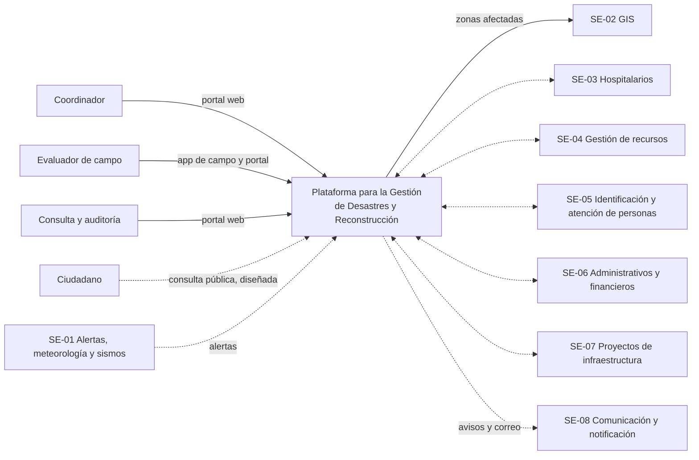
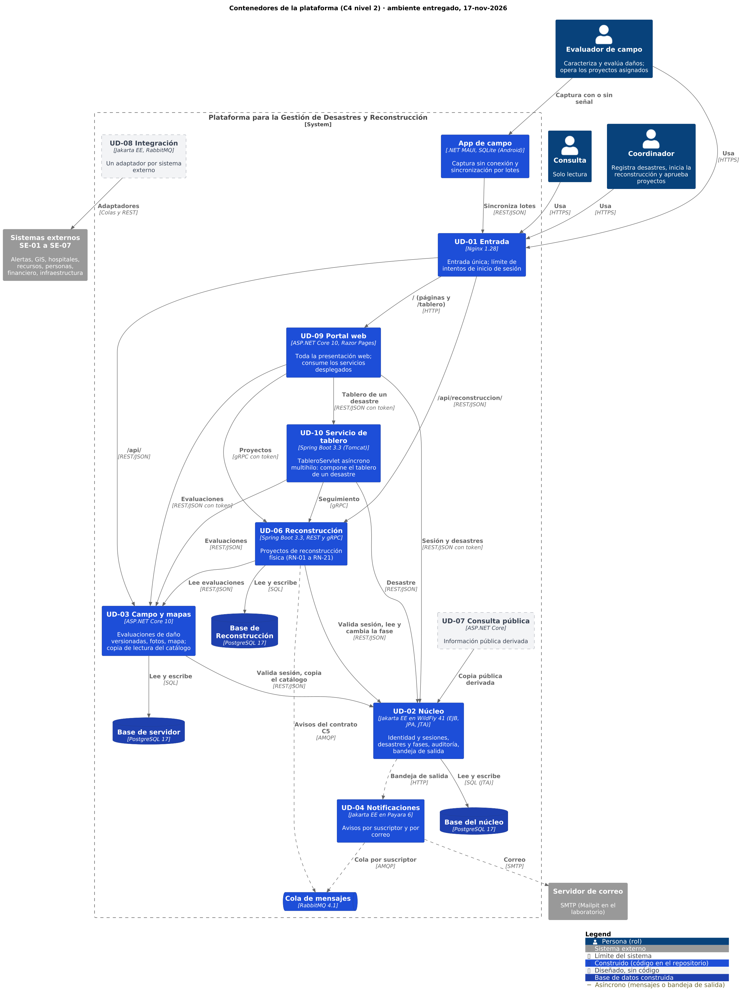
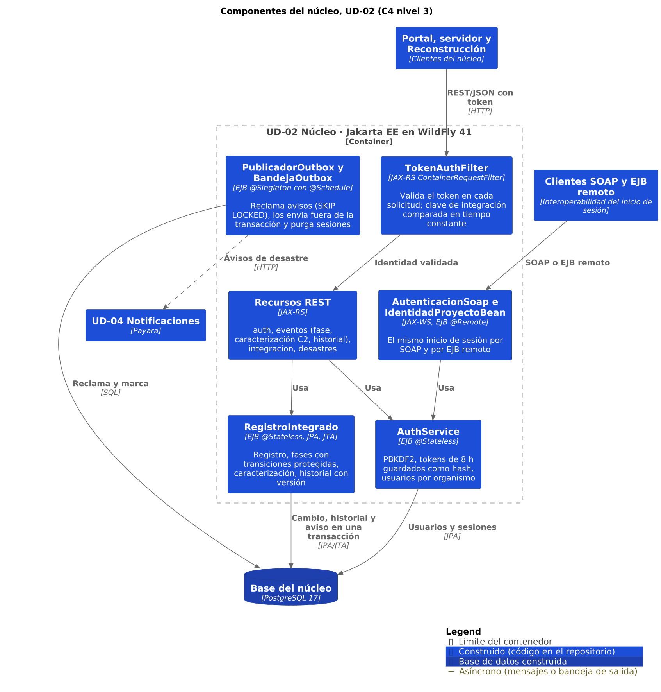
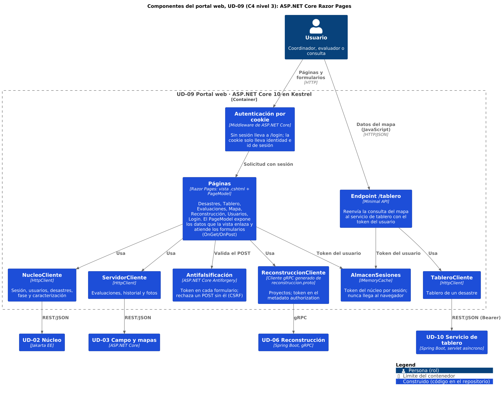
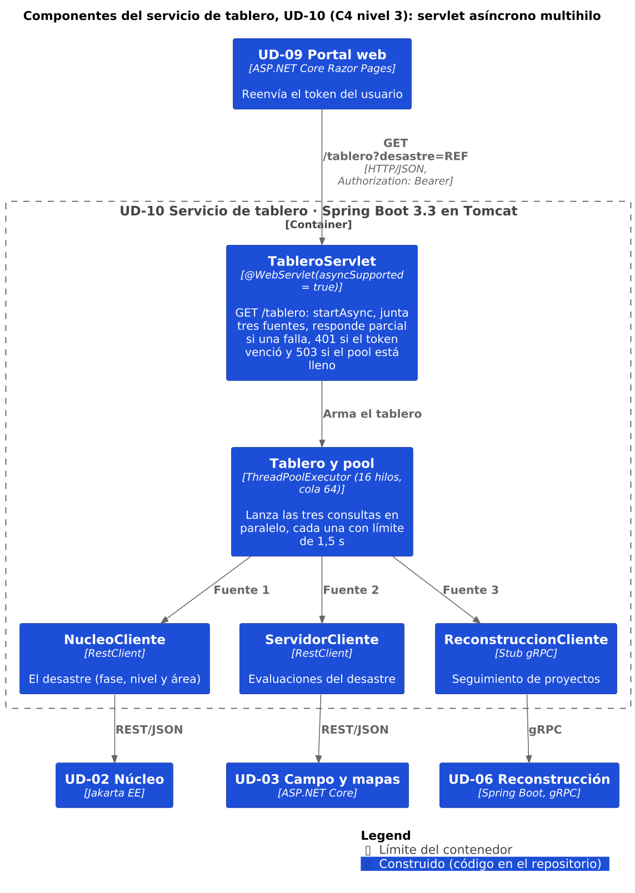
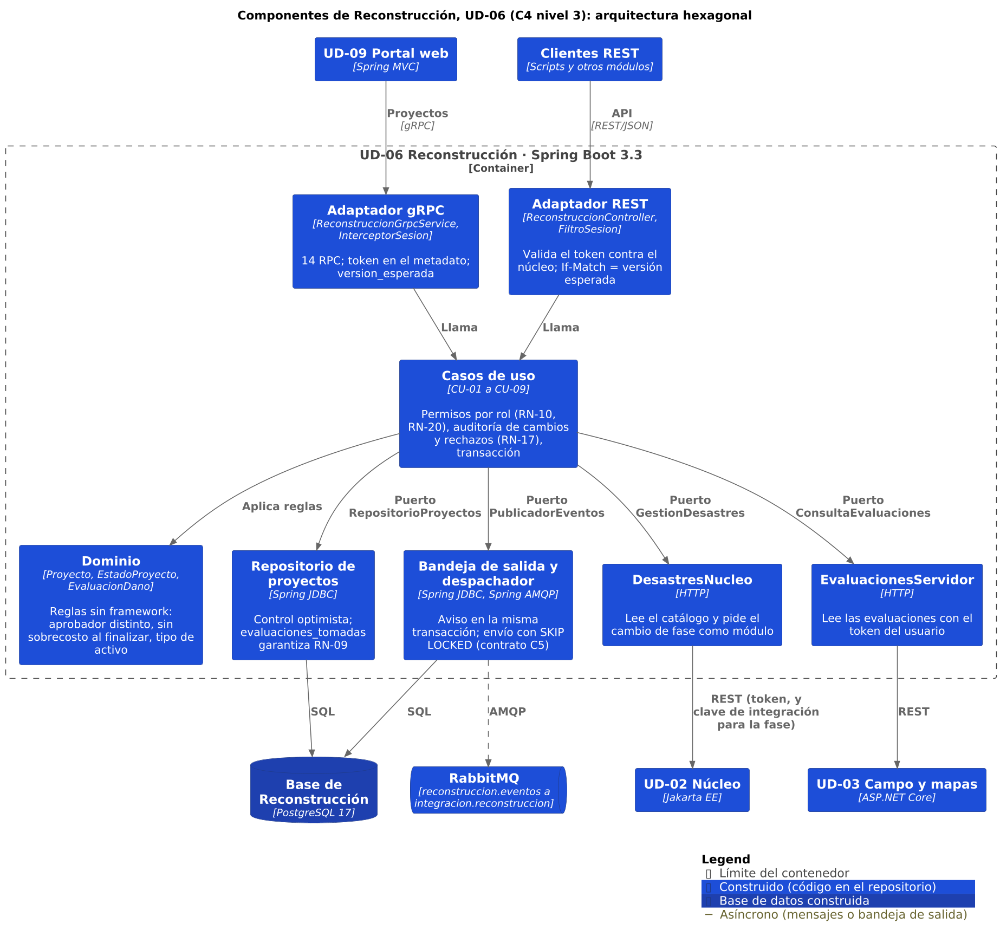
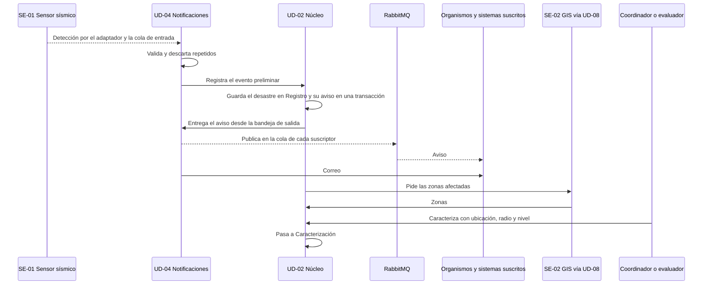
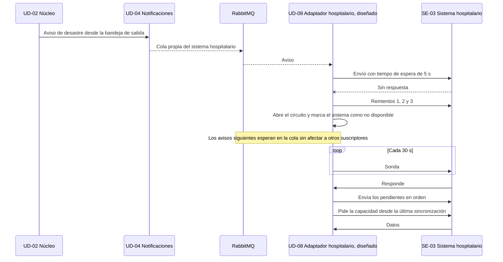
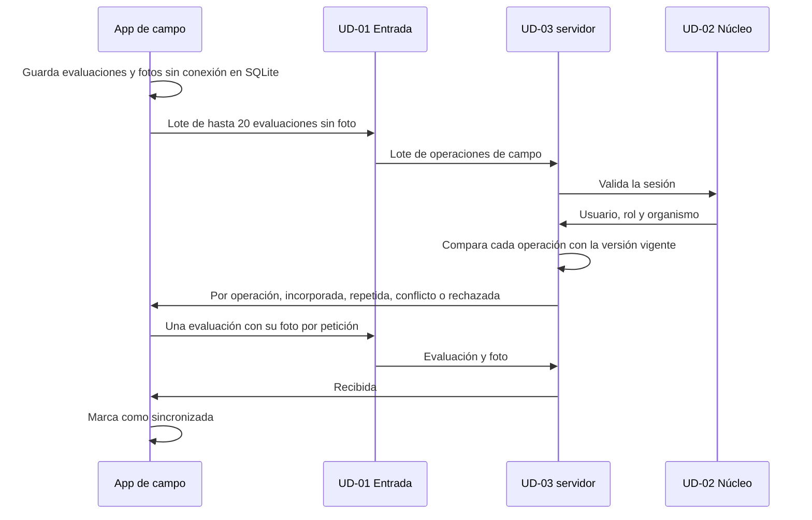
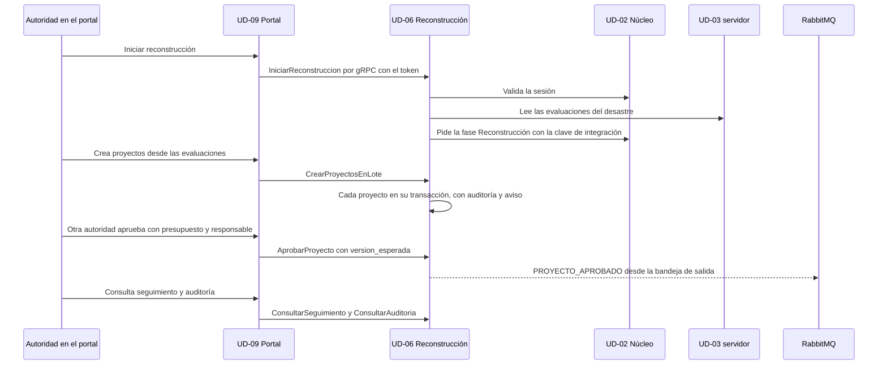

# SAD v2.2 · Plataforma para la Gestión de Desastres y Reconstrucción

**Documento de arquitectura de software, organizado según arc42**

**Versión:** 2.2 · **Fecha:** 18 de noviembre de 2026

**Equipo:** Andrés Barrios, Nicolás Parra, Thomás López, André Landinez

**Pontificia Universidad Javeriana** · Arquitectura de Software

## Introducción y metas

### Propósito y alcance

Este documento describe la arquitectura de la Plataforma para la Gestión de Desastres y Reconstrucción y justifica cada decisión con los requisitos del SRS. La plataforma reúne en un solo lugar la información que hoy está dispersa entre organismos durante una emergencia: el registro y la caracterización del desastre, la evaluación de daños hecha en campo, la coordinación entre organismos y la reconstrucción física posterior. Debe hacerlo con sistemas externos que no controla y que pueden fallar, con equipos de campo que trabajan sin señal y con picos de miles de usuarios en las primeras horas de un evento.

Esta versión entrega cuatro capacidades, además de la autenticación y la autorización que las protegen:

- **Captura en campo:** una app móvil que registra evaluaciones de daños y caracteriza el desastre sin conexión, y sincroniza sin perder ni duplicar lo capturado.
- **Evaluación de daños:** evaluaciones versionadas con su fotografía, consultables en un mapa.
- **Tablero del desastre:** un mapa que reúne el desastre, sus evaluaciones y sus proyectos de reconstrucción.
- **Reconstrucción física:** proyectos con aprobación, presupuesto, avance, evidencias y auditoría.

La gestión de personas afectadas y la de recursos y donaciones ya existen en otras entidades. La plataforma no las duplica: se integra con ellas como sistemas externos (SE-04 y SE-05, ADR-28). Quedan diseñadas, con sus contratos definidos, la coordinación de organismos, la consulta pública, la unidad de integración, el modo degradado y el despliegue en tres centros de datos.

El documento describe una sola arquitectura. Las partes **construidas** tienen código y pasan la verificación del ambiente entregado; las **diseñadas** están decididas y especificadas, pero no implementadas. Se distinguen porque las metas de disponibilidad y de escala dependen sobre todo de lo diseñado, y el lector debe saber qué está demostrado y qué no. Las vistas del modelo 4+1 se reparten así: la lógica en «Vista de bloques», la de desarrollo en «Organización del código», la de procesos en «Vista de ejecución», la física en «Vista de despliegue», y los escenarios en «Vista de ejecución» y «Requisitos de calidad». Las restricciones del SRS (CON-01 a CON-10) se explican en la sección donde condicionan el diseño.

### Metas cuantitativas

Cinco escenarios del SRS tienen importancia y dificultad altas, y son los que más condicionan la arquitectura. La tabla los resume con la decisión que provocan; el resto está en «Requisitos de calidad».

| Meta | Valor | Consecuencia en el diseño |
| --- | --- | --- |
| Disponibilidad de las funciones críticas (QA-DIS-01) | 99,95 % mensual: 21,6 minutos de caída como máximo | Lo crítico se separa de lo degradable y se replica en tres centros |
| Recuperación tras perder un centro (QA-DIS-02) | Lo crítico en 15 minutos, sin perder operaciones confirmadas | Cada cambio se confirma en dos centros antes de responder |
| Aumento repentino de usuarios (QA-ESC-01) | De 1.000 a 10.000 en 10 minutos, creciendo solo lo saturado | Unidades separadas por perfil de carga |
| Ingesta de campo (QA-ESC-02) | 500 equipos con un reporte por minuto, sin afectar la coordinación | Las evaluaciones viven en una unidad distinta del núcleo |
| Reconciliación sin conexión (QA-CNF-01) | Ningún conflicto resuelto por sobrescritura silenciosa | Cada operación viaja con identidad propia y versión base |
| Consulta frecuente y registro (QA-REN-01, QA-REN-02) | Menos de 2 s y de 3 s | Presupuesto de tiempo por tramo («Escalabilidad y rendimiento») |
| Alerta crítica (QA-REN-03) | Menos de 5 s, con hasta 10 alertas simultáneas | La alerta no espera a sistemas externos |

Una meta de tiempo se cumple cuando el percentil 95 queda dentro del tiempo, ninguna operación supera el doble y menos del 0,1 % termina con error. El promedio no sirve como criterio porque esconde las solicitudes lentas, que son las que sufre un coordinador en plena emergencia (ADR-29).

### Interesados

| Interesado | Qué espera de la arquitectura |
| --- | --- |
| Coordinadores y autoridades de los organismos | Registrar y seguir el desastre, coordinar la respuesta y aprobar proyectos con trazabilidad |
| Evaluadores de campo | Capturar sin señal y no perder ni duplicar nada al sincronizar |
| Auditores y entes de control | Saber quién hizo qué, cuándo y sobre qué dato |
| Ciudadanos | Consultar información pública aunque la plataforma esté bajo carga |
| Responsables de los sistemas externos | Contratos estables que no les exijan cambiar sus sistemas |
| Operación de la plataforma | Desplegar, verificar y recuperar con procedimientos claros |
| Equipo de desarrollo y revisores de arquitectura | Decisiones justificadas, contratos explícitos entre unidades y evidencia de lo construido |

## Contexto y alcance

### Contexto

*Figura 1. Contexto de la plataforma. Línea continua: uso o llamada inmediata. Línea punteada: mensajes en cola o canal diseñado.*

Las personas entran por dos clientes: el portal web, para la operación y el seguimiento, y la app de campo, para la captura. Los sistemas externos quedan a los lados porque la plataforma no los reemplaza ni los controla: recibe de ellos alertas y datos de referencia, y les entrega avisos y compromisos. Cada rol de la plataforma tiene un rol equivalente en Reconstrucción, porque esa capacidad aplica reglas propias de aprobación y responsabilidad.

| Actor | Rol en la plataforma | Rol en Reconstrucción | Qué hace |
| --- | --- | --- | --- |
| Coordinador | COORDINADOR | AUTORIDAD | Registra el desastre y cambia su fase y nivel; crea, aprueba y cancela proyectos; administra los usuarios de su organismo |
| Evaluador de campo | EVALUADOR | RESPONSABLE | Captura evaluaciones; caracteriza el desastre; opera el proyecto que tiene asignado |
| Consulta | CONSULTA | AUDITOR | Solo lectura, incluida la auditoría |
| Ciudadano | Sin sesión | — | Consulta pública (diseñada) |
| Sistema que no usa REST | Cuenta de la plataforma | — | Inicia sesión por SOAP o por EJB remoto |

### Sistemas externos

La plataforma no puede cambiar a los sistemas externos ni garantizar su disponibilidad (CON-01 a CON-04). Por eso cada uno sigue siendo dueño de sus datos, y la plataforma guarda una copia con su fuente y su hora: así puede seguir operando con el último dato conocido y mostrar qué tan reciente es. La columna de protección indica el tiempo de espera, los reintentos y el umbral que abre el corte de circuito.

| Sistema | Mecanismo | Qué cruza la frontera | Protección | Si no responde | Estado |
| --- | --- | --- | --- | --- | --- |
| SE-01a, b, c Alertas, meteorología, sismos | Entrada: cola, o webhook que deja el mensaje en la cola | Fenómeno, magnitud, ubicación y hora, en JSON o CAP | El emisor reintenta | La alerta siempre se recibe; lo inválido queda en cuarentena visible | Cola de entrada construida; adaptadores diseñados |
| SE-02 GIS | REST inmediato | Geometrías GeoJSON con la versión de su catálogo | 2 s; 2; 5 fallas en 30 s | El evento se registra con la última zona conocida, marcada como pendiente de actualizar; al volver el GIS se reemplaza por la vigente | Diseñado |
| SE-03 Hospitalarios | Cola diferida y consulta cada 60 s | Sale el aviso de desastre; entra la capacidad disponible, sin datos de pacientes | 5 s; 3; 3 seguidas | Se muestra la última capacidad con su hora; los avisos esperan en cola | Cola del aviso construida; adaptador diseñado |
| SE-04 Gestión de recursos | Cola diferida y consulta cada 5 min | Disponibilidad con su hora | 5 s; 3; 3 seguidas | Última disponibilidad con su hora | Diseñado |
| SE-05 Identificación y atención de personas | REST inmediato y cola | Solo identificadores; los datos de personas siguen en su sistema | 3 s; 2; 5 en 30 s | Sin efecto en las funciones críticas | Diseñado |
| SE-06 Administrativos y financieros | Cola diferida | Compromiso presupuestal (proyecto, monto, versión) y su respuesta | 10 s; 5; 3 seguidas | La operación queda En conciliación (ADR-21) | Diseñado |
| SE-07 Proyectos de infraestructura | Cola diferida | Proyectos, avances, estado y contratista | 10 s; 5; 3 seguidas | Los envíos esperan en cola | Diseñado |
| SE-08 Comunicación y notificación | Salida: cola por sistema suscrito y correo | Aviso JSON con su identificador | Reintento a los 5 s | El aviso queda pendiente hasta que el canal lo confirma | Construido |

Los valores de protección siguen la urgencia de cada intercambio. El GIS se consulta mientras un coordinador espera, por eso tiene la espera más corta y nunca bloquea el registro. Los sistemas administrativos se usan en procesos diferidos y toleran esperas y reintentos más largos. Un circuito abierto se prueba con una sonda cada 30 s y se cierra con la primera respuesta correcta.

### Modelo de integración

Los ocho tipos de sistemas externos usan formatos y mecanismos propios, no se pueden modificar y fallan por su cuenta. Si cada unidad interna hablara directamente con ellos, cada cambio de un externo obligaría a cambiar código del núcleo, y la caída de uno podría bloquear una operación crítica. Por eso toda comunicación con el exterior pasa por la unidad de integración (UD-08, diseñada), que tiene un adaptador por sistema. Las unidades internas solo conocen el modelo común de la plataforma.

Un adaptador tiene cuatro piezas, que una alerta de entrada recorre en este orden:

1. El **conector** recibe la alerta por el mecanismo del sistema emisor (webhook, cola o consulta periódica) y la deja en la cola de entrada antes de responder. Desde ese momento la alerta no se pierde, aunque la plataforma esté ocupada.
2. El **validador** revisa formato y contenido. Lo inválido pasa a cuarentena con un error explícito, nunca se descarta en silencio, y lo repetido se reconoce por fuente e identificador.
3. El **traductor** convierte el mensaje al modelo común. Es la única pieza que conoce el formato del emisor; si el emisor cambia su contrato, solo cambia el traductor (QA-INT-02).
4. La **protección** (tiempo de espera, reintentos y corte de circuito) rodea toda llamada al exterior, para que un sistema lento no retenga hilos ni conexiones de la plataforma.

Con la alerta ya traducida, el adaptador la entrega a la unidad dueña por su API habitual, por ejemplo al núcleo para crear el evento preliminar. La salida recorre el camino inverso: un cambio confirmado genera un aviso, el aviso llega a la cola propia de cada sistema suscrito, y el adaptador de ese sistema lo traduce y lo envía con su protección. Cada intercambio tiene un estado visible: Recibido, Validado, Incorporado o Rechazado con su causa en las entradas, y Aceptado o En conciliación (ADR-21) en las salidas.

El mecanismo se elige según lo que necesita quien inicia el intercambio (CON-05 y CON-06):

| Mecanismo | Cuándo se usa | Garantía |
| --- | --- | --- |
| API REST inmediata | Quien llama necesita la respuesta para continuar | Respuesta o error dentro del tiempo de espera |
| Cola diferida | El destino puede no estar disponible y lo importante es que el mensaje llegue | Al menos una vez; se guarda hasta que el destino lo acepta |
| Avisos por cola | Varios interesados deben enterarse de un cambio ya confirmado | Al menos una vez a cada suscriptor, sin que uno retrase a otro |
| Webhook de entrada | El externo avisa sin que se le pregunte | La recepción queda en cola antes de responder |

Todo mensaje lleva un identificador único y quien lo recibe descarta los repetidos, porque las colas entregan al menos una vez. Un sistema nuevo es un adaptador nuevo que se despliega solo, sin tocar los existentes (QA-EXT-01). Un sistema que solo necesita recibir avisos se suscribe por configuración, sin código nuevo; esa parte ya está construida.

## Estrategia de solución

### Estilo arquitectónico

La plataforma se organiza en servicios de grano grueso, cada uno dueño de su base de datos. Las fronteras se trazan con dos criterios. El primero es la **consistencia transaccional**: lo que debe guardarse junto, como un cambio y su auditoría, queda en la misma unidad, para resolverse con una transacción local y no con una distribuida. El segundo es el **perfil de carga**: lo que recibe picos distintos, como la ingesta de campo o la consulta ciudadana, va en unidades distintas, para crecer por separado (QA-ESC-01).

Las unidades se comunican de tres formas, según lo que necesita quien llama:

- **REST** cuando quien llama necesita la respuesta para continuar y el contrato debe ser abierto: entre .NET y Java, hacia la app y hacia los sistemas externos. Es el mecanismo por defecto, porque cualquier tecnología lo consume y se prueba con herramientas comunes.
- **gRPC** solo en el canal interno de Reconstrucción hacia el portal y el servicio de tablero. Ese canal tiene catorce operaciones con mensajes estructurados, y un contrato único compilado en Java y en .NET detecta en la compilación cualquier diferencia entre cliente y servidor (ADR-26).
- **Colas** cuando nadie espera la respuesta y lo importante es que el mensaje llegue: avisos y notificaciones, siempre publicados desde una bandeja de salida.

No se trata de dos opciones intercambiables: REST es la regla, y gRPC es la excepción para un contrato interno extenso entre servicios propios.

**Cómo se eligió el estilo.** Se compararon cuatro estilos frente a los atributos que más pesan en el árbol de calidad:

- **A. Monolito modular:** una sola aplicación desplegable con módulos internos.
- **B. Núcleo con tres satélites:** el diseño de la primera entrega, con un núcleo amplio y tres servicios a su alrededor.
- **C. Servicios por consistencia y carga:** el estilo descrito arriba.
- **D. Un servicio por componente:** microservicios finos.

Cada atributo se calificó de 1 a 5 según las propiedades conocidas de cada estilo. Los puntajes son valoraciones del equipo, no mediciones, y la tabla sirve para hacer explícito el razonamiento y sus puntos sensibles.

| Atributo (1 a 5) | A | B | C | D |
| --- | --- | --- | --- | --- |
| Disponibilidad de lo crítico | 3 | 3 | 4 | 4 |
| Escalabilidad por partes | 2 | 3 | 4 | 5 |
| Rendimiento | 5 | 4 | 4 | 3 |
| Resiliencia | 2 | 3 | 3 | 5 |
| Interoperabilidad | 3 | 4 | 4 | 4 |
| Modificabilidad | 3 | 3 | 4 | 5 |
| Integridad de los cambios | 5 | 4 | 5 | 3 |
| Simplicidad de operación | 5 | 4 | 3 | 1 |
| **Total** | **28** | **28** | **31** | **30** |

A y B pierden porque crecer solo lo saturado es una meta explícita: en ellos, atender un pico de consultas obliga a duplicar también lo que no lo necesita. D gana en escalabilidad y resiliencia, pero pierde en dos atributos decisivos. La **integridad de los cambios** importa porque la trazabilidad es obligatoria, y es más segura cuando el cambio y su registro ocurren en una sola transacción. La **simplicidad de operación** importa porque la plataforma la opera una entidad pública, no un equipo dedicado a decenas de servicios. El resultado es sensible: sin cualquiera de esas dos filas ganaría D. Se elige C porque ningún escenario exige lo que D hace mejor, que es escalar por separado una pieza pequeña del núcleo.

### Patrones

Cada patrón responde a un problema concreto que plantean los atributos de calidad. Se agrupan por el problema que resuelven.

**Consistencia y trazabilidad.** La plataforma no puede registrar un cambio sin su historial ni sin su auditoría (QA-TRZ-01), y tampoco puede perder el aviso que ese cambio debe generar (QA-REN-03). Una transacción distribuida entre la base y el gestor de colas es frágil y bloquea cuando falla el gestor. Por eso se usan dos patrones juntos. La **transacción local** guarda el cambio, su historial, su auditoría y su aviso en la base de la unidad dueña, en una sola transacción. La **bandeja de salida** (*outbox*) entrega después ese aviso a la cola: si el gestor no responde, el aviso espera y nada se pierde. Ambos están construidos en el núcleo, en servidor y en Reconstrucción.

**Integración y mensajería.** El **adaptador por sistema externo** (capa anticorrupción) aísla los formatos ajenos («Modelo de integración»). El patrón **publicar y suscribir con una cola por suscriptor** hace que un sistema caído acumule sus propios avisos sin retrasar a los demás. La cola de reintento y la de errores evitan que un mensaje defectuoso bloquee la cola.

**Acceso y presentación.** La **entrada única** (Nginx) es el único punto expuesto. Enruta hacia las unidades, limita el tamaño de las solicitudes y los intentos de inicio de sesión, y oculta la topología interna. La **fachada de API** da a la app una sola API: servidor delega la sesión y los desastres en el núcleo, de modo que la app no cambia si cambian las unidades internas. Esto importa porque las apps instaladas en campo se actualizan con lentitud.

En el portal se usa **MVVM** (modelo, vista y modelo de vista). La vista solo muestra y enlaza datos; el modelo de vista expone esos datos y atiende las acciones del usuario; el modelo es la información de los servicios dueños. La organización exige que toda interfaz de usuario se construya en .NET con un patrón que separe la vista de la lógica de presentación. En ASP.NET Core Razor Pages, cada página tiene una vista Razor y un PageModel que cumple el papel de modelo de vista. Así se elige MVVM del lado del servidor (ADR-23). Frente a MVC, evita un controlador común para pantallas que son formularios independientes. Frente a una aplicación de una sola página, el token de la sesión nunca llega al navegador.

**Rendimiento y aislamiento de fallas.** La **composición de API** arma el tablero del desastre consultando en paralelo a sus tres dueños con un pool de hilos acotado. Tarda lo que la fuente más lenta, no la suma de las tres, y si una falla responde con las demás (ADR-24). La **copia de lectura derivada** permite consultar datos de otra unidad sin leer su base: servidor guarda una copia del catálogo de desastres, y la consulta pública tendrá la suya. La arquitectura **hexagonal** (puertos y adaptadores) separa las reglas de Reconstrucción de los frameworks. Las reglas RN-01 a RN-21 se prueban sin base de datos y los mismos casos de uso atienden REST y gRPC.

### Tecnologías

La organización exige que toda interfaz de usuario se construya en .NET (CON-10) y dispone de experiencia en Jakarta EE, Spring Boot, PostgreSQL y RabbitMQ (CON-07). Dentro de esos límites, cada unidad usa la tecnología que mejor resuelve su necesidad principal:

- **Núcleo en Jakarta EE (WildFly):** su operación central guarda el desastre, su historial, su auditoría y su aviso juntos, y las transacciones administradas por el contenedor (JTA) lo garantizan sin código propio. Ofrece además SOAP y EJB remoto con las mismas cuentas, para los sistemas que no usan REST (CON-02).
- **Reconstrucción y servicio de tablero en Spring Boot:** son servicios aparte, con su propio servidor embebido, que exponen REST y gRPC con poca configuración. Usan el mismo lenguaje que el núcleo, así que el equipo comparte conocimiento y bibliotecas. El tablero necesita un servlet asíncrono con su propio pool de hilos, y Tomcat lo da directamente.
- **Notificaciones en Jakarta EE (Payara):** se reutiliza un componente existente y probado, con temporizadores y consumo de colas, en lugar de reescribirlo.
- **Portal y servidor en ASP.NET Core:** el portal cumple la restricción de presentación en .NET. servidor usa la misma plataforma que la app móvil, de modo que comparten los modelos de datos y los contratos de sincronización: la parte más delicada de la operación sin conexión se escribe una sola vez.
- **App de campo en .NET MAUI con SQLite:** es una app nativa que accede a la cámara, al GPS y al almacenamiento sin conexión. SQLite es una base transaccional embebida, que no pierde capturas si la app se cierra a mitad de una operación.
- **PostgreSQL** en cada unidad: transacciones confiables, bloqueo por fila y la lectura que salta filas ya tomadas, con la que varias instancias reparten la bandeja de salida sin publicar dos veces.
- **RabbitMQ:** colas durables, una por suscriptor, con reintento y cola de errores, y clientes estándar en Java y en .NET.
- **Nginx:** proxy inverso maduro que limita la tasa y el tamaño de las solicitudes sin desarrollo propio.

### Referente: Sahana Eden

Sahana Eden, la plataforma abierta de gestión de desastres analizada en el SRS, sirve de referente. De ella se toman cuatro ideas probadas en emergencias reales: la plataforma web como punto común entre organismos, la configuración por catálogos, la información geográfica como eje transversal y el control de acceso por organización. No se toman su unidad única de despliegue ni su base compartida, porque impiden escalar y proteger lo crítico por separado, que son metas centrales de esta plataforma.

## Vista de bloques

### Contenedores (C4 nivel 2)

*Figura 2. Contenedores de la plataforma (C4 nivel 2). Azul: construido. Gris punteado: diseñado.*

La figura se lee de arriba abajo. Arriba están las personas y sus dos clientes, el navegador y la app de campo. Todo el tráfico entra por la entrada única y de allí va al portal, a servidor o a Reconstrucción. En el centro están las unidades de negocio, cada una con su base. A la derecha y abajo están la mensajería y las notificaciones, que reciben los avisos de las bandejas de salida. En gris quedan la consulta pública y la unidad de integración.

| ID | Unidad | Tecnología | Responsabilidad | Datos propios | Criticidad | Estado |
| --- | --- | --- | --- | --- | --- | --- |
| UD-01 | Entrada | Nginx 1.28 | Acceso único; enruta y limita tamaño e intentos de inicio de sesión | Ninguno | Crítica | Construida |
| UD-02 | Núcleo | Java 21, Jakarta EE, WildFly 41 | Identidad y sesiones; gestión de desastres; auditoría; bandeja de salida | Base propia | Crítica | Construida; delimitación, consolidación y coordinación diseñadas |
| UD-03 | Campo y mapas (servidor) | ASP.NET Core 10 | Evaluaciones, fotos, mapa, copia del catálogo de desastres y API de la app | Base propia | Crítica | Construida; validación y duplicados diseñados |
| UD-04 | Notificaciones | Java 17, Jakarta EE, Payara 6 | Cola por suscriptor, correo, registro de entregas y entrada de alertas | Registro de entregas | Crítica | Construida |
| UD-06 | Reconstrucción | Java 17, Spring Boot 3.3 | Proyectos de reconstrucción física (RN-01 a RN-21) | Base propia | Degradable | Construida |
| UD-07 | Consulta pública | ASP.NET Core | Copia pública de solo lectura | Copia derivada | Degradable | Diseñada |
| UD-08 | Integración | Jakarta EE, RabbitMQ | Un adaptador por sistema externo | Intercambios pendientes | Según el adaptador | Diseñada |
| UD-09 | Portal web | ASP.NET Core 10, Razor Pages | Única interfaz web | Sesiones en memoria | Crítica | Construida |
| UD-10 | Servicio de tablero | Java 21, Spring Boot 3.3 | Tablero de un desastre con un servlet asíncrono | Ninguno | Degradable | Construida |
| — | App de campo | .NET MAUI, SQLite | Captura sin conexión y sincronización | Capturas del usuario | Crítica | Construida |
| INF-01 | Mensajería | RabbitMQ 4.1 | Colas durables | Mensajes en tránsito | Crítica | Construida, un nodo |
| INF-02 | Monitoreo | Sondas y métricas | Detectar fallas y saturación | Métricas | Crítica | Solo sondas de salud |

La criticidad sigue la clasificación del SRS. Una función es **crítica** si su ausencia hace perder información operativa o detiene la respuesta inmediata: recibir alertas, registrar el desastre, notificar, sincronizar evaluaciones, coordinar, consultar el estado y autenticar. Es **esencial** si se necesita durante la emergencia pero tolera una espera breve: validar evaluaciones, consolidar duplicados y consultar el mapa de daños. Es **degradable** si puede suspenderse para liberar capacidad: fotografías, consulta pública, reconstrucción y consultas históricas. UD-05, la unidad de personas afectadas, se retiró al tratar ese dominio como sistema externo (ADR-28); su identificador no se reutiliza.

**Por qué estas unidades.** Cada frontera responde a una razón de consistencia o de carga:

- **El núcleo reúne tres responsabilidades que cambian juntas.** La *identidad* (usuarios, organismos, roles y sesiones) dice quién actúa y con qué permisos. La *gestión de desastres* registra el desastre y cambia su nivel, su fase y su caracterización. La *auditoría* deja constancia de cada cambio. Una sola operación, como reclasificar un desastre, necesita las tres: comprobar el rol y el organismo de quien la pide, cambiar el desastre, guardar el historial y el registro de auditoría, y dejar el aviso para los organismos. Si estuvieran en unidades distintas, la operación necesitaría una transacción distribuida o podría quedar un cambio sin auditoría.
- **Las evaluaciones van aparte** porque reciben la escritura de 500 equipos de campo, con fotos y ráfagas al reconectar (QA-ESC-02). Separadas, esa carga crece sola y no le quita capacidad al registro de desastres. La foto va con su evaluación (ADR-13).
- **Las notificaciones van aparte** para que registrar un desastre no dependa del correo ni del gestor de colas: el núcleo confirma el registro y el aviso sale después.
- **Reconstrucción va aparte** porque opera durante meses después de la emergencia, tiene reglas propias y es degradable. Su falla no debe tocar lo crítico.
- **El portal y el servicio de tablero van aparte** porque no guardan datos de negocio: consultan a cada dueño y crecen con el número de usuarios.

**Propiedad de los datos.** Cada unidad es dueña de su base y ninguna lee la base de otra. La regla tiene cuatro razones:

- Cada unidad puede cambiar su esquema sin coordinar con las demás.
- Una consulta pesada en una unidad no bloquea las tablas de otra.
- Una credencial comprometida solo expone los datos de su unidad.
- Cada base se replica y crece según su propia carga.

Cuando una unidad necesita datos de otra, los pide por su API o mantiene una copia de lectura alimentada por avisos. Por ejemplo, servidor guarda una copia del catálogo de desastres para vincular evaluaciones sin consultar al núcleo en cada captura. Esa copia puede ir unos segundos atrás. Se acepta porque una evaluación de un desastre recién creado queda preliminar y se vincula sola cuando llega la copia, sin perder nada (ADR-03).

El núcleo y servidor conservan una funcionalidad de solicitudes de recursos anterior a la definición del alcance. No está expuesta en el portal y se retirará, porque la gestión de recursos es un sistema externo («Riesgos y deuda técnica»).

### Componentes (C4 nivel 3)

#### Núcleo (UD-02)

*Figura 3. Componentes del núcleo (C4 nivel 3).*

El núcleo tiene dos tipos de clientes: las unidades internas, que usan REST con el token del usuario, y los sistemas que no usan REST, que inician sesión por SOAP o EJB remoto. Toda solicitud REST pasa primero por el **filtro de autenticación**. El filtro valida el token contra las sesiones guardadas y, en las rutas internas, compara la clave de integración en tiempo constante, para que el tiempo de respuesta no revele cuántos caracteres acertó un atacante. Solo con la identidad validada la solicitud llega a los **recursos REST**, que exponen la sesión, los desastres con su fase, su caracterización y su historial, y el catálogo interno.

Los recursos delegan en dos servicios. El **servicio de identidad** guarda las contraseñas con PBKDF2 y emite tokens de 8 horas, de los que guarda solo el hash. Lo usan por igual REST, SOAP y EJB remoto, de modo que hay una sola fuente de usuarios y una revocación surte efecto en todos los canales. El **registro integrado** aplica las reglas del desastre: registro, transiciones de fase protegidas, caracterización y nivel. Cada cambio, su historial, su auditoría y su aviso se guardan en una transacción JTA, la razón por la que el núcleo usa Jakarta EE. Fuera de esa transacción, el **publicador de la bandeja de salida** reclama los avisos pendientes cada segundo y los entrega a notificaciones. Lo hace fuera de la transacción para que una falla de notificaciones nunca deshaga un registro. El mismo publicador purga las sesiones vencidas.

#### Portal web (UD-09)

*Figura 4. Componentes del portal web (C4 nivel 3).*

El portal es la única interfaz web y no tiene lógica de negocio: cada pantalla es una página Razor con su PageModel, que consulta a los dueños de los datos por clientes dedicados. Usa REST para el núcleo, servidor y el servicio de tablero, y gRPC para Reconstrucción. Las pantallas cubren:

- el inicio de sesión;
- los desastres, con su registro, su caracterización, el cambio de fase y el historial;
- el tablero con el mapa;
- las evaluaciones con su historial y su foto;
- la reconstrucción completa;
- los usuarios del organismo.

El portal también protege la sesión. La cookie del navegador solo lleva la identidad y un identificador de sesión, y el token del núcleo se queda en la memoria del portal: así, un script malicioso en el navegador no puede robar el token. Cada formulario lleva un token antifalsificación contra solicitudes forjadas desde otro sitio. Los botones se muestran según el rol, pero esa es solo una ayuda de usabilidad: cada servicio vuelve a validar los permisos, porque una solicitud puede construirse sin pasar por la pantalla.

#### Servicio de tablero (UD-10)

*Figura 5. Componentes del servicio de tablero (C4 nivel 3): servlet asíncrono multihilo.*

No tiene interfaz y solo lo llama el portal, con el token del usuario. El servlet libera el hilo del servidor web y reparte las tres consultas en un pool acotado. Cada fuente valida el token contra el núcleo; si alguna responde que venció, el servlet responde lo mismo y el portal cierra la sesión («Tablero de un desastre (servlet multihilo)»).

#### Reconstrucción (UD-06)

*Figura 6. Componentes de Reconstrucción (C4 nivel 3): arquitectura hexagonal.*

Reconstrucción tiene las reglas de negocio más numerosas de la plataforma (RN-01 a RN-21) y dos canales de entrada. La arquitectura hexagonal pone las reglas en el centro, sin dependencia de frameworks:

- **Entrada:** REST y gRPC. Ambos validan el token contra el núcleo y reciben la versión que el cliente espera modificar.
- **Casos de uso (CU-01 a CU-09):** autorizan por rol y organismo, abren la transacción y auditan tanto los cambios como los intentos rechazados (RN-17).
- **Dominio:** el proyecto, sus estados y los del desastre, y la evaluación de daño. No conoce Spring, gRPC ni la base de datos, y por eso sus reglas se prueban en memoria con rapidez (E7).
- **Salida:** el repositorio con control optimista de versiones, la bandeja de salida hacia la mensajería, y los adaptadores hacia el núcleo (catálogo y cambio de fase) y hacia servidor (evaluaciones, con el token del usuario).

Así, agregar un canal o cambiar la base toca un adaptador y no las reglas. En servidor (UD-03) los componentes son la fachada de API de la app, la recepción de lotes inmediata o diferida (ADR-18), las evaluaciones versionadas, los mapas y la copia del catálogo de desastres.

### Reglas de dominio por capacidad

#### Gestión de desastres (núcleo)

El registro guarda el identificador que genera el cliente, el tipo, la fecha, la ubicación, el nivel de 1 a 4, la descripción, el organismo, la fase y la versión. El organismo sale de la sesión y no de lo que envía el cliente, para que nadie registre a nombre de otro organismo. La caracterización agrega el punto y el radio del área afectada. El identificador del cliente permite reenviar el registro sin duplicarlo cuando la red falla después de guardar.

**Fases.** Un desastre pasa por cuatro fases: Registro, Caracterización, Reconstrucción y Cierre. Estados como «Detectado», «En atención» o «En recuperación» describen situaciones dentro de esas fases, no transiciones del sistema. Las transiciones están protegidas porque cada una habilita acciones con consecuencias: iniciar la reconstrucción compromete presupuesto, y cerrar congela el registro.

| Transición | Quién la pide | Condición | Por qué |
| --- | --- | --- | --- |
| Registro → Caracterización | El coordinador, o automática con la primera caracterización | — | Caracterizar es la evidencia de que el evento es real y tiene área |
| Caracterización → Reconstrucción | Solo Reconstrucción, con el token del usuario y la clave de integración | Al menos una evaluación validada con daño moderado o superior (RN-01, RN-02) | No se compromete presupuesto sin daño evaluado; la regla la conoce Reconstrucción y no el núcleo |
| Reconstrucción → Cierre | Solo Reconstrucción | Ningún proyecto sin finalizar ni cancelar (RN-04) | Cerrar con obras abiertas dejaría proyectos sin desastre vigente |
| Registro o Caracterización → Cierre | El coordinador, con motivo (RN-03) | — | Permite cerrar una falsa alarma sin pasar por reconstrucción |
| Desde Cierre | Nadie | Fase terminal (RN-05) | Un desastre cerrado es un registro histórico y no se reabre |

Todo cambio de fase exige un motivo y guarda la versión, el valor anterior, el nuevo y el autor, porque las decisiones sobre un desastre deben poder explicarse después (QA-TRZ-01). Si un coordinador intenta por la API una transición reservada a Reconstrucción, el núcleo la rechaza.

**Caracterización (contrato C2).** Recibe latitud, longitud, radio en kilómetros (hasta 500), nivel opcional, descripción, la versión base y una clave de idempotencia. La app la envía desde campo, a veces horas después y varias veces por una red intermitente. Por eso repetir la clave devuelve el mismo resultado sin aplicarlo dos veces. Si alguien cambió el desastre entretanto, una versión vieja recibe un conflicto con la versión actual, en lugar de sobrescribir el cambio ajeno. La caracterización queda en el historial y, si cambia el nivel, avisa a los organismos. El nivel del desastre (1 a 4) no es el nivel de afectación de una evaluación (1 a 5): uno clasifica el evento y el otro, un activo dañado.

#### Evaluación de daños (servidor y app)

| Aspecto | Construido | Diseñado | Por qué |
| --- | --- | --- | --- |
| Datos | Identificador del dispositivo, desastre, evaluador y organismo de la sesión, ubicación, tipo de activo del catálogo (C1) y en texto, nivel de afectación 1 a 5, descripción, foto y versión | — | El identificador del dispositivo permite crear la evaluación sin conexión; el organismo sale de la sesión |
| Estados | Preliminar (sin desastre vinculado) y Registrada | Validada por un coordinador distinto del evaluador, Devuelta y Duplicada | Una evaluación puede capturarse antes de que el desastre exista en la plataforma; la validación por otra persona evita que alguien apruebe su propio reporte |
| Evidencias | Una foto JPEG o PNG de hasta 5 MB; correcciones con historial que no tocan la captura original | Documentos PDF; hasta cinco evidencias | El límite cuida el ancho de banda de campo; el original se conserva como prueba |
| Uso | Mapa de calor y panorama | Estimación de costo y prioridad por zona | El mapa orienta la respuesta; la estimación es degradable |

Mientras la validación no esté construida, Reconstrucción toma como validada una evaluación vinculada a un desastre registrado. Es una simplificación declarada en «Riesgos y deuda técnica».

#### Reconstrucción física (UD-06)

| Transición del proyecto | Quién | Condición | Por qué |
| --- | --- | --- | --- |
| Propuesto → Aprobado | Una autoridad distinta de quien lo formuló (RN-20) | Presupuesto mayor que cero, financiación y responsable (RN-11, RN-12) | Nadie aprueba el gasto que propuso; control contra el fraude |
| Aprobado → En ejecución | El responsable asignado (RN-21) | Contratista y cronograma (RN-11) | La obra empieza cuando hay quién la ejecuta y cuándo |
| En ejecución ↔ Suspendido | Autoridad o responsable asignado | Motivo (RN-16) | Una suspensión debe explicarse ante los entes de control |
| En ejecución → Finalizado | Autoridad o responsable asignado | Avance del 100 %, al menos una evidencia y sin sobrecosto (RN-15) | No se da por terminada una obra sin prueba ni con el presupuesto excedido |
| No terminal → Cancelado | Solo la autoridad (RN-21) | Motivo; sus evaluaciones quedan libres | Las evaluaciones liberadas pueden originar otro proyecto |

Finalizado y Cancelado son terminales (RN-16), para que el historial de un proyecto cerrado no cambie. Un proyecto nace cuando el desastre está en Reconstrucción (RN-06), a partir de evaluaciones del mismo desastre y organismo que no estén en otro proyecto (RN-07). Si hubo destrucción total, es de reconstrucción y no de reparación (RN-08). Una evaluación origina a lo sumo un proyecto no cancelado, y lo garantiza una restricción de unicidad en la base, que también resuelve dos solicitudes simultáneas (RN-09). Cada organismo ve solo sus proyectos (RN-10).

Solo la autoridad modifica el presupuesto, y siempre con motivo (RN-12). El avance solo baja como corrección con motivo (RN-13). El sobrecosto se marca y se avisa, pero no bloquea el registro del costo (RN-14): impedir que se anote un gasto real ocultaría el problema en vez de mostrarlo. Al crear el proyecto se copian sus evaluaciones de origen, para que conserve la evidencia que lo justificó aunque después alguien corrija la evaluación. El compromiso presupuestal ante el sistema financiero (SE-06) queda diseñado (ADR-21).

#### Capacidades diseñadas sin código

Esta versión priorizó las cuatro capacidades del alcance. Quedan diseñadas, con sus decisiones tomadas para que se incorporen sin cambiar los contratos existentes:

- la coordinación de organismos, con participación por desastre y tareas con estados (ADR-19);
- los catálogos configurables de tipos de desastre y organismos, hoy listas fijas (ADR-08);
- la consulta pública, que solo mostrará lo publicable;
- la delimitación del área con dos fechas por versión (ADR-06);
- la consolidación de reportes duplicados con alias (ADR-05).

### Organización del código

Todas las unidades siguen las mismas capas, con dependencias que solo apuntan hacia adentro, para que las reglas de negocio no dependan de la tecnología de entrada ni de la base:

| Capa | Contiene | Depende de |
| --- | --- | --- |
| Dominio | Entidades y reglas | Nada |
| Casos de uso | Una operación por intención de negocio | Dominio |
| Adaptadores | Controladores REST y gRPC, mensajería, repositorios | Casos de uso |
| Infraestructura | Base de datos, colas, red, configuración | Adaptadores |

Cada unidad tiene su propio módulo de código y su propio contenedor. Ninguna importa código de otra: se comunican solo por contratos REST, gRPC y de eventos («APIs y eventos»). Así, cada una se compila, se prueba y se despliega por separado. El contrato gRPC se copia en el portal y en el tablero, y una prueba comprueba que las copias son idénticas a la de Reconstrucción.

## Vista de ejecución

Esta sección recorre los cinco escenarios de operación que más exigen a la arquitectura, el tablero multihilo y la sincronización sin conexión. En los diagramas, la flecha continua es una llamada inmediata, y la punteada, un mensaje en cola o una respuesta diferida.

### Escenario A: inicio de una emergencia

*Figura 7. Escenario A: inicio de una emergencia.*

Un sensor detecta un sismo y la alerta entra por su adaptador a la cola de entrada, donde queda a salvo aunque la plataforma esté ocupada. Notificaciones la valida, descarta repetidos y pide al núcleo el registro del evento preliminar. El núcleo guarda el desastre y su aviso en una sola transacción. Después, la bandeja de salida entrega el aviso a notificaciones, que lo publica en la cola de cada organismo suscrito y envía el correo. Mientras tanto, el núcleo pide al GIS las zonas afectadas, y un coordinador o evaluador caracteriza el desastre, que pasa a Caracterización.

La decisión clave es que **la alerta no espera al GIS**: avisar a los organismos es crítico y debe ocurrir en menos de 5 s (QA-REN-03), mientras que la zona exacta puede llegar después. Por eso el aviso sale de la bandeja de salida y no de una cadena de llamadas.

**Qué está construido y por qué el resto está diseñado.** Está construido lo que determina la calidad del escenario: el registro con su aviso en una transacción, la bandeja de salida, la cola por suscriptor, el correo, la caracterización y el cambio de fase. Los adaptadores de SE-01 y SE-02 y el registro automático del evento preliminar están diseñados, porque las redes de sensores y el GIS son sistemas de otras entidades que no están disponibles para integrarlos en esta versión. La cola de entrada ya existe, así que agregar esos adaptadores no cambia el flujo.

| Tramo de la alerta | Presupuesto |
| --- | --- |
| Guardar el evento y su aviso, con réplica en otro centro | 0,8 s |
| Espera en la bandeja de salida (ciclo de 1 s) | 1,0 s |
| Entrega a notificaciones y publicación | 0,4 s |
| Consumo, cola de cada suscriptor y correo | 1,5 s |
| Margen | 1,3 s |
| **Total (QA-REN-03)** | **5,0 s** |

Con avisos aislados, la alerta tardó 2,7 s y 3,2 s, con un ciclo de bandeja de 5 s que hoy es de 1 s. El consumidor procesa hasta 20 mensajes por cola en cada ciclo, para atender las 10 alertas simultáneas de la meta (ADR-27). Esa simultaneidad aún no está medida.

| Situación | Qué hace la plataforma | Por qué |
| --- | --- | --- |
| Mensaje inválido o repetido | Lo inválido va a la cola de errores; lo repetido se descarta por fuente e identificador | Un sensor puede reenviar la misma alerta, y un mensaje defectuoso no debe bloquear a los demás |
| El núcleo no responde al registrar | El mensaje vuelve a su cola de reintento cada 5 s | La alerta no se pierde y se registra en cuanto el núcleo vuelve |
| El GIS no responde | El evento se crea con la última zona conocida, pendiente de actualizar | La zona no es necesaria para alertar |
| Notificaciones o RabbitMQ no responden | El aviso espera en la bandeja de salida | El registro ya está confirmado; el aviso sale al recuperarse (verificado deteniendo RabbitMQ) |

### Escenario B: aumento repentino de usuarios

Al inicio de una emergencia, los usuarios pasan de 1.000 a 10.000 en diez minutos, la mayoría ciudadanos que consultan. La arquitectura separa esas consultas del trabajo de los funcionarios. Los ciudadanos usarán la consulta pública, que lee su propia copia desde caché, con límite de tasa, y nunca llama al núcleo. Los funcionarios usan el portal y la app, que sí llegan a las unidades de negocio. Cada unidad crece por separado cuando su métrica lo pide («Escalabilidad y rendimiento»), así que un pico ciudadano agrega instancias de la consulta pública y no del núcleo.

| Situación | Qué hace la plataforma | Por qué |
| --- | --- | --- |
| Las consultas ciudadanas superan el límite | La entrada responde 429 y los funcionarios siguen por sus rutas | El exceso ciudadano no consume la capacidad de la operación |
| Una unidad pasa del 60 % de uso sostenido | Se agregan instancias solo de esa unidad | Crecer antes de saturarse da margen al tiempo de arranque |
| La carga supera la capacidad | Se degrada en el orden de «Resiliencia y recuperación» | Lo degradable cede capacidad a lo crítico |
| El núcleo no responde | Se rechazan las operaciones protegidas; la consulta pública sigue | La consulta pública no depende de la sesión |

El tablero, la consulta más compuesta, acota sus hilos: con el pool lleno responde 503 en lugar de cargar más a los servicios de atrás. Con 20 clientes simultáneos respondió con un percentil 95 de 366 ms en una sola máquina (E2). No hay prueba con 10.000 usuarios.

### Escenario C: falla de un sistema externo

*Figura 8. Escenario C: falla del sistema hospitalario.*

El aviso de un desastre llega a la cola propia del sistema hospitalario. El adaptador intenta enviarlo con un tiempo de espera de 5 s y tres reintentos. Si el hospital sigue sin responder, abre el circuito: deja de llamarlo, lo marca como no disponible y lo prueba con una sonda cada 30 s. Mientras tanto, los avisos siguientes esperan en su cola. Cuando el hospital responde, el adaptador envía los pendientes en orden y pide la capacidad hospitalaria desde la última sincronización.

La falla queda contenida porque **ninguna unidad interna llama al hospital**: solo su adaptador lo hace, y lo hace desde una cola propia. Los demás suscriptores y las funciones críticas siguen trabajando (QA-RES-01). Tras una caída de horas, los pendientes salen por lotes, primero lo más reciente; los datos viejos se muestran con su hora; y una operación sin respuesta en el plazo queda En conciliación, sin darse por hecha ni por rechazada (ADR-21).

**Qué está construido y por qué el resto está diseñado.** Está construido el mecanismo que aísla la falla: cada sistema suscrito tiene su cola durable, y si deja de consumir, sus avisos esperan sin afectar a los demás. El adaptador con corte de circuito y la consulta de capacidad están diseñados, porque el sistema hospitalario es de otra entidad y no hay una instancia disponible para integrarlo. Cuando se construya, el adaptador se conectará a la cola existente sin cambiar al núcleo ni a notificaciones.

### Escenario D: evaluación distribuida y sincronización sin conexión

*Figura 9. Escenario D: sincronización de evaluaciones de campo.*

El evaluador captura sin señal y la app guarda cada evaluación y su foto en SQLite. Al recuperar conexión, la app envía primero lotes de hasta 20 evaluaciones sin foto. servidor valida la sesión con el núcleo y compara cada operación con la versión vigente, y responde por operación si quedó incorporada, repetida, en conflicto o rechazada. Después la app envía cada foto con su evaluación, una por petición, y marca como sincronizado lo que servidor confirma. Las fotos van después porque una foto pesada en una red débil no debe retrasar los datos que la coordinación necesita para decidir (QA-ESC-02). Evaluador y organismo salen siempre de la sesión, nunca de lo que envía la app.

El tiempo de confirmación no está medido en campo. Se estima en unos 8 s para subir una foto de 1 MB a 1 Mbps, más 1,8 s para confirmar, frente a la meta de 10 minutos. Hoy la app sincroniza cada 8 s mientras la pantalla de captura está abierta.

| Situación | Qué hace la plataforma | Por qué |
| --- | --- | --- |
| Se corta el envío de una evaluación con foto, o se reenvía un lote | Nada queda a medias; lo repetido responde «repetida» y no se duplica | Cada operación lleva un identificador generado en el dispositivo, así que reenviar es seguro |
| Otra persona corrigió antes la misma evaluación | Conflicto: se conservan la propuesta y el dato vigente, y decide el evaluador | Ninguna versión sobrescribe a otra en silencio (QA-CNF-01) |
| La sesión venció | La app avisa, conserva los pendientes y no reintenta hasta un nuevo inicio de sesión | Un evaluador puede pasar más de un turno sin señal; confundir sesión vencida con falta de red retrasaría los envíos sin aviso |
| El núcleo no responde | servidor rechaza el lote; la app sigue capturando y reintenta después | Sin validar la sesión no se acepta nada; lo capturado sigue a salvo en el dispositivo |
| El desastre aún no está en la copia de servidor | La evaluación queda preliminar y se vincula sola cuando llega la copia | La consistencia eventual de segundos no hace perder capturas |
| La carga supera la capacidad | El lote se recibe y se incorpora en diferido (ADR-18) | Recibir rápido protege al dispositivo; incorporar después protege a servidor |

### Escenario E: reconstrucción

*Figura 10. Escenario E: reconstrucción física.*

Una autoridad inicia la reconstrucción desde el portal. Reconstrucción valida la sesión, lee las evaluaciones del desastre en servidor y, si se cumplen las reglas, pide al núcleo la fase Reconstrucción. Luego la autoridad crea proyectos a partir de las evaluaciones, cada uno en su propia transacción, para que un proyecto inválido no impida crear los demás. Otra autoridad aprueba con presupuesto y responsable, y el aviso sale por la bandeja de salida. Finalmente se consultan el seguimiento y la auditoría.

Las fallas se tratan así. Si servidor no responde, no se crea el proyecto y se reintenta con el mismo identificador. Si dos personas cambian el proyecto a la vez, la segunda recibe un conflicto de versión. Si la mensajería no responde, el aviso espera en la bandeja de salida. Un compromiso sin respuesta del sistema financiero quedaría En conciliación (ADR-21, diseñado). La verificación de punta a punta de Reconstrucción comprueba, entre otros casos, que nadie aprueba su propio proyecto, el sobrecosto, la cancelación sin permiso y el canal gRPC (E1); las reglas del dominio se prueban aparte (E7).

### Tablero de un desastre (servlet multihilo)

*Figura 11. Tablero de un desastre: el portal consume el servlet asíncrono, que consulta tres fuentes en paralelo.*

El tablero junta datos de tres dueños: el desastre (núcleo), sus evaluaciones (servidor) y sus proyectos (Reconstrucción). Consultarlos en secuencia sumaría sus tiempos, y la falla de uno tumbaría la página. Por eso:

1. El portal llama al servicio de tablero con el token del usuario.
2. El servlet pasa la solicitud a modo asíncrono y libera el hilo del servidor web, para que las esperas no agoten los hilos que atienden solicitudes nuevas.
3. Un pool de 16 hilos con cola de 64 consulta las tres fuentes en paralelo. Cada fuente tiene 1,5 s de límite, y la respuesta completa, 3 s.
4. Si una fuente falla o vence, responde con las demás e indica cuál faltó. Si una responde que el token venció, el portal cierra la sesión.
5. Con el pool y la cola llenos responde 503 con la hora de reintento. Nunca encola sin límite, porque una cola infinita convertiría un pico en una caída.

Se midió de punta a punta en el ambiente entregado, pasando por el navegador, Nginx, el portal, el servicio de tablero y las tres fuentes (E2):

| Escenario | Solicitudes | Clientes | p50 | p95 | Lectura |
| --- | --- | --- | --- | --- | --- |
| Paralelo | 100 | 1 | 27 ms | 50 ms | Un 22 % más rápido en p95: tarda lo de la fuente más lenta |
| Secuencial | 100 | 1 | 41 ms | 64 ms | |
| Paralelo | 300 | 20 | 223 ms | 366 ms | Igual al secuencial (3 % más) en una máquina saturada |
| Secuencial | 300 | 20 | 182 ms | 355 ms | |
| Reconstrucción congelada | 60 | 20 | 1.515 ms | 1.528 ms | 60 de 60 respuestas parciales, sin errores |

Con un cliente, el paralelo gana lo esperado. Con 20 clientes en una sola máquina no gana, porque los servicios de atrás ya están saturados y el paralelo triplica la carga simultánea sobre ellos. Es un compromiso aceptado (ADR-24): en el despliegue objetivo cada fuente tiene sus propias instancias. Con una fuente congelada, el tablero respondió parcial en todos los casos, sin errores, que es la propiedad que más importa en una emergencia.

Medir corrigió dos defectos. Con el plazo de 5 s de las páginas, una fuente colgada retenía los hilos y se rechazaban solicitudes; hoy el plazo de cada cliente es el límite de su fuente. Además, la fuente de Reconstrucción descargaba el catálogo completo del núcleo en cada consulta; hoy las consultas de solo lectura usan una copia de hasta 3 s, y las operaciones que deciden reglas leen siempre el dato fresco.

## Vista de despliegue

### Ambiente entregado: Docker Compose en una máquina

*Figura 12. Despliegue entregado: Docker Compose en una máquina, más el teléfono Android.*

El ambiente entregado reproduce todas las unidades construidas en una máquina, cada una en su contenedor y con su base, para probar el comportamiento funcional y medir. Solo la entrada publica un puerto de uso. Los demás puertos publicados sirven a las pruebas y escuchan únicamente en la máquina local.

| Contenedor | Unidad | Tecnología | Puerto en el equipo | Habla con |
| --- | --- | --- | --- | --- |
| web | UD-01 Entrada | Nginx 1.28 | 127.0.0.1:18085 | portal, api y reconstruccion |
| portal | UD-09 Portal web | ASP.NET Core 10, Razor Pages | — | nucleo, api y tablero (REST); reconstruccion (gRPC) |
| tablero | UD-10 Servicio de tablero | Spring Boot 3.3, Tomcat | — | nucleo y api (REST); reconstruccion (gRPC) |
| nucleo | UD-02 Núcleo | Jakarta EE en WildFly 41 | 127.0.0.1:18092 (pruebas) | database; desastres (bandeja de salida) |
| database | Base del núcleo | PostgreSQL 17 | — | — |
| api | UD-03 Campo y mapas | ASP.NET Core 10 | — | db; nucleo (sesión y catálogo); desastres |
| db | Base de servidor | PostgreSQL 17 | — | — |
| desastres | UD-04 Notificaciones | Jakarta EE en Payara 6 | — | rabbitmq; mailpit |
| rabbitmq | Mensajería | RabbitMQ 4.1 | Ninguno: solo la red interna | — |
| mailpit | Buzón de pruebas | Mailpit | 127.0.0.1:18026 | — |
| reconstruccion | UD-06 Reconstrucción | Spring Boot 3.3 | 127.0.0.1:19096 (pruebas gRPC) | reconstruccion-db; nucleo; api; rabbitmq |
| reconstruccion-db | Base de Reconstrucción | PostgreSQL 17 | — | — |
| Teléfono Android | App de campo | .NET MAUI y SQLite | — | web, hacia api |

Un solo comando de arranque construye las imágenes, aplica las migraciones del núcleo y levanta los doce contenedores. Ninguna imagen ni archivo de configuración versionado contiene secretos: el arranque los toma de un archivo de entorno local, como se explica en «Gestión de secretos». El ambiente prueba el comportamiento funcional y sirve para medir (ADR-29), pero no la disponibilidad ni la carga de 10.000 usuarios; esas metas dependen del despliegue objetivo.

### Despliegue objetivo: tres centros de datos (diseñado)

*Figura 13. Despliegue objetivo en tres centros de datos (diseñado, sin montar).*

El objetivo de 99,95 % deja 21,6 minutos de caída al mes, y la pérdida de un centro no puede perder operaciones confirmadas (QA-DIS-02). Un solo centro no resiste su propia caída. Dos centros, uno activo y otro en espera, no pueden confirmar un cambio en ambos sin detenerse cuando falta uno. Con tres centros, cada cambio se confirma en dos: si se pierde cualquiera, los otros dos tienen todo lo confirmado y siguen formando mayoría.

Las unidades no guardan estado y corren en los tres centros. Cada base PostgreSQL tiene un primario y dos réplicas síncronas, y un cambio se confirma cuando está en el primario y en una réplica. RabbitMQ replica sus colas en tres nodos. Cada 15 minutos se toma una copia aislada con versiones, para recuperarse de una corrupción lógica que la réplica copiaría. El centro C solo aloja lo crítico, porque basta para mantener la mayoría de dos sobre tres. La sesión vive en la base del núcleo y se valida contra el primario vigente, para que una revocación surta efecto de inmediato en todos los centros.

| Elemento | Centros | Instancias mínimas | Crecimiento |
| --- | --- | --- | --- |
| UD-01 Entrada, UD-02 Núcleo, UD-03 Campo y mapas, UD-09 Portal | A, B, C | 2 por centro | Automático por uso o por tasa |
| UD-04 Notificaciones | A, B, C | 1 por centro | Fijo; requiere ADR-22 |
| UD-06 Reconstrucción y UD-08 Integración | A, B | 1 por centro | Fijo |
| UD-07 Consulta pública | A, B | 2 por centro | Automático, hasta 10 veces |
| INF-01 RabbitMQ e INF-02 Monitoreo | A, B, C | 1 por centro | Fijo |

**Cálculo ilustrativo de disponibilidad.** Muestra por qué se eligen tres centros; no demuestra el 99,95 %. Si cada centro está disponible el 99,5 % del tiempo (p = 0,995) y sus fallas son independientes, al menos dos de tres lo están con probabilidad 3p²(1 − p) + p³ = 0,999925, es decir, unos 3 minutos de caída al mes. Los errores de software y de despliegue, la red entre centros, la conmutación (hasta 5 minutos) y los errores de operación deben caber en los 18 minutos restantes. Solo la operación real puede confirmarlo. Para que las fallas sean de verdad independientes, los centros no deben compartir proveedor de energía ni de red.

## Conceptos transversales

### Seguridad

La plataforma sigue tres principios. Se niega todo lo que no está permitido de forma expresa. Cada permiso depende del rol y del organismo de quien actúa. Toda operación crítica deja un registro que no se puede alterar. Varios organismos comparten la plataforma, y un error de permisos entre ellos sería tan grave como una caída (QA-SEG-02).

**Autenticación.** El núcleo es la única autoridad de usuarios, organismos y roles, y SOAP y EJB remoto usan las mismas cuentas que REST: así hay un solo lugar donde crear, suspender o revocar a un usuario. Las contraseñas se guardan con PBKDF2, un algoritmo deliberadamente lento que encarece los ataques de diccionario. El inicio de sesión tarda lo mismo exista o no el usuario, para no revelar qué cuentas existen. La entrada limita los intentos a 30 por minuto por dirección, para frenar ataques de fuerza bruta. Queda diseñada una credencial propia para cada sistema externo.

**Sesiones.** El token dura 8 horas, lo que dura un turno, y el núcleo guarda solo su hash: una copia de la base no permite suplantar a nadie. Cada unidad valida el token contra el núcleo en cada solicitud, en lugar de confiar en un token firmado que se valida solo. Se eligió así porque, si un dispositivo se pierde o un usuario cambia de organismo, la revocación debe surtir efecto de inmediato y no al vencer el token (ADR-10). El costo es una consulta al núcleo por operación, que se mitiga con su redundancia. Cerrar sesión revoca el token en REST, SOAP y EJB remoto. En el portal, el token nunca llega al navegador. Queda diseñado cerrar las sesiones al cambiar el rol o el organismo de un usuario.

**Autorización y aislamiento entre organismos.** El rol y el organismo salen siempre de la sesión validada, nunca de lo que envía el cliente. Cada servicio comprueba los permisos en el backend, aunque el portal oculte los botones. El núcleo, servidor y Reconstrucción filtran toda lectura y escritura por el organismo de la sesión, y las fotos heredan los permisos de su evaluación. Una solicitud denegada no modifica nada. Queda diseñado el ámbito de evento, que permitirá a varios organismos compartir la información de un desastre en el que participan (ADR-19).

**Cifrado.** En el dispositivo, el token se guarda en el almacenamiento seguro del sistema operativo. El despliegue objetivo cifra el tráfico con TLS y los datos en reposo, con llaves fuera de las unidades. El SQLite del móvil aún no se cifra, una limitación declarada en «Riesgos y deuda técnica».

**Auditoría.** El núcleo registra la creación del desastre y el historial de nivel, fase y caracterización, en la misma transacción del cambio: si existe el cambio, existe su registro. Reconstrucción registra los cambios y también los intentos rechazados (RN-17), porque un intento indebido es información para los entes de control. Quedan diseñados el registro de solo adición y la consulta consolidada de todas las unidades (ADR-20).

**Datos personales.** La plataforma no guarda datos de personas afectadas (ADR-28). Con los sistemas de salud y de atención a personas solo cruzaría identificadores, lo que reduce la superficie que exige la protección de datos personales (CON-09).

**Operaciones de dos personas.** Un coordinador puede crear otro coordinador de su organismo, y así existe la segunda persona que exige la aprobación de proyectos (RN-20). Con la misma regla quedan diseñadas las operaciones de alto impacto: cambiar políticas de acceso o de sesión, certificar una regla de consolidación, declarar una falla grave y restaurar la copia aislada.

**Modo degradado de servidor (diseñado).** Hoy, sin el núcleo, servidor rechaza todo. El diseño permite, solo mientras el núcleo no responde, las consultas del propio organismo con la última validación exitosa de la sesión, durante 15 minutos desde ella y sin pasar de su vencimiento. Las capturas se reciben como pendientes, sin mostrarlas, y lo demás recibe 503. Al volver el núcleo, cada captura se incorpora solo si su sesión seguía vigente cuando llegó. Los 15 minutos equilibran la continuidad del trabajo de campo con el riesgo de aceptar una sesión revocada durante la caída.

#### Gestión de secretos

Un secreto es toda credencial que da acceso: contraseñas de bases de datos, claves de integración, credenciales de sistemas externos y llaves de cifrado. Excluir el archivo de secretos del control de versiones solo evita publicarlos en el repositorio. No los protege en los servidores, donde cualquiera con acceso a la máquina puede leer el archivo, ni en las imágenes, los registros o las copias de respaldo, y tampoco permite saber quién los usó ni cambiarlos sin detener el servicio. Por eso la plataforma sigue cuatro reglas en cualquier ambiente:

- Ningún secreto vive en el código, en una imagen de contenedor ni en un archivo de configuración versionado.
- Cada unidad recibe solo los secretos que necesita, al arrancar y en tiempo de ejecución.
- Todo secreto se puede cambiar sin modificar código ni reconstruir imágenes.
- Todo acceso a un secreto queda registrado.

**En el ambiente entregado (construido).** El arranque crea, a partir de una plantilla, un archivo de entorno local que no se versiona. Docker Compose pasa a cada contenedor solo las variables que usa, y ningún archivo versionado tiene contraseñas. Las imágenes no contienen secretos: por ejemplo, el usuario técnico del EJB remoto se crea al arrancar el núcleo a partir de esas variables, en lugar de grabarse al construir la imagen, donde quedaría en su historial. La clave de integración se compara en tiempo constante, la importación por integración está apagada por defecto y los puertos de prueba solo escuchan en la máquina local. Este esquema es adecuado para una máquina de laboratorio, pero no para producción.

**En el despliegue objetivo (diseñado).** Los secretos viven en un **gestor de secretos** centralizado, por ejemplo HashiCorp Vault o el servicio equivalente del proveedor de nube, replicado en los tres centros:

- **Identidad de carga de trabajo.** Cada instancia se autentica ante el gestor con la identidad que le asigna la plataforma de ejecución, no con una contraseña fija, y recibe solo las políticas de su unidad.
- **Entrega en memoria.** El secreto llega a la instancia al arrancar, como archivo en memoria o variable del proceso. Nunca se escribe en el disco de la imagen ni aparece en los registros.
- **Credenciales dinámicas.** Para las bases de datos, el gestor emite credenciales propias de cada instancia con vigencia de horas. Si una se filtra, caduca sola y se sabe de qué instancia salió.
- **Rotación.** Los secretos estáticos, como las claves de sistemas externos, se rotan periódicamente y de inmediato ante cualquier sospecha, sin desplegar código.
- **Llaves de cifrado** en un servicio de gestión de llaves o en un módulo de seguridad de hardware. Las unidades piden cifrar o descifrar, pero nunca ven la llave maestra.
- **Auditoría y separación.** El gestor registra quién leyó cada secreto y cuándo. Cada ambiente (desarrollo, pruebas y producción) tiene secretos distintos, y el acceso de emergencia exige dos personas.

Como defensa complementaria, está diseñado que la integración continua revise cada cambio en busca de secretos antes de aceptarlo en el repositorio.

### Resiliencia y recuperación

La plataforma debe seguir atendiendo lo crítico aunque falle una parte (QA-RES-01, QA-RES-02) y recuperarse de una falla grave sin perder lo confirmado (QA-DIS-02). Para eso combina mecanismos que contienen una falla donde ocurre con un orden explícito de qué se sacrifica primero.

| Mecanismo | Dónde y con qué valores | Estado |
| --- | --- | --- |
| Tiempos de espera | Entrada: 5 s de conexión. Portal: 2 s de conexión y 5 s de lectura (4 s hacia el tablero). Tablero: 1,5 s por fuente y 3 s en total. servidor al núcleo: 5 s. Núcleo a notificaciones: 2 s y 3 s. Adaptadores: 2 a 10 s | Construido, salvo adaptadores |
| Reintentos | Bandeja de salida en cada ciclo; cola de reintento a los 5 s; la app reenvía con los mismos identificadores | Construido |
| Corte de circuito | Por adaptador: 3 fallas seguidas o 5 en 30 s; sonda cada 30 s | Diseñado |
| Colas durables | Entrada de alertas, una por suscriptor, correo y eventos de Reconstrucción | Construido en un nodo |
| Degradación controlada | Respuesta parcial del tablero y 503 con el pool lleno; orden descrito abajo | Tablero construido; resto diseñado |
| Recuperación automática | Nueva instancia en 2 minutos; conmutación entre centros en 5 minutos | Diseñado |

Los tiempos de espera son cortos donde un usuario espera y más largos donde el proceso es diferido. Ninguna llamada espera más que el presupuesto de la operación que la contiene. Cada unidad corre en su proceso, con su grupo de conexiones, y el pool del tablero no comparte hilos con el servidor web: una dependencia lenta agota, a lo sumo, los recursos de quien la llama. Dos de estas propiedades están medidas: la bandeja de salida no pierde avisos al detener RabbitMQ, y el tablero responde parcial con Reconstrucción caída (E1, E2).

**Orden de degradación.** Bajo carga excesiva, la plataforma cede capacidad en este orden, de lo que menos daño causa al suspenderse a lo que más:

1. Consultas históricas y estimaciones: responden 503 con hora de reintento.
2. Fotos: se aceptan primero las evaluaciones sin foto, y las fotos esperan en el dispositivo.
3. Consulta pública: sirve la última copia en caché y luego aplica límite de tasa.
4. Reconstrucción: pasa a solo lectura y el tablero se muestra sin proyectos.
5. Integraciones diferidas: se acumulan en sus colas.

Lo crítico nunca se degrada por la carga de lo anterior. Los dos primeros pasos no pierden información, porque lo pedido puede repetirse y lo capturado sigue en el dispositivo. Por eso van antes que los que afectan a usuarios externos o a procesos de otras entidades.

En el despliegue objetivo, cada tipo de falla se trata así:

| Falla | Respuesta | Automática | Restablecimiento | Pérdida |
| --- | --- | --- | --- | --- |
| Cae una instancia (sonda cada 5 s) | El tráfico va a las demás y se crea otra | Sí | Sin interrupción | Ninguna |
| Caen las instancias del núcleo de un centro | Tráfico a otro centro; servidor en modo degradado; la app sigue capturando | Sí | 5 min | Ninguna |
| Falla un sistema externo | Contención en el adaptador; pendientes en cola | Sí | Sin interrupción de lo crítico | Ninguna |
| Se pierde un centro | Los otros dos siguen confirmando | Sí | 5 min | Ninguna: cada cambio estaba en dos de tres |
| Se pierden dos centros | Dos personas declaran la falla, bloquean los centros perdidos y el sobreviviente asume | No | 15 min | Posible: lo confirmado solo en los perdidos |
| Corrupción lógica | Se detienen las escrituras y se restaura la copia aislada | No: dos personas | 4 horas | Hasta 15 min; se completa con los dispositivos |

QA-DIS-02 se cumple con la pérdida de un centro. Las dos últimas filas son más raras, y no se automatizan porque una decisión equivocada causaría más daño que la demora: promover el centro equivocado podría dejar dos primarios, y restaurar una copia sin confirmar la corrupción borraría datos válidos.

**Conmutación (5 minutos).** Los dos centros restantes confirman la pérdida (30 s), el balanceador retira el tráfico (30 s), una réplica asume si allí estaba el primario (1 min), las unidades críticas crecen para absorber la carga (2 min) y queda 1 minuto de margen. Un coordinador con un miembro por centro mantiene el turno del primario con mayoría de dos y promueve la réplica más adelantada. El primario anterior queda bloqueado, para que nunca haya dos. Las solicitudes en curso se reintentan con el mismo identificador, así que no se duplican. Todo esto es diseño, salvo que varias instancias no publiquen el mismo aviso, que ya está construido («Concurrencia y consistencia»).

**Tras recuperar.** Los pendientes salen en el siguiente ciclo de la bandeja de salida, los dispositivos sincronizan lo que guardaban, y un cambio hecho sobre una versión perdida entra como conflicto, nunca como sobrescritura. El restablecimiento sigue el orden de la clasificación del SRS: lo crítico en 15 minutos, lo esencial en 1 hora y lo degradable en 4 horas. Cada plazo tiene una razón:

- **15 minutos para lo crítico.** La meta de 99,95 % permite 21,6 minutos de caída al mes. Una falla grave en un mes no puede gastar todo ese presupuesto, porque en el mismo mes pueden ocurrir fallas menores. Con 15 minutos queda un margen de 6,6 minutos, cerca de un 30 %. Con 20 minutos el margen sería de 1,6 minutos, y cualquier otro incidente incumpliría la meta. Además, la conmutación automática está diseñada para 5 minutos, así que los 15 cubren también el caso manual de dos centros perdidos.
- **1 hora para lo esencial.** Validar evaluaciones, consolidar duplicados y consultar el mapa de daños trabajan sobre información que ya está a salvo en los dispositivos o en colas, así que esperar no pierde datos: retrasa el análisis. Una hora acota ese retraso a una fracción pequeña de un periodo operativo de una emergencia, que suele planearse en bloques de 12 horas. A un reporte por minuto, una hora equivale a unos 60 reportes por equipo en espera, que los dispositivos guardan y la recepción por lotes absorbe al volver. Con dos horas, la coordinación tomaría decisiones durante más tiempo sin el mapa de daños actualizado.
- **4 horas para lo degradable.** La reconstrucción se planea en semanas y meses, las fotos esperan en el dispositivo, la consulta pública sigue sirviendo su última copia y las consultas históricas son de análisis. Cuatro horas, medio turno de 8, devuelven estas funciones dentro del mismo turno de trabajo, sin reservar para ellas la capacidad que se dedica a lo crítico.

Cada plazo más corto exigiría más capacidad redundante, que en operación normal estaría ociosa. Los plazos son metas de diseño y se comprobarían con un simulacro trimestral de pérdida de centro.

### Escalabilidad y rendimiento

Cada unidad crece por separado, agregando instancias iguales, cuando supera el 60 % de uso sostenido durante 2 minutos (diseñado). El umbral de 60 % deja margen para absorber la carga mientras arrancan las instancias nuevas, que deben operar en menos de 5 minutos (QA-ESC-01). El núcleo y servidor se dimensionan para quedar por debajo del 50 % en el pico y del 70 % con un centro perdido, porque al perder un centro los otros dos asumen su tráfico.

| Fuente de carga | Supuesto | Carga resultante | Unidad |
| --- | --- | --- | --- |
| 8.000 ciudadanos | Una consulta cada 30 s | 267 consultas por segundo | UD-07, casi todo desde caché |
| 2.000 funcionarios | Una operación cada 10 s; 80 % consultas | 160 consultas y 40 escrituras por segundo | Portal, servidor y núcleo |
| 500 equipos de campo | Un reporte por minuto con foto de 1 MB | 8 registros y 8 MB por segundo; ráfagas al reconectar | UD-03 |
| Validación de sesiones | Una por solicitud protegida | Cerca de 210 lecturas por segundo | UD-02 |
| Sistemas externos | Consultas periódicas y alertas | Menos de 10 mensajes por segundo | UD-08 y UD-04 |

**Modelo de capacidad (estimación).** Supone 100 operaciones por segundo por instancia del núcleo o de servidor, y 500 respuestas desde caché por instancia de consulta pública. Una prueba de carga debe reemplazar ese supuesto. Como referencia, una instancia de servidor atendió entre 314 y 350 consultas por segundo en una comprobación local.

| Unidad | Pico | Instancias mínimas | Uso en el pico | Con un centro menos |
| --- | --- | --- | --- | --- |
| UD-03 Campo y mapas | 210 operaciones por segundo | 6 | 35 % | 53 % |
| UD-02 Núcleo | 273 operaciones por segundo | 6 | 46 % | 68 % |
| UD-07 Consulta pública | 267 consultas por segundo | 4 | 13 % | 27 % |

El modelo muestra por qué conviene separar las unidades. Con 80.000 ciudadanos solo crecería la consulta pública, de 4 a 9 instancias. Con fotos de 5 MB, servidor pasaría de 6 a 12 instancias. Si la capacidad real del núcleo fuera la mitad de la supuesta, quedaría al 91 % y habría que duplicarlo. Por eso su validación de sesiones es el primer punto a medir.

Los tiempos de respuesta se reparten en un presupuesto por tramo. Así, cada equipo sabe cuánto puede gastar su parte, y una medición señala qué tramo se excede:

| Tramo | Consulta (QA-REN-01, 2 s) | Registro (QA-REN-02, 3 s) |
| --- | --- | --- |
| Red hasta la entrada | 0,5 s | 0,5 s |
| Entrada y enrutamiento | 0,1 s | 0,1 s |
| Validación de la sesión | 0,2 s | 0,2 s |
| Unidad dueña: lectura, o guardado con aviso y réplica | 0,5 s | 0,9 s |
| Respuesta | 0,4 s | 0,4 s |
| Margen | 0,3 s | 0,9 s |

En el ambiente entregado, el tablero tuvo un percentil 95 de 50 ms con un cliente y de 366 ms con 20, y el registro de un desastre respondió en 22 ms con poca carga. Ninguna cifra incluye red real, réplica en otro centro ni 10.000 usuarios. Confirmar en otro centro consumiría cerca de 0,8 s de los 3 s del registro. Las listas aún no se paginan; está diseñado paginarlas de 20 en 20 con cursor.

### APIs y eventos

Las APIs siguen las mismas convenciones en todas las unidades, para que un cliente que aprende una las conozca todas y para que repetir una solicitud siempre sea seguro:

| Convención | Regla | Por qué |
| --- | --- | --- |
| Versión | Prefijo sin número; un cambio incompatible se publica como versión 2 y convive con la anterior | Las apps instaladas en campo se actualizan con lentitud |
| Autenticación | Token Bearer; en gRPC, el mismo token en los metadatos | Un solo mecanismo de sesión para todos los canales |
| Repetición segura | Toda escritura lleva un identificador del cliente; repetirla no duplica | Las redes de campo cortan después de guardar |
| Control de versión | La escritura indica la versión que espera modificar; si cambió, responde conflicto | Ningún cambio sobrescribe a otro en silencio |
| Formato | JSON; fechas ISO 8601 con zona; geometrías GeoJSON | Formatos abiertos que entienden los sistemas externos |

Los códigos de respuesta distinguen qué debe hacer el cliente: 200 o 201, aplicada; 202, recibida para proceso diferido; 401, sin credencial válida (iniciar sesión); 403, sin permiso; 404, inexistente o fuera del ámbito; 409, conflicto (decidir); 413 y 415, tamaño o tipo; 422, regla de negocio; 429, límite; 503, degradada, con hora de reintento. En gRPC se usan los equivalentes: FAILED_PRECONDITION por regla, PERMISSION_DENIED, NOT_FOUND, ABORTED por cambio simultáneo e INVALID_ARGUMENT.

| Unidad | Recursos construidos | Requisitos |
| --- | --- | --- |
| Núcleo | Sesión (iniciar, consultar, cerrar) y usuarios del organismo; desastres con su historial, nivel, fase y caracterización; catálogo interno con clave de integración; inicio de sesión por SOAP y EJB remoto | RF-GD-01, 03, 05, 06, 07, 13, 14 |
| servidor | Desastres y catálogos para la app, incluidos los tipos de activo (C1) y la caracterización (C2); lotes de campo; evaluaciones con historial, foto y desastre; panorama; salud | RF-ED-01 a 03, 07, 08, 11 a 14 |
| Reconstrucción | REST y gRPC con las mismas 14 operaciones: iniciar reconstrucción, crear proyectos (uno o en lote), aprobar, iniciar ejecución, registrar avance y costo, adjuntar evidencia, modificar presupuesto, cambiar estado, seguimiento, auditoría, cerrar el desastre y consultar evaluaciones | RF-RE-01 a 06 |
| Servicio de tablero | Tablero de un desastre; solo lo llama el portal | Tablero del desastre |
| Notificaciones | Recepción de avisos desde las bandejas de salida; suscripción de sistemas | RF-GD-13, RF-CO-06 |

Las unidades acuerdan cinco contratos explícitos, de modo que cada una puede cambiar por dentro sin romper a las demás:

| Contrato | Qué fija | Estado |
| --- | --- | --- |
| C1 Tipos de activo | Nueve códigos en una tabla configurable. Un código desconocido o ausente se lee como OTRO y se conserva el original, para no perder capturas de apps anteriores | Construido en servidor, el tablero, Reconstrucción y la app |
| C2 Caracterización | Operación del núcleo que servidor ofrece a la app y reenvía tal cual, con sus respuestas de éxito, conflicto, permiso e inexistencia | Construido en el núcleo, servidor y la app |
| C3 Resumen de evaluaciones | Totales por nivel y por tipo de activo | Opcional; el tablero lo arma con el panorama |
| C4 Sesión | Token validado contra el núcleo; 401 si venció, 403 sin permiso | Construido |
| C5 Eventos de Reconstrucción | Identificador del evento (también el del mensaje), tipo, fecha, desastre, proyecto, organismo y datos | Publicación y consumo construidos (ADR-27) |

| Aviso | Origen y canal | Estado |
| --- | --- | --- |
| Desastre registrado y nivel cambiado | Núcleo → bandeja de salida → notificaciones → cola por suscriptor y correo | Construido |
| Proyecto creado, aprobado, con cambio de estado o con sobrecosto; presupuesto modificado; desastre en reconstrucción o cerrado | Reconstrucción → bandeja de salida → C5 → notificaciones | Construido; correo para aprobación, sobrecosto y cierre |
| Alerta externa | SE-01 → cola de entrada | Cola construida; adaptadores diseñados |
| Fase cambiada por el coordinador, delimitación, tarea, sistema externo caído | Núcleo y UD-08 | Diseñado |

**Garantías de entrega.**

- *Sin pérdida:* el aviso se guarda con su cambio y se entrega hasta que se acepta.
- *Al menos una vez:* un aviso puede repetirse, y el destinatario lo descarta por su identificador.
- *Orden no garantizado:* cada aviso lleva el recurso y su versión, y el destinatario conserva la más alta. Garantizar el orden obligaría a un solo consumidor y limitaría la capacidad.
- *Capacidad:* 10 alertas críticas simultáneas, porque el modelo de carga supone menos de 10 mensajes por segundo de todos los externos. Por encima, se atiende por severidad y la espera crece, como degradación declarada.
- *Robustez:* cada cola tiene una cola de reintento, que devuelve el mensaje a los 5 s, y una cola de errores visible para un operador.

### Operación sin conexión

Los evaluadores trabajan donde la infraestructura de comunicaciones puede estar dañada, así que capturar no puede depender de la red (CON-08), y lo capturado no puede perderse ni duplicarse al sincronizar (QA-DIS-03, QA-CNF-01).

- La app exige un primer inicio de sesión con conexión, para descargar los catálogos del organismo, y guarda el token en el almacenamiento seguro del dispositivo.
- SQLite es la fuente de verdad local. Catálogo y capturas se separan por organismo, y las capturas también por usuario, para que un dispositivo compartido no mezcle información.
- Sin conexión se captura y se corrige. Cada operación lleva un identificador generado en el dispositivo y la versión base, porque no puede pedirle un identificador al servidor (ADR-04). Ante un conflicto, el evaluador elige, y su decisión viaja como una operación nueva.
- El dispositivo no borra una captura hasta que el servidor la confirma. Revocar la sesión de un dispositivo perdido impide sincronizar, pero no borra lo guardado; por eso el dispositivo solo guarda catálogos y capturas de su propio usuario. El SQLite no va cifrado, una limitación declarada.
- La app trata la sesión vencida aparte de la falta de red: avisa, conserva lo pendiente y no reintenta hasta un nuevo inicio de sesión. Elige el tipo de activo del catálogo descargado (C1) sin perder el texto libre, y caracteriza el desastre sin conexión (C2).

### Concurrencia y consistencia

Varios usuarios y dispositivos pueden cambiar el mismo dato, y en el despliegue objetivo varias instancias atienden a la vez. Las reglas siguientes evitan duplicados, sobrescrituras y avisos repetidos sin recurrir a transacciones entre unidades:

- **Identificador del cliente y versión base.** Repetir una escritura no duplica. El mismo identificador con otro contenido, o una versión que ya no es la vigente, responde conflicto sin cambiar nada.
- **Transacción local.** El cambio, su historial, su auditoría y su aviso van juntos en la base de la unidad dueña. No hay transacciones entre unidades, porque acoplarían su disponibilidad.
- **Bloqueo del desastre.** Todo cambio de nivel, fase o caracterización bloquea la fila del desastre antes de comparar la versión, para que dos cambios simultáneos no lean la misma versión.
- **Reclamo de avisos.** La bandeja del núcleo reclama los avisos con un bloqueo que salta las filas ya tomadas y vence a los 30 s. El envío a notificaciones ocurre fuera de la transacción, y si falla, el aviso vuelve a estar disponible al vencer el reclamo. Reconstrucción y los lotes diferidos de servidor usan el mismo bloqueo, así que varias instancias no publican dos veces lo mismo.
- **Reconstrucción.** La base decide entre dos proyectos simultáneos sobre la misma evaluación (RN-09), y el repositorio rechaza la segunda escritura sobre una versión aunque el cliente no indique cuál esperaba.
- **Consistencia eventual.** Las copias de lectura van segundos atrás (ADR-03). Se acepta porque ninguna decisión crítica se toma sobre una copia: las operaciones que aplican reglas leen siempre al dueño.

## Decisiones arquitectónicas

Cada decisión indica su estado, los requisitos que la motivan, el contexto, lo decidido, las alternativas descartadas y sus consecuencias.

#### Unidades de despliegue por consistencia y perfil de carga (ADR-01) · Construido en parte

**Requisitos:** QA-ESC-01, QA-ESC-02, QA-DIS-01. **Contexto:** hay que crecer solo lo que se satura, y un cambio, su historial, su auditoría y su aviso deben guardarse juntos. **Decisión:** servicios de grano grueso. El núcleo reúne identidad, desastres y auditoría; las evaluaciones, las notificaciones, Reconstrucción, el portal y el tablero van en unidades aparte («Vista de bloques»). **Alternativas:** monolito modular, núcleo con satélites y un servicio por componente, comparadas en «Estilo arquitectónico». **Consecuencias:** lo que recibe picos crece solo, y lo consistente queda en una transacción local. El núcleo es dependencia de todos, así que necesita redundancia.

#### Comunicación entre unidades (ADR-02) · Construido

**Requisitos:** QA-RES-02, QA-REN-02, QA-REN-03. **Contexto:** una llamada inmediata acopla la disponibilidad de quien llama a la del llamado; una cola desacopla, pero no da respuesta en el momento. **Decisión:** llamada inmediata con tiempo de espera solo cuando el usuario espera el resultado, con REST como regla y gRPC para el canal interno de Reconstrucción (ADR-26). Colas para avisar, siempre desde una bandeja de salida. **Alternativas:** todo inmediato, que propaga fallas; todo por eventos, que no permite confirmar un registro. **Consecuencias:** el registro se confirma con su resultado y no depende de notificaciones. Sin el núcleo, ninguna unidad atiende operaciones protegidas.

#### Datos por unidad y copias de lectura derivadas (ADR-03) · Construido; copia pública diseñada

**Requisitos:** QA-ESC-01, QA-SEG-02. **Contexto:** miles de consultas compiten con los registros, y los organismos no deben ver datos ajenos. **Decisión:** ninguna unidad lee la base de otra. servidor copia el catálogo de desastres, Reconstrucción copia las evaluaciones de origen, y la consulta pública tendrá solo lo publicable, por inclusión expresa. **Alternativas:** base compartida, que acopla esquemas y fallas; lectura pública sobre los datos operativos, que expone y carga lo crítico. **Consecuencias:** consistencia eventual de segundos en las copias.

#### Reconciliación tras trabajar sin conexión (ADR-04) · Construido

**Requisitos:** QA-CNF-01, QA-DIS-03. **Contexto:** lo capturado llega horas después, cuando otros pudieron cambiar los mismos datos. **Decisión:** cada cambio viaja con un identificador generado en el dispositivo y su versión base; si la vigente es otra, queda como conflicto explícito, que decide una persona. **Alternativas:** identificador asignado por el servidor, que no funciona sin conexión; la última escritura gana, que sobrescribe en silencio. **Consecuencias:** ni sobrescrituras silenciosas ni capturas perdidas. A cambio, el dispositivo guarda más datos y alguien debe resolver los conflictos.

#### Consolidación de reportes (ADR-05) · Diseñado

**Requisitos:** QA-CNF-02. **Contexto:** varios reportes pueden referirse al mismo evento o activo. **Decisión:** la similitud solo propone y decide una persona, salvo una regla certificada por dos. Consolidar crea un alias hacia un evento canónico abierto, sin mover datos, y revertir cierra el alias. **Alternativas:** reemplazar el original, que pierde la procedencia; unir por similitud de forma automática, que puede fusionar eventos distintos. **Consecuencias:** un error de consolidación se corrige sin tocar datos, pero toda consulta por evento debe resolver el alias.

#### Historia con dos fechas por versión (ADR-06) · Diseñado

**Requisitos:** QA-TRZ-02. **Contexto:** el área afectada cambia durante el evento y los datos de campo llegan tarde. **Decisión:** cada versión de la delimitación y del nivel guarda desde cuándo aplica y cuándo se registró. **Alternativas:** guardar solo una de las dos fechas, que no permite reconstruir qué se sabía en cada momento. **Consecuencias:** distingue qué estaba afectado a las 10:00 de qué se sabía a las 10:00, a costa de consultas históricas más costosas, que por eso son degradables.

#### Integración por adaptadores (ADR-07) · Diseñado; colas de suscriptor construidas

**Requisitos:** QA-INT-01, QA-INT-02, QA-RES-01, QA-EXT-01. **Contexto:** ocho tipos de sistemas con formatos propios que no se pueden cambiar y que fallan por su cuenta. **Decisión:** un adaptador por sistema en UD-08 y cuatro mecanismos según la necesidad («Modelo de integración»). **Alternativas:** integración directa desde cada servicio, que reparte formatos ajenos por todo el código; imponer un formato, que contradice CON-01. **Consecuencias:** integrar o cambiar un sistema toca un solo adaptador, y su falla queda en él. Cuesta un salto más y un modelo común que mantener.

#### Variabilidad por configuración (ADR-08) · Diseñado

**Requisitos:** QA-MOD-01, QA-MOD-02. **Contexto:** tipos de desastre, activos y organismos deben agregarse durante una emergencia, sin código y en menos de una hora. **Decisión:** los catálogos son configuración ordinaria y auditada; las reglas de seguridad, sesiones y consolidación son configuración de alto impacto, que exige dos personas. **Alternativas:** extensiones con código, que exigen desplegar. **Consecuencias:** cambia sin desplegar y sin perder trazabilidad. Hoy solo el catálogo de tipos de activo es configurable (C1).

#### Recuperación ante falla grave (ADR-09) · Diseñado

**Requisitos:** QA-DIS-02. **Contexto:** recuperar lo crítico en 15 minutos sin perder lo confirmado. **Decisión:** la pérdida de un centro se resuelve sola en 5 minutos; la de dos centros o una corrupción lógica exige la decisión de dos personas («Resiliencia y recuperación»). **Alternativas:** copia periódica con restauración manual, o centro en espera con réplica diferida; ambas pierden lo último confirmado. **Consecuencias:** cuesta tres centros, y las fallas mayores pueden perder datos, que se completan con los dispositivos.

#### Seguridad y control de acceso (ADR-10) · Construido; modo degradado diseñado

**Requisitos:** QA-SEG-01, QA-SEG-02, QA-TRZ-01. **Contexto:** varios organismos comparten la plataforma y un dispositivo puede perderse. **Decisión:** token de 8 horas validado contra el núcleo por cada unidad en cada solicitud; usuario, rol y organismo salen de esa validación («Seguridad»). **Alternativas:** token firmado sin consulta, cuya revocación tarda hasta su vencimiento; proveedor de identidad externo, que agrega una dependencia ajena en lo crítico. **Consecuencias:** revocación inmediata y organismo imposible de falsificar desde el cliente, a costa de un salto al núcleo por operación.

#### Protección de las funciones críticas (ADR-11) · Separación construida; redundancia diseñada

**Requisitos:** QA-DIS-01, QA-RES-02. **Contexto:** el SRS clasifica las funciones en críticas, esenciales y degradables. **Decisión:** lo crítico vive en la entrada, el portal, el núcleo, servidor y notificaciones, con capacidad sobrante y en los tres centros; Reconstrucción y la consulta pública van aparte, y el desastre se confirma antes de notificar. **Alternativas:** tratar todo igual, o separar por criticidad dentro de una unidad, donde una falla degradable sigue afectando lo crítico. **Consecuencias:** medido, sin Reconstrucción el tablero sigue respondiendo. Implica capacidad ociosa en operación normal.

#### Tres centros de datos con réplica síncrona (ADR-12) · Diseñado

**Requisitos:** QA-DIS-01, QA-DIS-02. **Contexto:** 99,95 % mensual son 21,6 minutos de caída, sin perder lo confirmado. **Decisión:** tres centros independientes; cada base con primario y dos réplicas síncronas, que confirma con una; RabbitMQ en tres nodos. **Alternativas:** un centro redundante, o dos centros activo y en espera, que no pueden confirmar en ambos sin detenerse al perder uno. **Consecuencias:** unos 0,8 s más por escritura crítica, y los centros no deben compartir dependencias.

#### La fotografía viaja con su evaluación (ADR-13) · Construido

**Requisitos:** QA-CNF-01, QA-ESC-02. **Contexto:** una evaluación lleva una foto de hasta 5 MB capturada sin conexión. **Decisión:** la foto viaja con su evaluación y se guarda con ella; primero van los lotes sin foto. **Alternativas:** canal aparte con carga reanudable, que puede dejar evaluaciones sincronizadas sin su evidencia. **Consecuencias:** no hay evaluación sin su foto, y la foto hereda sus permisos. Un corte obliga a reenviar la foto completa.

#### Entrada única (ADR-14) · Construido

**Requisitos:** QA-ESC-01, QA-SEG-01. **Contexto:** varios clientes llegan a varias unidades. **Decisión:** Nginx enruta por prefijo hacia el portal, servidor y Reconstrucción, y limita el tamaño de las solicitudes y los intentos de inicio de sesión. **Alternativas:** acceso directo a cada unidad, que expone la topología y reparte los controles. **Consecuencias:** las unidades no se exponen. Como todo pasa por la entrada, no guarda estado y se replica.

#### Notificación por dos canales (ADR-15) · Construido

**Requisitos:** QA-REN-03. **Contexto:** una alerta debe llegar a sistemas y a personas, y cualquier destino puede fallar. **Decisión:** una cola propia por sistema suscrito, más correo; cada canal con cola de reintento y de errores. **Alternativas:** un solo canal con reintentos, donde un destino caído retrasa a todos. **Consecuencias:** un suscriptor caído no retrasa a los demás. Los avisos pueden repetirse y se descartan por identificador.

#### Monitoreo activo (ADR-16) · Solo sondas de salud

**Requisitos:** QA-RES-02, QA-ESC-01. **Contexto:** detectar una falla en 10 s y crecer en 5 minutos exige medir siempre. **Decisión:** sonda cada 5 s y métricas de uso, latencia y colas, que disparan reemplazo, crecimiento y conmutación. **Alternativas:** depender de reportes de usuarios, que llegan tarde. **Consecuencias:** sin medición continua no hay reacción automática, y el monitoreo también debe ser redundante.

#### Tecnologías de la implementación (ADR-17) · Construido

**Requisitos:** CON-02, CON-07, CON-10. **Contexto:** la organización exige .NET en la presentación y dispone de experiencia en Jakarta EE, Spring Boot, PostgreSQL y RabbitMQ. **Decisión:** la tecnología de cada unidad según su necesidad principal («Tecnologías»): Jakarta EE para el núcleo transaccional, Spring Boot para Reconstrucción y el tablero, ASP.NET Core para el portal y servidor, .NET MAUI con SQLite para la app. **Alternativas:** una sola plataforma para todo, que no cumple la restricción de presentación o desaprovecha JTA. **Consecuencias:** dos plataformas y tres servidores de aplicaciones que operar. CON-02 se ejercita con REST, gRPC, SOAP y EJB remoto.

#### Incorporación inmediata o diferida de los lotes (ADR-18) · Construido

**Requisitos:** QA-ESC-02. **Contexto:** servidor puede aplicar cada lote al recibirlo o después. **Decisión:** ambas formas, con el mismo contrato, elegidas por configuración; por defecto, inmediata. **Alternativas:** solo inmediata, que satura en ráfagas; solo diferida, que demora los conflictos. **Consecuencias:** la inmediata confirma en la llamada y la diferida absorbe picos, pero en diferido el evaluador no ve los conflictos de inmediato.

#### Ámbito de acceso por organismo y por evento (ADR-19) · Organismo construido; evento diseñado

**Requisitos:** QA-SEG-02. **Contexto:** hay que aislar a los organismos y, a la vez, permitirles compartir durante una emergencia. **Decisión:** ámbito de organismo y ámbito de evento, este último según la participación vigente en el desastre. **Alternativas:** todo por organismo, que impide coordinar; todo visible, que expone información ajena. **Consecuencias:** se comparte solo lo que la coordinación necesita, y cada consulta comprueba la participación.

#### Auditoría local por unidad con consulta consolidada (ADR-20) · Auditoría local construida

**Requisitos:** QA-TRZ-01. **Contexto:** no debe haber cambio sin registro, y no hay transacciones entre bases. **Decisión:** cada unidad audita en su base, en la transacción del cambio, y envía una copia que se consolida para la consulta. **Alternativas:** un almacén único escrito por llamada, que puede fallar después del cambio y dejarlo sin registro. **Consecuencias:** si existe el cambio, existe su registro. La consulta consolidada va segundos atrás.

#### Operaciones externas con confirmación explícita (ADR-21) · Diseñado

**Requisitos:** QA-RES-01. **Contexto:** comprometer un presupuesto ante SE-06 depende de un sistema que puede no responder y no comparte transacción. **Decisión:** la operación queda Por confirmar hasta que el externo responde. Sin respuesta en el plazo pasa a En conciliación: no se libera ni se revierte nada, y se consulta su estado; si no hay forma de consultarlo, decide una persona con motivo. **Alternativas:** darla por hecha o por rechazada al vencer el plazo; si el externo sí la aplicó, ambos lados quedarían distintos. **Consecuencias:** los estados intermedios son visibles, y cada contrato externo necesita consulta, cancelación o plazo de validez.

#### Registro de entregas en base de datos (ADR-22) · Diseñado

**Requisitos:** QA-DIS-01, QA-REN-03. **Contexto:** notificaciones registra sus entregas en un archivo con un solo escritor. **Decisión:** una base propia y replicada, de la que cada instancia toma avisos con bloqueo por fila, como ya hacen el núcleo y Reconstrucción. **Alternativas:** archivo con instancia en espera, que no sobrevive a un centro. **Consecuencias:** permite varias instancias y un registro que sobrevive a un centro. Mientras tanto, hay una sola instancia activa.

#### Presentación web en ASP.NET Core Razor Pages (ADR-23) · Construido

**Requisitos:** CON-10; QA-SEG-01, QA-ESC-01. **Contexto:** toda interfaz de usuario debe construirse en .NET con un patrón que separe la vista de la lógica de presentación (MVC, MVP o MVVM), y debe consumir los servicios existentes sin reescribirlos. **Decisión:** el portal (UD-09) en ASP.NET Core 10 con Razor Pages. Cada pantalla es una vista Razor con su PageModel, que actúa como modelo de vista: MVVM del lado del servidor. Consume REST del núcleo, de servidor y del tablero, y gRPC de Reconstrucción. **Alternativas:**

- Web Forms, cuyo patrón natural es MVP, solo existe en .NET Framework sobre Windows y no corre en contenedores Linux.
- Una aplicación de una sola página, o Blazor interactivo, dejaría el token del lado del cliente o mantendría una conexión y un estado por usuario.
- ASP.NET Core MVC era válido, pero agrega controladores comunes a pantallas que son formularios independientes.

**Consecuencias:** misma plataforma que servidor, sin estado de vista por usuario y con protección antifalsificación por defecto. Los tokens viven en la memoria del portal, así que varias instancias necesitan afinidad o un almacén compartido. El servlet multihilo ya no cabe en la presentación (ADR-24).

#### Servlet asíncrono y multihilo para el tablero (ADR-24) · Construido y medido

**Requisitos:** QA-REN-01, QA-RES-02, QA-ESC-01. **Contexto:** el tablero junta tres dueños; en secuencia, sus latencias se suman y una falla tumba la página. Como la presentación es .NET, el servlet no puede vivir en el portal. **Decisión:** el servicio de tablero (UD-10, Spring Boot en Tomcat), que solo consume el portal. Su servlet asíncrono reparte las consultas en un pool de 16 hilos con cola de 64, con 1,5 s por fuente, respuesta parcial y 503 con el pool lleno. **Alternativas:**

- Consultas secuenciales, que suman las latencias.
- Paralelas desde el navegador, que exponen las fuentes.
- El servlet dentro del núcleo, que crearía un ciclo con servidor.

**Consecuencias:** sin carga tarda lo de la fuente más lenta; una fuente caída no tumba el tablero; el pool limita la presión sobre los servicios. Las tres propiedades están medidas. Con 20 clientes en una sola máquina el paralelo no gana, porque las fuentes ya están saturadas.

#### Operación sin conexión con .NET MAUI y SQLite (ADR-25) · Construido y probado en un celular real

**Requisitos:** CON-08, CON-10; QA-DIS-03, QA-CNF-01. **Contexto:** los evaluadores trabajan sin señal, a veces más de un turno; capturar no puede depender de la red, y lo capturado no puede perderse ni duplicarse. **Decisión:** app de campo en .NET MAUI para Android con SQLite como fuente de verdad local. Las operaciones llevan identificador del dispositivo y versión base, se sincronizan en lotes idempotentes de hasta 20, y un conflicto lo decide el evaluador. **Alternativas:**

- Una aplicación web progresiva da menos control del almacenamiento, la cámara y el GPS sin conexión.
- Un framework móvil fuera de .NET no cumple la restricción de presentación.

**Consecuencias:** la captura no se borra hasta la confirmación, y comparte modelos y contratos con servidor. A cambio, solo funciona en Android, el SQLite no va cifrado, y con más de 8 horas sin señal hay que iniciar sesión de nuevo antes de sincronizar.

#### Reconstrucción en Spring Boot con REST y gRPC interno (ADR-26) · Construido

**Requisitos:** QA-INT-01, QA-TRZ-01. **Contexto:** Reconstrucción es un servicio de gestión en línea con muchas reglas propias, que comparte con el núcleo la identidad y la fase del desastre. **Decisión:** unidad propia en Spring Boot con su base. Ofrece REST para clientes heterogéneos y gRPC como canal interno hacia el portal y el tablero, valida el token contra el núcleo y publica desde una bandeja de salida (C5). **Alternativas:** incorporarla al núcleo, que mezclaría una función degradable con lo crítico; implementarla en .NET, lo que separaría su lenguaje del de los demás servicios de gestión. **Consecuencias:** reglas probadas en un dominio sin framework y un contrato tipado entre servicios. A cambio, una tercera base y un tercer servidor de aplicaciones.

#### Consumo de avisos en notificaciones con bandeja de entrada y deduplicación (ADR-27) · Construido

**Requisitos:** QA-REN-03, QA-RES-02. **Contexto:** los avisos de Reconstrucción no se consumían; el componente de notificaciones tomaba un mensaje por segundo, y como la bandeja de salida entrega al menos una vez, un aviso puede llegar repetido o interrumpirse por un reinicio. **Decisión:** un consumidor periódico lee hasta 20 avisos por ciclo, con confirmación manual, reintento a los 5 s hasta cinco veces y cola de errores. Una bandeja de entrada persistente guarda el estado de cada aviso, para descartar los ya atendidos incluso después de un reinicio. **Alternativas:** consumidor por mensaje con JMS, que exige más configuración; un servicio aparte. **Consecuencias:** un proceso que recibe al menos una vez se vuelve idempotente, y un aviso mal formado no bloquea la cola. Si el proceso cae entre enviar y marcar, un correo puede repetirse una vez. La bandeja vive en un archivo, así que hay una sola instancia activa (ADR-22).

#### Personas afectadas, recursos y donaciones como sistemas externos (ADR-28) · Aplicado

**Requisitos:** CON-01. **Contexto:** la gestión de personas afectadas y la de recursos y donaciones ya la hacen sistemas de otras entidades, que la plataforma no debe reemplazar. **Decisión:** se tratan como sistemas externos (SE-04 y SE-05), con su punto de integración; la unidad de personas afectadas (UD-05) se retira sin reutilizar su número, y Reconstrucción no registra personas. **Alternativas:** construirlas dentro de la plataforma, duplicando sistemas existentes y datos personales. **Consecuencias:** el esfuerzo se concentra en las capacidades del alcance, se guarda menos información personal, y el ámbito de caso deja de aplicar.

#### Metas de rendimiento con percentiles medidos (ADR-29) · Aplicado

**Requisitos:** QA-REN-01 a QA-REN-03. **Contexto:** las metas dan tiempos sin decir cómo medirlos, y el promedio esconde las solicitudes lentas. **Decisión:** se miden el percentil 50 y el 95, con el número de solicitudes y la concurrencia. Las metas de los tres centros se tratan como metas de diseño. **Alternativas:** el promedio o el máximo, que esconden o exageran. **Consecuencias:** «p95 menor que 2 s» es una latencia máxima con hasta 5 % de incumplimiento, como proponen Bass, Clements y Kazman. Lo medido en una máquina no se extrapola al despliegue objetivo.

## Requisitos de calidad

### Árbol de calidad

Los escenarios completos están en el SRS. Aquí se ordenan por importancia (I) y dificultad (D): A alta, M media, B baja. Los de importancia y dificultad altas guiaron las decisiones principales.

| Atributo | Refinamiento | Escenario del SRS | (I, D) |
| --- | --- | --- | --- |
| Disponibilidad | Servicio continuo de lo crítico | QA-DIS-01 | (A, A) |
| Disponibilidad | Recuperación tras perder un centro | QA-DIS-02 | (A, A) |
| Disponibilidad | Datos de campo sin pérdida | QA-DIS-03 | (M, M) |
| Escalabilidad | Usuarios e ingesta de campo | QA-ESC-01, QA-ESC-02 | (A, A) |
| Rendimiento | Consulta, registro y alerta | QA-REN-01 a QA-REN-03 | (A, M) |
| Resiliencia | Falla externa y falla interna | QA-RES-01, QA-RES-02 | (A, M) |
| Interoperabilidad y extensibilidad | Intercambio, cambio de contrato, sistema nuevo | QA-INT-01, QA-INT-02, QA-EXT-01 | (A, M); (M, M); (M, M) |
| Seguridad | Confidencialidad y separación entre organismos | QA-SEG-01, QA-SEG-02 | (A, M) |
| Trazabilidad | Operaciones críticas; evolución del evento | QA-TRZ-01, QA-TRZ-02 | (A, B); (M, M) |
| Modificabilidad | Tipo de desastre y organismo | QA-MOD-01, QA-MOD-02 | (M, B) |
| Confiabilidad | Reconciliación; consolidación | QA-CNF-01, QA-CNF-02 | (A, A); (M, M) |

### Verificación

La arquitectura se verifica en tres niveles, porque cada uno detecta fallas que los otros no ven. Las **pruebas de dominio** comprueban las reglas de negocio en memoria, sin red ni base (E7). Las **pruebas de punta a punta** ejercitan el ambiente entregado completo a través de sus APIs, como lo haría un cliente real, incluidas las fallas inducidas. La **prueba instrumentada de la app** corre en un celular real y ejecuta los métodos de la app con desconexión real (E3). Las pruebas de punta a punta se agrupan por capacidad y se ejecutan con un solo comando (E1):

| Prueba | Qué comprueba | Atributos |
| --- | --- | --- |
| API e integración | Catálogos, versiones, validación, importación de geometrías, cambios concurrentes, mapa de calor y fotos | QA-INT-01, QA-CNF-01 |
| Campo | Captura en campo y su llegada a servidor vinculada al desastre | QA-ESC-02 |
| Reconstrucción | Fases, reglas de proyectos y permisos por REST y gRPC, avisos y correo | QA-TRZ-01, QA-SEG-02 |
| Evolución | Cambios de nivel repetidos sin duplicar, conflictos de versión, historial, correcciones de evaluaciones sin sobrescritura y sesión por SOAP | QA-CNF-01, QA-TRZ-01, QA-INT-01 |
| Unificación | Sesión única y roles entre unidades, aislamiento entre organismos, identidad tomada del token y avisos que esperan con RabbitMQ detenido | QA-SEG-02, QA-RES-02, QA-REN-03 |
| Caracterización y tipos de activo | C1 y C2 entre la app, servidor y el núcleo, incluido el conflicto de versión | QA-CNF-01 |
| Portal | Las pantallas con los tres roles, el tablero y el cierre de sesión | QA-SEG-01, QA-SEG-02 |
| Seguridad | Acceso sin token, clave de integración y límite de intentos | QA-SEG-01 |
| EJB remoto | El mismo inicio y cierre de sesión que REST | QA-INT-01 |
| App en un celular real | Desconexión, persistencia, conflicto, C1, C2 y sesión vencida | QA-DIS-03, QA-CNF-01 |

En la última corrida pasaron todas: 271 comprobaciones de punta a punta (E1) y 33 en el celular (E3). La verificación cubre el comportamiento funcional y las fallas inducidas. No cubre la disponibilidad de los tres centros ni la carga de 10.000 usuarios, que requieren el despliegue objetivo. La tabla siguiente resume cómo atiende la arquitectura cada escenario y qué evidencia lo respalda:

| Escenario | Cómo lo atiende la arquitectura | ADR | Evidencia |
| --- | --- | --- | --- |
| QA-DIS-01 | Redundancia de lo crítico; lo degradable aparte | 01, 11, 12 | Diseño; el tablero sigue sin Reconstrucción (medido) |
| QA-DIS-02 | Réplica síncrona y conmutación | 09, 12 | Solo diseño |
| QA-DIS-03, QA-CNF-01 | Operaciones sobre versión base; almacén local | 04, 13, 25 | Prueba en celular real (E3) y de evolución (E1) |
| QA-ESC-01 | Unidades que crecen por separado; entrada única; portal sin estado de vista | 01, 03, 14, 23 | Modelo de capacidad (estimación) |
| QA-ESC-02 | Unidad propia para campo; fotos después; incorporación diferida | 13, 18 | Prueba de campo (E1); sin prueba con 500 equipos |
| QA-REN-01 | Copias de lectura; consultas en paralelo | 03, 24, 29 | Tablero: p95 de 50 ms con 1 cliente y de 366 ms con 20 (E2) |
| QA-REN-02 | Presupuesto por tramo; resultado en la misma llamada | 02, 29 | 22 ms con poca carga |
| QA-REN-03 | Bandeja de salida; cola por suscriptor; consumo por lotes con deduplicación | 02, 15, 27 | 2,7 s y 3,2 s con avisos aislados; 10 simultáneas sin medir |
| QA-RES-01 | Adaptador con corte de circuito y cola | 07, 21 | Cola por suscriptor y bandeja de salida verificadas (E1) |
| QA-RES-02 | Procesos separados; respuesta parcial | 11, 16, 24 | 60 de 60 respuestas parciales con Reconstrucción caída (E2) |
| QA-INT-01, QA-INT-02, QA-EXT-01 | Adaptadores; REST, gRPC, SOAP y EJB remoto | 07, 17, 26 | gRPC desde un cliente .NET; EJB remoto (E8); suscripción de sistemas |
| QA-SEG-01, QA-SEG-02 | Sesión validada en el núcleo; permisos en el backend | 10, 19, 23 | Pruebas de seguridad, portal y unificación (E1) |
| QA-TRZ-01 | Auditoría en la transacción del cambio | 20 | Pruebas de Reconstrucción y caracterización (E1) |
| QA-TRZ-02, QA-MOD-01, QA-MOD-02, QA-CNF-02 | Dos fechas; configuración; alias | 05, 06, 08 | Solo diseño, salvo el catálogo configurable de tipos de activo (C1) |

## Riesgos y deuda técnica

Los riesgos se ordenan por su efecto sobre las metas de calidad. *Aceptado* significa que se convive con el riesgo de forma consciente; *abierto*, que tiene una acción pendiente.

| Riesgo o deuda | Impacto | Estado | Acción |
| --- | --- | --- | --- |
| Tres centros sin montar (réplicas, promoción y bloqueo del primario) | QA-DIS-01 y QA-DIS-02 solo tienen sustento de diseño | Aceptado | Montarlo y hacer el simulacro |
| El núcleo valida cada sesión | Si se satura o cae, lo sienten todas las unidades | Abierto | Redundancia; medir la validación bajo carga |
| Modo degradado de servidor sin código | Sin núcleo, servidor rechaza todo, incluido el mapa | Abierto | Implementarlo; mientras tanto, redundancia del núcleo |
| Consulta pública e integración sin código | La parte ciudadana del escenario B y los adaptadores de A y C solo están en diseño | Aceptado | Empezar por SE-01, SE-02 y SE-06 |
| Notificaciones guarda sus entregas en archivos | Una sola instancia activa; 10 alertas simultáneas sin medir | Abierto | Pasar a PostgreSQL (ADR-22) y medir |
| El servicio de notificaciones no autentica a quien lo llama | Dentro de la red interna, cualquier contenedor podría publicar o suscribirse | Abierto | Clave de servicio en sus rutas |
| Sin pruebas de carga de 10.000 usuarios ni de 500 equipos con fotos | Las metas de escala no tienen evidencia | Abierto | Prueba con red real |
| Validación de evaluaciones sin código | Reconstrucción toma como validada una evaluación vinculada a un desastre | Abierto | Validación por un coordinador distinto |
| Tokens de sesión del portal en memoria | Varias instancias exigen afinidad; un reinicio pide entrar de nuevo | Abierto | Afinidad en la entrada o almacén compartido |
| Un cambio de fase del coordinador no emite aviso | Los organismos no se enteran de un cierre directo | Abierto | Emitirlo desde la bandeja de salida |
| SQLite del móvil sin cifrar | Un dispositivo perdido expone las capturas de su usuario | Aceptado | Cifrado de la base local |
| Sin TLS ni cifrado en reposo en el ambiente entregado | Datos en claro dentro de la máquina | Aceptado para el laboratorio | Despliegue objetivo con TLS y gestor de secretos |
| Entrega de avisos al menos una vez | Si notificaciones cae entre enviar y marcar, un correo puede repetirse una vez | Aceptado | Documentado (ADR-27) |
| Catálogo de servidor con consistencia eventual | Una evaluación de un desastre recién creado queda preliminar unos segundos | Aceptado | Documentado; las pruebas esperan la sincronización |
| Funcionalidad de solicitudes de recursos sin uso en el núcleo y en servidor | Mantener código fuera del alcance | Abierto | Retirarla con sus pruebas |
| Catálogos fijos; consolidación, dos fechas, coordinación y auditoría consolidada sin código | QA-MOD-01, QA-CNF-02 y QA-TRZ-02 solo en diseño | Abierto | ADR-05, 06, 08, 19 y 20 |
| Mosaicos del mapa desde un servicio público | Sin internet, el mapa no muestra el fondo | Aceptado | Servidor de mosaicos propio si se requiere |

## Glosario

| Término | Significado |
| --- | --- |
| Fase del desastre | Registro, Caracterización, Reconstrucción o Cierre |
| Caracterización | Ubicación, radio, nivel y descripción de un desastre (C2) |
| Nivel 1 a 4 | Clasificación del desastre por impacto; distinta del nivel de afectación 1 a 5 de una evaluación |
| Función crítica, esencial o degradable | Clasificación del SRS según el daño que causa la ausencia de la función |
| Unidad de despliegue (UD) | Proceso que se despliega, crece y falla por separado, dueño de su base |
| Aviso | Mensaje que anuncia un cambio ya guardado y viaja por una cola |
| Bandeja de salida | Tabla donde el cambio y su aviso se guardan en la misma transacción |
| Versión base | Versión que el cliente tenía cuando hizo el cambio |
| Clave de idempotencia | Identificador del cliente que evita aplicar dos veces una solicitud repetida |
| Respuesta parcial | Respuesta del tablero que trae las fuentes disponibles y nombra la que faltó |
| MVVM | Modelo, vista y modelo de vista: la vista enlaza datos que expone el modelo de vista, que atiende sus acciones |
| Adaptador | Pieza de la unidad de integración que traduce entre un sistema externo y el modelo común |
| Corte de circuito | Deja de llamar a un sistema que falla y lo prueba cada cierto tiempo |
| En conciliación | Operación externa sin resultado conocido: no se revierte y se consulta hasta tener uno definitivo |
| Réplica síncrona | Copia en otro centro que confirma un cambio antes de responder |
| Copia aislada | Respaldo con versiones, sin acceso desde la operación, para recuperar datos corruptos |
| Gestor de secretos | Servicio que guarda credenciales, las entrega en tiempo de ejecución y registra su uso |
| p50 y p95 | Tiempo por debajo del cual queda el 50 % o el 95 % de las solicitudes medidas |

## Anexo. Registro de evidencias

Los resultados medidos citan su evidencia con un identificador. Son los mismos identificadores del ATAM, por eso la numeración salta los que el SAD no usa. Cada fila resume qué se ejecutó y qué resultó, para que el documento se sostenga sin acceso al código.

| ID | Qué se ejecutó | Qué resultó |
| --- | --- | --- |
| E1 | Verificación de punta a punta de la versión final en el ambiente entregado (Docker Compose en una máquina): API, integración y sincronización de campo; Reconstrucción por REST y gRPC; evolución de los servicios existentes; unificación de datos; caracterización y tipos de activo; portal .NET y tablero; seguridad y EJB remoto | 271 comprobaciones correctas y ninguna fallida: Reconstrucción 85, unificación 54, portal y tablero 47, evolución 38, caracterización y tipos de activo 32, seguridad 10, EJB remoto 2, y los conjuntos de API, integración y campo. Confirmó además que la imagen del núcleo no guarda la clave EJB y que RabbitMQ no publica puertos fuera de la red interna |
| E2 | Tres corridas de medición del tablero en el ambiente entregado, cada una con 100 solicitudes de un cliente, 300 de 20 clientes simultáneos y 60 con Reconstrucción congelada; pool de 16 hilos, cola de 64 y límite de 1,5 s por fuente | Todas las solicitudes respondieron. En la corrida final, el percentil 95 fue de 50 ms con un cliente y de 366 ms con 20. Con Reconstrucción congelada, las 60 respuestas llegaron parciales en unos 1,5 s: una fuente caída no bloquea el tablero |
| E3 | Prueba instrumentada de la app de campo en un celular real (Samsung Galaxy A15, Android 16) contra el ambiente entregado, más un recorrido de la interfaz con capturas | 33 comprobaciones correctas: caracterización sin conexión que persiste, tipos de activo, sincronización al volver la red, conflicto de versión sin sobrescribir y sesión vencida sin perder lo pendiente. Las 23 capturas muestran esos casos; los dos hallazgos del primer recorrido se corrigieron y se volvieron a probar |
| E7 | Pruebas automatizadas de Reconstrucción sobre la versión final, en memoria, sin red ni base de datos | 32 pruebas correctas en menos de un segundo: 14 de las reglas del proyecto y 18 de los casos de uso |
| E8 | Inicio y cierre de sesión de un cliente Java por EJB remoto contra el núcleo, en el ambiente entregado | 2 comprobaciones correctas: el EJB remoto reutiliza la identidad y el token de la plataforma REST, y su cierre revoca la misma sesión |
